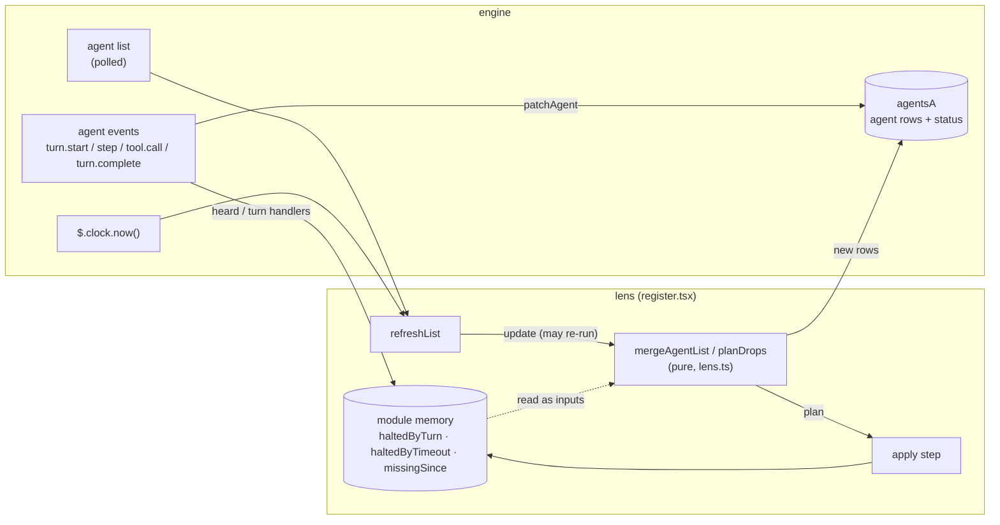

# Narrative: a working agent must never read "halted" (ITEM-104)

> **In progress.** This tells the journey up to the staged design of decision 17 and the ADR of decision 20 ([ADR-0009](../decisions/ADR-0009-lens-marks-that-guard-an-agents-status-live-in-its-row-in-agentsa.md)). The code of the last step (44.2.l2.4) is built; its tests (44.3.l2.4) and the last review round are still to come, and the live check M35 has not run. Records are linked by step code; all of them are in [`docs/handoffs/FEAT-20261020-ai-dlc-lens/`](../../handoffs/FEAT-20261020-ai-dlc-lens/).

## Act 1: the problem

The lens pane is where the human watches a run: which agents work, which wait, which stopped. Its one red word is *halted*. It tells the human to step in.

On 2026-11-01, during step 44, the pane showed the background documentation-writer of stage 44.5.l3.10 as halted while it was plainly working: a message sent to it was queued "for its next tool round", which only a live agent does (run state entry 2ie; [research 44.1.l2.1](../../handoffs/FEAT-20261020-ai-dlc-lens/44.1.l2.1-research-assistant-to-orchestrator.handback.md)). A false *halted* is worse than no status at all: it asks the human to rescue an agent that needs nothing, and it teaches the human to ignore the one signal that should never be ignored.

So the goal was simple to say: **an agent that is working never reads halted, and an agent that really stopped still does.** The human made it a bug fix inside step 44, before the step's G4, as backlog item ITEM-104 (P1).

The players: the human, who decided every turn below; research-assistant, who found the likely cause; Boris Cherny (agent-manager), who built each fix; Kent Beck (sqa-engineer), who tested it and ran the mutants; the code-reviewer pair (standards and spec axes), whose findings drove each round; and, when the human escalated, Zoran Horvat (system-engineer) and I, Mark Richards (software-architect), with one design each.

## Act 2: the journey

### What we were up against

| Type | Constraint | Effect on the design |
| --- | --- | --- |
| Technical | The lens only sees what the engine tells it: events for each agent's turn (`turn.start`, `turn.step`, `tool.call`, `turn.complete`) and the engine's agent list, polled every couple of seconds. | Every rule had to be stated in those two sources, and they can disagree. |
| Technical | `turn.complete` carries a reason (`answer`, `error`, `refusal`, `aborted`). Whether it fires for one round of a background subagent's work, rather than for the end of its task, is undocumented (research 44.1.l2.1, open question). | A non-answer turn end is not proof that the agent stopped. |
| Technical | The engine's agent list keeps a row "until the engine drops its task"; finished tasks are dropped (standards W1 of [44.4.1.l3.1](../../handoffs/FEAT-20261020-ai-dlc-lens/44.4.1.l3.1-code-reviewer-to-orchestrator.handback.md)). | A missing row means either "finished" or "working but no longer listed"; the lens cannot tell which. |
| Technical | The agent rows live in an engine atom (`agentsA`) whose `update` writes on a version check and runs the updater again on a miss (engine types, cited in 44.4.1.l3.2 and 44.2.l2.3). | Anything the updater does besides returning the new rows can happen twice. |
| Technical | The test kit cannot make `update` miss (sqa 44.3.l2.3, mutant M2), and the hooks' `Date.now` cannot be moved from a test (sqa 44.3.l2.2). | Some correctness could only be shown by reading the code, until the design made it testable. |
| Evidence | The cause was never captured live: the lens probe log was off (research 44.1.l2.1). | Every fix rests on the most likely cause, not a proven one; M35 is the live check. |
| Process | The code-review loop has 2 rounds by default; the human raised it to 3 for this loop only ([51](../../handoffs/FEAT-20261020-ai-dlc-lens/51-human-decision.human.md)), and set an escalation trigger (run state entry 2jd). | Each round's Warnings went to the human, not silently into the next round. |

### What the design had to deliver

| Characteristic | Why it matters | How it is measured |
| --- | --- | --- |
| Truthful status | The human acts on *halted*; a false one costs attention and trust. | A working background subagent never reads halted (ITEM-104 AC). |
| Recoverability | A status that cannot come back from a wrong guess turns a small error into a permanent one. | Each halt the lens guessed is undone by evidence of life (a listed `running`, or an event). |
| Configurability | How long silence means "gone" depends on the work. | `droppedSubagentMinutes`, default 15, 0 = never (decision 16). |
| Testability | A rule that only holds by convention breaks the first time someone forgets it. | Each rule has a test that fails without it (mutant tables of 44.3.l2.1 to 44.3.l2.3). |

### Turn 1: the bug report, and fix now or reproduce first

- **As seen then.** research-assistant traced *halted* to the raw stored status. The most likely cause: a non-answer `turn.complete` for the background subagent stored `failed`, and nothing but a later `turn.start` cleared it. Second, less likely: the agent list itself reported `failed` and the lens kept it. Confidence that this event fired for this agent: Low-Medium, because nothing was captured ([44.1.l2.1](../../handoffs/FEAT-20261020-ai-dlc-lens/44.1.l2.1-research-assistant-to-orchestrator.handback.md)).
- **Options.** The orchestrator asked the human: "fix now from the research, or reproduce it first with the lens's event log on?" ([49](../../handoffs/FEAT-20261020-ai-dlc-lens/49-human-decisions.human.md), addendum).
  - **Fix now (Recommended):** the narrow fix research-assistant named, tests with a background spawn, then review; a live check with probes later, as a manual check.
  - **Reproduce first:** the idea came from research-assistant's open question. The human turns on the lens probes and reloads, the orchestrator starts a background agent, and research-assistant reads `PROBE-LOG.jsonl`. It is slower and needs the human's reload.
- **Choice.** The human chose "Fix now". The live check became manual check M35, "not run" until the human runs it (49, first bullet).
- **Why.** Not recorded: the human gave no reason (49, addendum).
- **Cost.** The fix is aimed at the model of the engine event, not the event. That debt is carried by M35 to this day.

### Turn 2: fix 1, "halt only when the list agrees"

- **What was built** ([44.2.l2.1](../../handoffs/FEAT-20261020-ai-dlc-lens/44.2.l2.1-agent-manager-to-orchestrator.handback.md)). A subagent's non-answer turn end makes it `failed` or `killed` only when the engine's list also says it ended; otherwise it stays `running`. A halt that came this way is remembered in a module-level set, `haltedByTurn`, so that a later listed `running` can undo it, while a `failed` the list itself reported is never undone. The main agent and teammates are unchanged.
- **Cost, stated by agent-manager as a risk to the human.** A subagent that really failed and that the list never shows as ended now reads running instead of halted. Eleven old tests encoded the old behaviour; sqa-engineer changed their fixtures (the list now reports the failure) without weakening them, and added the background-spawn tests ([44.3.l2.1](../../handoffs/FEAT-20261020-ai-dlc-lens/44.3.l2.1-sqa-engineer-to-orchestrator.handback.md)). Committed in 16d7584.
- **The seed of later trouble.** `haltedByTurn` lives in module memory, next to the row it describes rather than in it. Each later turn added one more such mark.

### Turn 3: review round 1, and what a missing row means (decision 16)

- **As seen then.** Both axes approved with zero Blockers. The standards axis raised W1: the list drops finished tasks, so a subagent that failed and was then dropped reads "in progress" forever; it proposed commenting the case, adding the converse check to M35, and asking the human whether a time-based fallback was wanted. W3: keep ITEM-104 In Progress until M35 has run ([44.4.1.l3.1](../../handoffs/FEAT-20261020-ai-dlc-lens/44.4.1.l3.1-code-reviewer-to-orchestrator.handback.md)). The spec axis judged the open risk acceptable and raised five suggestions, among them that `haltedByTurn` survives `session.start` ([44.4.2.l3.1](../../handoffs/FEAT-20261020-ai-dlc-lens/44.4.2.l3.1-code-reviewer-to-orchestrator.handback.md)).
- **Options.** The orchestrator put W1 to the human as one question with three options ([50](../../handoffs/FEAT-20261020-ai-dlc-lens/50-human-decisions.human.md), addendum):
  - **Dropped = ended (Recommended):** a running agent that disappears from the list is treated as ended, with no timer.
  - **Time-based fallback:** after N minutes with no events, show the agent halted. The question named the risk: a slow, silent agent marked halted, which is the original bug. The idea came from the standards axis, which said to ask the human about it.
  - **Accept the limit:** keep it documented and let M35 decide later. This is where fix 1 stood, and the spec axis had found that acceptable.
- **Choice.** The human chose the time-based fallback (decision 16). Two follow-up questions shaped it:
  - "After how long?" was offered as 15, 30 or 10 minutes. The human answered "make it configurable".
  - "When should the timer apply?" was offered as "Only if dropped from list (Recommended)" or "Always". The human chose "Only if dropped from list".
  
  The resulting rule protects the original goal. A subagent missing from the list *and* silent for the timeout shows halted. The timer counts only while the agent is missing, so an agent the list shows running is never timed out. The 15-minute default is the orchestrator's proposal. The fix round's scope was asked too: the human chose "Warnings + suggestions" over "Warnings only", so the round took all three Warnings and the nine suggestions.
- **Why not "dropped = ended".** The human gave no reason. The code written afterwards states the risk that option carries: the engine also drops finished tasks, and the lens cannot tell those from working ones, so halting on a missing row at once would bring back the ITEM-104 symptom (the comment agent-manager added in 44.2.l2.2).
- **What was built** ([44.2.l2.2](../../handoffs/FEAT-20261020-ai-dlc-lens/44.2.l2.2-agent-manager-to-orchestrator.handback.md)). Setting `droppedSubagentMinutes` (0 to 1440, default 15, 0 = never); a second module mark, `missingSince`, restarted by any event of the agent (`heard`) and cleared when the row returns; the timeout halt was added to `haltedByTurn` so a listed `running` could resume it; both marks cleared at `session.start`; a non-answer turn end never moves an already-ended agent back to running. Tests: [44.3.l2.2](../../handoffs/FEAT-20261020-ai-dlc-lens/44.3.l2.2-sqa-engineer-to-orchestrator.handback.md), with one timeline test that had to wait about 115 s of real time because the hooks read the wall clock. Committed in 99aa663.
- **Cost.** Two marks in module memory now guarded status changes, and the timeline test was slow and load-sensitive.

### Turn 4: review round 2, three Warnings, and "fix them first"

- **As seen then** ([44.4.1.l3.2](../../handoffs/FEAT-20261020-ai-dlc-lens/44.4.1.l3.2-code-reviewer-to-orchestrator.handback.md), [44.4.2.l3.2](../../handoffs/FEAT-20261020-ai-dlc-lens/44.4.2.l3.2-code-reviewer-to-orchestrator.handback.md)), with the review loop at its last round:
  - **W-A (standards):** the marks were written *inside* the `update` updater, which the engine may run twice: a resumed agent could stay failed, or the timer could restart. Inferred from the engine types, not reproduced. Proposed fix: keep the updater pure and apply the mark writes after `update` resolves.
  - **W-B (standards):** the timeout read `Date.now`, not the engine clock `$.clock.now()`, which a test can drive. Proposed fix: read the engine clock once before `update`.
  - **W1 (spec):** a timeout halt was not undone by a later event, so a subagent silent through one long tool call and then working on would read halted: the ITEM-104 symptom again. Proposed fix: a separate `haltedByTimeout` mark that any event clears; alternative: accept and document.
- **Options offered to the human** ([51-orchestrator-to-human](../../handoffs/FEAT-20261020-ai-dlc-lens/51-orchestrator-to-human.handoff.md)): approve G4 with the Warnings as follow-ups, or fix them first, which needed a third review round.
- **Choice.** The human chose "fix the Warnings first" and raised this loop to 3 rounds; the suggestions became ITEM-105 ([51](../../handoffs/FEAT-20261020-ai-dlc-lens/51-human-decision.human.md)).
- **What was built** ([44.2.l2.3](../../handoffs/FEAT-20261020-ai-dlc-lens/44.2.l2.3-agent-manager-to-orchestrator.handback.md)). The updater stopped writing module state and a separate apply step wrote the marks after `update`; the timeout read `$.clock.now()`; a third mark, `haltedByTimeout`, let any event of the agent revive a timeout halt, while a halt the list confirmed stays. One deviation, for review: when `$.clock.now()` rejects, the wall clock stands in, because most kit tests mock no clock (761/124 without it). Agent-manager also named a **known narrow race**: an event arriving between the updater's write and the apply step finds no `haltedByTimeout` mark yet, so the agent stays halted until its next event.
- **Tests** ([44.3.l2.3](../../handoffs/FEAT-20261020-ai-dlc-lens/44.3.l2.3-sqa-engineer-to-orchestrator.handback.md)). A driven clock brought the timeline test from about 115 s to under a second, and 13 of 16 mutants were killed. But **M2, the impure updater, survived**: the kit cannot make `update` conflict, so W-A could only be shown fixed by reading the code. M10 (the `heard` call at `turn.start`) was reported equivalent and M16 (a guard in `heard`) unreachable. Committed in 349a4a4.

### Turn 5: the escalation, and two designs

- **Trigger.** The human had said: if Kent Beck or Boris Cherny cannot solve the problem, bring in Mark Richards and Zoran Horvat (run state entry 2jd). A mutant that no test could kill met that trigger (entry 2je). Both of us got the findings, the code and the tests, read-only.
- **The diagnosis we shared.** The updater no longer *wrote* module state, but it still *read* it, and its parts were private to `register.tsx`, so no unit test could call it twice; it also still stamped tasks with `nowMs()`, so two runs on the same input could differ.
- **Zoran Horvat's design (system-engineer, [44.1.l2.2](../../handoffs/FEAT-20261020-ai-dlc-lens/44.1.l2.2-system-engineer-to-orchestrator.handback.md)): narrow.** Move the updater body into pure, exported functions in `hooks/lens.ts`, `mergeAgentList` and `planDrops`, which take the time `t` and the marks as inputs and return the new rows plus a plan; the apply step stays the only writer of the marks. A unit test calls them twice on deep-frozen input, which kills M2. Remove the unreachable guard (M16); keep the `turn.start` `heard` call only if a driven-clock timing test shows it matters (M10). He named the race as out of scope for a narrow change and advised accepting it.
- **My design (software-architect, [44.1.l2.2](../../handoffs/FEAT-20261020-ai-dlc-lens/44.1.l2.2-software-architect-to-orchestrator.handback.md)): by construction.** Every mark guards one status change of one agent, yet the status is in an engine atom with a conditional, retried write and the marks are in module memory changed at other moments. One rule spread over two stores with no shared commit cannot be made atomic, however carefully the steps are ordered; W-A, the race and a lifetime mismatch (the marks are lost on a plugin reload, the rows are not) all come from that split. So: move the three marks onto each agent's row in `agentsA` (for example `haltedBy` and `missingSince`), written by the same `update` that changes the status; bump the atom's shape from `agents-3` to `agents-4`; have `session.start` clear the marks in every row. I rejected **a separate atom for the marks**, because `update` covers one atom and the race between two atoms would remain. Proposed rule: state that guards a status change lives in the same atom as the status; module memory holds only caches and diagnostics. I asked for ADR-0009 once the human chose it, and recommended fixing it inside ITEM-104.
- **The trade-off between them.** The narrow design is small, keeps the persisted shape and makes the updater testable now; it leaves the race and the reload mismatch. Mine removes them, but changes the persisted shape (rows stored before a reload in the same session are dropped once), touches every reader of the marks and needs an ADR.
- **Choice.** The human staged them (decision 17, [52](../../handoffs/FEAT-20261020-ai-dlc-lens/52-human-decisions.human.md)): the narrow design now, in ITEM-104, with the race as a documented known limit; the marks-in-rows design as follow-up ITEM-106 (P2), with ADR-0009 written when it is taken up. Later the same day the human brought the ADR forward: decision 20 ([54](../../handoffs/FEAT-20261020-ai-dlc-lens/54-human-decision.human.md)) has ADR-0009 written now, with this narrative, while ITEM-106 stays for later. Decision 18: try a timing test for M10 and remove the call if it shows no difference; remove the M16 guard.
- **What was built** ([44.2.l2.4](../../handoffs/FEAT-20261020-ai-dlc-lens/44.2.l2.4-agent-manager-to-orchestrator.handback.md)). `mergeAgentList` and `planDrops` exported from `lens.ts`; the task stamp uses `t`; the guard in `heard` removed; on the clock fallback, an E4 probe line (`clock: 'wall'`) while `probes` is on, the optional note from my hand-back. The `turn.start` `heard` call is kept until the timing test reports.

## Act 3: where it stands

### The design now

The halted rule has three parts, all in the LLD's section 4:

1. **A turn end halts only with the list's agreement.** A non-answer turn end leaves a subagent running unless the agent list says it ended (`haltedByTurn` marks those halts); a listed `running` undoes such a halt; a `failed` the list itself reported is never undone by the lens.
2. **A dropped, silent subagent halts after a timeout.** Missing from the list and silent for `droppedSubagentMinutes` (default 15) means `failed`, marked in `haltedByTimeout`; the timer (`missingSince`) counts only while the row is missing and restarts on any event; any event or a listed `running` revives it.
3. **The poll's updater is pure.** `refreshList` reads the engine clock once, then its `update` calls `mergeAgentList` and `planDrops`, which read the marks as inputs and write nothing; one apply step after `update` writes the marks.

The dashed seam is the one ITEM-106 closes: the rows and the marks that guard them are two stores, written at different moments.

### Decisions, and where each came from

| Decision | Made by | Traces back to |
| --- | --- | --- |
| Fix now from the research; live check M35 instead of a reproduction | human, [49](../../handoffs/FEAT-20261020-ai-dlc-lens/49-human-decisions.human.md) | Turn 1; the evidence constraint |
| A turn end halts only when the list agrees | human (49), from research 44.1.l2.1 | Turn 1–2; the undocumented `turn.complete` constraint |
| Time-based fallback for a dropped subagent, configurable, default 15 min | human, decision 16 ([50](../../handoffs/FEAT-20261020-ai-dlc-lens/50-human-decisions.human.md)); default proposed by the orchestrator | Turn 3; the missing-row constraint; configurability |
| Fix the round-2 Warnings before G4; loop raised to 3 rounds | human, [51](../../handoffs/FEAT-20261020-ai-dlc-lens/51-human-decision.human.md) | Turn 4; recoverability (W1), testability (W-A, W-B) |
| Narrow pure planner now, marks-in-rows later | human, decision 17 ([52](../../handoffs/FEAT-20261020-ai-dlc-lens/52-human-decisions.human.md)) | Turn 5; the `update` re-run and kit constraints |
| M16 guard removed; M10 call removed only if a timing test shows no difference | human, decision 18 (52) | Turn 4–5 mutant results |
| ADR-0009 "Lens marks that guard an agent's status live in its row in `agentsA`" | proposed by software-architect; accepted with its staging by the human (decision 17), written now by decision 20 ([54](../../handoffs/FEAT-20261020-ai-dlc-lens/54-human-decision.human.md)): [ADR-0009](../decisions/ADR-0009-lens-marks-that-guard-an-agents-status-live-in-its-row-in-agentsa.md), status accepted, implementation pending ITEM-106 | Turn 5; the two-store split |

### What ITEM-106 and ADR-0009 will change

[ADR-0009](../decisions/ADR-0009-lens-marks-that-guard-an-agents-status-live-in-its-row-in-agentsa.md) states the rule. A mark that guards an agent's status change lives in that agent's row in `agentsA`, written by the same `update` that changes the status. Module memory holds only caches and diagnostics. The ADR exists so that no later change moves the marks back into module memory "to keep the rows clean". Today's code is the interim the ADR names: the pure planner of decision 17.

[ITEM-106](../../backlog/backlog.md) ("Lens: halt marks live in the agent row (agentsA)", TechDebt, P2, Backlog) is the work that brings the code in line with the ADR. The human keeps it for later (54).

- **What it changes.**
  - `haltedByTurn`, `haltedByTimeout` and `missingSince` leave module memory and become fields of each `LensAgent` row (for example `haltedBy: 'turn' | 'timeout' | null` and `missingSince: number | null`), written in the same `update` as the status.
  - The atom's shape tag moves from `agents-3` to `agents-4`. Rows stored before a reload in the same session are dropped once, which is accepted, because the lens rebuilds them from events and the list.
  - `session.start` clears the marks in every row, keeping today's behaviour and its test.
  - `heard` and the turn handlers write the marks inside the `patchAgent` updaters they already call. The apply step after `update`, and the three module collections, go away.
- **Why.**
  - Each change of a status and its mark becomes one compare-and-set write on one atom, so the race goes away instead of only narrowing.
  - A re-run of the update is harmless by construction.
  - Marks and rows share one lifetime across a plugin reload.
- **Acceptance criteria** (backlog ITEM-106):
  - (a) the three marks are fields of the agent row, written in the same update as the status;
  - (b) the shape tag is `agents-4`, and a stored `agents-3` value is dropped once;
  - (c) `session.start` clears the marks in every row;
  - (d) a test re-runs the `refreshList` update on the same input and gets the same rows (no race), and the ITEM-104 tests still pass;
  - (e) ADR-0009 is written and linked (done early, by decision 20);
  - (f) `node --test "tests/**/*.test.mjs"` and `claude plugin test ./plugins/claude/ai-dlc-lens` pass, with the output quoted.

Until ITEM-106 is built, the decision 17 interim stands, with the race as a known limit.

### Open, and the risks

| Risk / open item | Likelihood | Impact | Mitigation or owner |
| --- | --- | --- | --- |
| **The race.** An event that lands between the updater's write and the apply step finds no timeout mark yet; the agent stays halted until its next event or a listed `running`. A second window of the same kind can lose one timer restart (harmless). | Low | Medium: a short false *halted*, the ITEM-104 symptom | Documented known limit (LLD section 4, README); removed by ITEM-106 |
| **The cause is unconfirmed.** M35, including its converse case, has not run; the fix follows the model of the engine event. | Unknown | High if the real cause is another event | The human runs M35 with probes on; ITEM-104 stays In Progress until its result is recorded |
| A subagent the list keeps showing as running stays in progress until the list drops or ends it. | Low | Medium: a stopped agent reads in progress | Documented known limit; inherent to "never time out a listed agent" (decision 16) |
| The marks are lost on a plugin reload while the rows survive, so a halt stored before a reload is not undone by a listed `running`. | Low | Low | Documented in the `haltedByTurn` comment; removed by ITEM-106 |
| The clock fallback shapes production code around a kit limit, and could hide a real host failure. | Low | Low | E4 probe line on fallback (44.2.l2.4); a `clock.now` stub in every test helper was the rejected alternative |
| The `turn.start` `heard` call (M10) may be dead code. | — | Low | Decision 18: timing test in 44.3.l2.4, removed by agent-manager if no difference |
| The pure planner is only proven pure by its new unit test. | — | — | 44.3.l2.4 (pending), then review round 3 of 3 |
