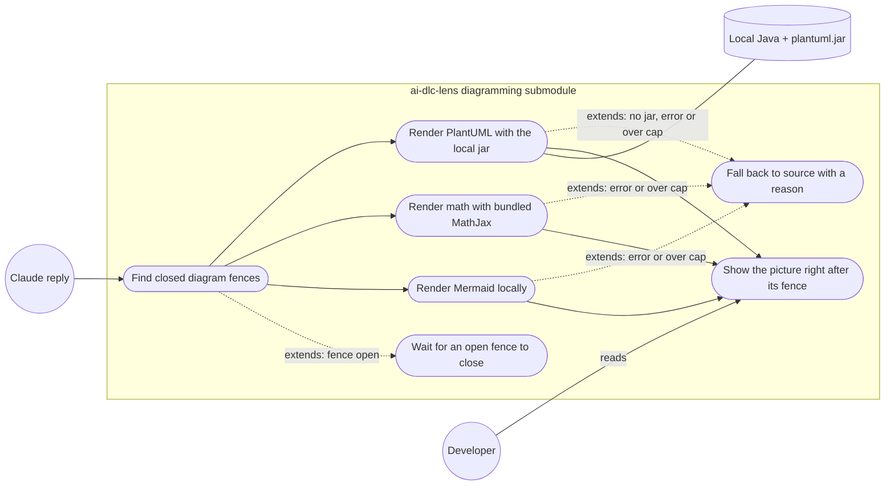

# User stories: root 20, the lens diagramming submodule

Sources: the approved plan `00c-approved-plan-2026-10-24.md` ("00c"), the team brief `14.1.16-orchestrator-to-team.handoff.md` ("team brief"), the product brief `docs/product/active/brief-tier-1-sprint-1.md` ("brief §n"), `tasks.md` in this folder, and the deep dive `14.1.15-research-assistant-to-orchestrator.handback.md` ("15", by section). Engine facts in 15 come from a gitignored copy of the 2.1.308 types and are provisional.

## How to read this file

| Tag | Route |
|---|---|
| `[PT]` | `npx @anthropic-ai/claude-code plugin test ./plugins/claude/ai-dlc-lens` (`$.ui.mount` element trees, stubbed renderers) |
| `[BV]` | `npx @anthropic-ai/claude-code plugin validate --strict ./plugins/claude/ai-dlc-lens`, or a scripted search named in the AC |
| `[DC]` | document check against the named file |
| `[MV]` | manual check on the named surface, steps given |

## Terms

- **Diagram fence**: a fenced block in an assistant reply tagged `mermaid`; LaTeX math tagged `math`, `latex` or `tex`, or a display-math block (`$$ … $$`, `\[ … \]`); or tagged `plantuml` / `puml` (15 §4 R1). The exact tag list is fixed at G2.
- **Math or TeX diagram**: a `math` fence and a display-math block are always math. A `latex` or `tex` fence is a **TeX diagram** when its body contains `\documentclass`, `\usepackage`, `\begin{document}` or `\begin{tikzpicture}`, and math otherwise. A `tikz` fence is always a TeX diagram. Math is drawn (US-20.2); a TeX diagram is not (AC-20.2.2, Q20-3).
- **Closed fence**: a fence whose closing delimiter has arrived. An **open fence** has not; a **streaming** reply is one still arriving.
- **Picture**: the rendered diagram: PNG through `Image` on the terminal, Svg in VS Code and desktop (00c root 20).
- **Svg cap**: 131,072 characters per Svg (`avatar.ts:13`).
- **Local renderer**: code that runs on the user's machine: bundled with the plugin (a Mermaid layout and rasteriser, MathJax), or a local program the user configured (Java + `plantuml.jar`).
- **Increment**: Mermaid first, then LaTeX math, then PlantUML (human decision 20).

## Spike before the stories (ITEM-052)

Can an `AssistantMessage` render replace one fence inside a reply and keep the rest of the text? The answer decided where the picture goes. G2 closed it (OQ1, option A, `31-orchestrator-to-human.handoff.md`): each picture goes right after its fence, with the source still shown, replacing the plan's "beneath the reply" (00c root 20); there is no layout setting (`docs/specs/diagramming.spec.md`, OQ1).

## Stories

### US-20.1 Mermaid diagrams render in the chat (increment 1, ITEM-053)
As a developer reading an architect's or engineer's reply, I want a closed Mermaid fence drawn as a picture, so that I see the diagram without leaving the chat.

- AC-20.1.1 `[PT]` Given an assistant reply with one closed `mermaid` fence holding a valid flowchart, when the reply renders on the terminal surface, then a PNG picture of it is shown right after its fence, with the source still shown (G2 OQ1).
- AC-20.1.2 `[PT]` Given the same reply on the VS Code or desktop surface, when it renders, then an Svg picture is shown right after its fence, with the source still shown (G2 OQ1).
- AC-20.1.3 `[PT]` Given a reply with three closed `mermaid` fences, when it renders, then three pictures are shown, each right after its own fence, with each source still shown (G2 OQ1).
- AC-20.1.4 `[PT]` Given a reply with no diagram fence, when it renders, then it is drawn exactly as without the submodule.
- AC-20.1.5 `[PT]` Given one valid fence of each Mermaid kind flowchart, sequence, class, state and ER (Q20-2, po: this is the floor), when each renders, then each gives a picture. G2 may add kinds to the list; it may not drop these five.

### US-20.2 LaTeX math renders with bundled MathJax (increment 2, ITEM-054)
As a developer reading a reply with formulas, I want math drawn as a picture, so that formulas are readable.

- AC-20.2.1 `[PT]` Given a reply with a closed display-math block (`$$ … $$`, `\[ … \]` or a `math` fence), when it renders, then a picture of the formula made by the bundled MathJax is shown right after its block, with the source still shown (G2 OQ1).
- AC-20.2.2 `[PT]` Given a fence that *Terms* classes as a TeX diagram (a `tikz` fence, or a `latex` fence whose body has `\begin{tikzpicture}`), when it renders, then no picture is made and the source is shown with a one-line reason that TeX diagrams are not supported (Q20-3, po: math only).
- AC-20.2.3 `[PT]` Given a `latex` fence whose body is `E = mc^2` (none of the TeX-document markers of *Terms*), when it renders, then it is drawn as math, as in AC-20.2.1.

### US-20.3 PlantUML renders only with a local Java (increment 3, ITEM-055)
As a developer who has Java and `plantuml.jar` installed, I want PlantUML fences drawn locally, so that I get pictures without sending my design anywhere.

- AC-20.3.1 `[PT]` Given a configured local Java and `plantuml.jar` path and a closed `plantuml` fence, when it renders, then the picture comes from that local program and is shown right after its fence, with the source still shown (G2 OQ1).
- AC-20.3.2 `[PT]` Given no configured Java or jar, when a `plantuml` fence renders, then the source is shown with a one-line notice saying how to configure the local renderer, and no render is attempted.
- AC-20.3.3 `[PT]` Given a configured path outside the trusted folders, or one that does not exist, when a `plantuml` fence renders, then the program is not run and the source is shown with a one-line reason (the lens's path trust rule, `avatar.ts:242-262`).

### US-20.4 Open and streaming fences wait (ITEM-053, ITEM-054, ITEM-055)
As a developer watching a reply arrive, I want nothing drawn until a fence is closed, so that half diagrams never flash on screen.

- AC-20.4.1 `[PT]` Given a streaming reply whose `mermaid` fence has no closing delimiter yet, when it renders, then neither a picture nor an error is shown for that fence.
- AC-20.4.2 `[PT]` Given the same reply after the closing delimiter arrives, when it renders, then the picture is shown.
- AC-20.4.3 `[PT]` Given a finished reply that ends inside an open fence, when it renders, then the fence is shown as source only.

### US-20.5 Rendering never uses the network (ITEM-053, ITEM-054, ITEM-055)
As a developer whose diagrams describe internal systems, I want every diagram drawn on my machine, so that my designs never leave it (human decision 20: offline only, never a remote renderer).

- AC-20.5.1 `[PT]` Given a test session that renders one fence of each increment with network access stubbed to fail and to record every attempt, when the fences render, then no network request is attempted.
- AC-20.5.2 `[BV]` Given the submodule's own source files and its settings schema (the plugin's files, not the vendored renderer bundles such as Mermaid and MathJax, whose SVG output and code hold namespace URLs like `http://www.w3.org/2000/svg`), when they are searched for the remote-renderer hosts `kroki`, `plantuml.com` and `mermaid.ink`, then nothing is found, and the settings schema has no key that names a renderer URL or host. AC-20.5.1 (network stubbed and recorded) is the proof that nothing is fetched; this search only guards against a remote renderer being wired in by name.
- AC-20.5.3 `[PT]` Given a diagram source that contains an image link or an `http(s)` include, when it renders, then the link is not fetched (the lens's `classify` rule, `avatar.ts:205-216`).

### US-20.6 Failures fall back to the source with a reason (ITEM-053, ITEM-054, ITEM-055)
As a developer, I want a diagram that cannot be drawn to stay readable as text, so that a bad diagram never breaks the reply.

- AC-20.6.1 `[PT]` Given a closed fence whose picture would be an Svg over 131,072 characters, when it renders, then no picture is shown for it, its source is shown with a one-line reason naming the size cap, and the rest of the reply and its other pictures are unaffected.
- AC-20.6.2 `[PT]` Given a fence with a syntax error, when it renders, then its source is shown with a one-line reason from the renderer, and the rest of the reply is unaffected.
- AC-20.6.3 `[PT]` Given a terminal PNG over the `Image` size bound (2 MiB, 15 §2), when it renders, then the source is shown with a one-line reason.
- AC-20.6.4 `[PT]` Given a renderer that throws, when the fence renders, then the reply falls back to its native drawing (as the lens does at `register.tsx:3209`), and the user sees no error beyond the one-line reason.

### US-20.9 Each increment can be turned on and off (ITEM-053, ITEM-054, ITEM-055)
As a developer, I want a setting per increment, so that I can turn off a renderer I do not want without losing the others (Q20-6, po 2026-10-24).

- AC-20.9.1 `[PT]` Given no setting, when the lens loads, then Mermaid and math rendering are on and PlantUML rendering is on only when a Java and `plantuml.jar` path is configured (AC-20.3.2 otherwise). The settings follow the lens's existing pattern, a key in `.ai-dlc/lens.json` and its `AI_DLC_LENS_*` variable (`plugins/claude/ai-dlc-lens/hooks/settings.ts`); the key names are fixed in the spec at G2.
- AC-20.9.2 `[PT]` Given the Mermaid setting off and math on, when a reply with one `mermaid` fence and one `$$ … $$` block renders, then the Mermaid fence is drawn exactly as without the submodule (no picture, no reason line) and the math block gives a picture. The same holds for each increment's setting on its own.

### US-20.7 Reused ideas are credited and the plugin stays valid (ITEM-056)
As the plugin maintainer, I want every reused idea credited and the lens checks green, so that licensing and quality hold.

- AC-20.7.1 `[DC]` Given `THIRD_PARTY_NOTICES.md`, when it is read, then it has an entry in its existing format (one heading per upstream, a linked paragraph, the full licence text, a NOTICE block when the upstream has one) for each upstream whose idea or code is actually reused, from: diagram-pane (MIT), claude-code-figures (Apache-2.0, its NOTICE checked and reproduced if present), claude-latex (MIT), show-me (MIT), archpane (MIT), mermaid-inline (MIT); and for every bundled renderer (the Mermaid layout, MathJax, the rasteriser) (00c root 20; `tasks.md` ITEM-056).
- AC-20.7.2 `[BV]` Given the lens after the change, when `plugin validate --strict ./plugins/claude/ai-dlc-lens` and `plugin test ./plugins/claude/ai-dlc-lens` run, then both pass (00c root 20).
- AC-20.7.3 `[DC]` Given the lens hooks folder's `ATTRIBUTION.md` (`tasks.md` ITEM-056), when it is read, then it records the change.

### US-20.8 A manual check on each surface (ITEM-053)
As the human approving G4, I want to see a diagram on each surface, so that the picture path is proven where automated tests cannot reach.

- AC-20.8.1 `[MV]` Given a kitty-protocol terminal, VS Code 2.1.299 or later, and desktop, when Claude replies with a closed Mermaid flowchart, then each surface shows the picture right after its fence, with the source still shown (G2 OQ1). Steps: ask Claude for "a mermaid flowchart of A → B → C" on each surface and look right after the fence. The steps go into `MANUAL-CHECKS.md` before G4 (00c *Verification*).

## Out of scope

- Any remote renderer, opt-in or not (human decision 20).
- Drawing fences found in `Read` results of planning artefacts (`docs/architecture/**`) (brief §8 Q20b default; 15 §5).
- TeX-based diagrams (`latex` + `dvisvgm`) beyond math (Q20-3).
- archpane-style diagrams that Claude draws through a tool call.

## Traceability to the plan's tier 1 ACs (00c, root 20)

`P20-n` is the n-th AC bullet of 00c root 20, the same as "AC n" in `tasks.md`.

| Plan AC | Covered by |
|---|---|
| P20-1 closed fences render below the reply with the source still visible (placement changed at G2 OQ1: right after each fence) | AC-20.1.1, AC-20.1.2, AC-20.1.3, AC-20.2.1, AC-20.3.1 |
| P20-2 open or streaming fences are not rendered | AC-20.4.1, AC-20.4.2, AC-20.4.3 |
| P20-3 no network request during rendering | AC-20.5.1, AC-20.5.2, AC-20.5.3 |
| P20-4 over the 131,072-char Svg cap, or on an error → source plus a one-line reason | AC-20.6.1, AC-20.6.2, AC-20.6.3, AC-20.6.4 |
| P20-5 PNG through `Image` on the terminal, Svg in VS Code and desktop | AC-20.1.1, AC-20.1.2, AC-20.8.1 |
| P20-6 THIRD_PARTY_NOTICES.md entries for every idea reused, figures NOTICE checked | AC-20.7.1 |
| P20-7 lens `validate` and tests pass | AC-20.7.2 |
| Human decision: offline only, never remote | US-20.5, *Out of scope* |
| Human decision: order Mermaid → LaTeX math (bundled MathJax) → PlantUML (local Java + jar) | US-20.1, US-20.2, US-20.3 |
| Plan: spike first (in-fence replacement) | *Spike* (ITEM-052) |
| po decisions Q20-2 (Mermaid floor), Q20-3 (math only), Q20-6 (a setting per increment) | AC-20.1.5; *Terms*, AC-20.2.2, AC-20.2.3; AC-20.9.1, AC-20.9.2 |

## Use-case diagram

## Defaults applied (brief §8)

- Q20a: a PNG rasteriser (for example resvg-js) is acceptable, subject to the G2 licence check (AC-20.1.1, AC-20.7.1).
- Q20b: chat replies only; `Read` results are out (*Out of scope*).
- QS: root 20 is in sprint 1 as a stretch and is the first to move to the backlog (front matter).

## Questions decided by `po` (2026-10-24)

`po` accepted every recommended default: Q20-2 the Mermaid floor is flowchart, sequence, class, state and ER; Q20-3 TeX for math only, TeX-based diagrams out; Q20-6 an on / off setting per increment, Mermaid and math on by default, PlantUML on only when a jar is configured. The feature id is `diagramming`, as in `pm`'s `tasks.md` front matter. Question numbers follow 15's list; Q20-1, Q20-4 and Q20-5 were answered by the brief (§8 Q20a, Q20b) or by 15. The questions as asked:

- **Q20-2 Mermaid kinds.** Is "at least flowchart, sequence, class, state and ER" the right floor? Recommended: yes, mermaid-inline's set (15 §1).
- **Q20-3 TeX diagrams.** Math only, TeX-based diagrams out (15 §3)? Recommended: yes.
- **Q20-6 Settings.** An on / off setting per increment, in the lens's `AI_DLC_LENS_*` / `.ai-dlc/lens.json` pattern (`settings.ts:65`)? Recommended: yes; Mermaid and math on by default, PlantUML on only when a jar is configured.

## Research to verify before G2 (not for the human)

- PlantUML's licence, and whether the figures repository has a NOTICE file (15 §6 Q3, Q7).
- Spike ITEM-052.

## ADR candidates

- Offline only, with no remote renderer even as an opt-in: surprising without context (most diagram tools use a server), hard to reverse once users rely on the privacy guarantee, chosen over opt-in remote rendering. The architect records it.

## Docs update

- `plugins/claude/ai-dlc-lens/README.md`, a new diagramming section: status *planned*; what changes: US-20.1 to US-20.6 and the settings of Q20-6.
