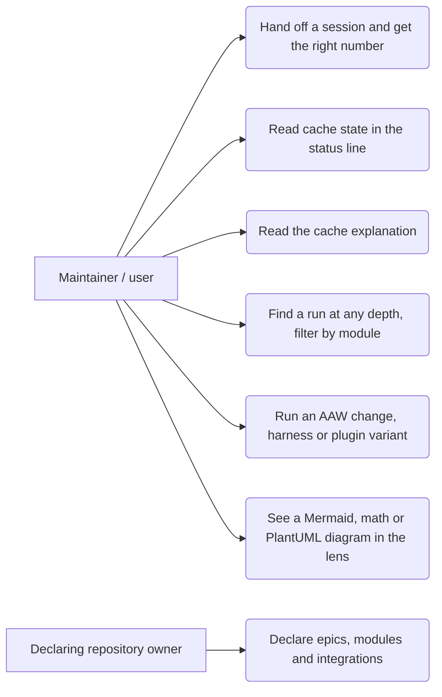

# Product brief: tier 1 of scope v2 (roots 16-20)

Sources. Human decisions are binding and are in `docs/handoffs/FEAT-20261020-ai-dlc-lens/00c-approved-plan-2026-10-24.md` (*Your decisions*, *Tier 1 requirements*) and `14.1.16-orchestrator-to-team.handoff.md` (*Human decisions for tier 1*). Research is cited by hand-back, all in `docs/handoffs/FEAT-20261020-ai-dlc-lens/`: `14.1.11` (root 16), `14.1.12` (root 17), `14.1.13` (root 18), `14.1.14` (root 19), `14.1.15` (root 20), written in full as `<n>-research-assistant-to-orchestrator.handback.md`. Explorer facts: `14.1.1` to `14.1.3`. Earlier lens brief: `docs/product/ai-dlc-lens/brief.md`. Nothing here re-decides a human decision. Where intent is open it is in section 8 with a default; those defaults, QS and the Sprint line in section 7 are **Assumptions — need human confirmation**.

## 1. Problem

Five independent problems block the larger scope (agile tree, new phases, lens grouping):

1. The auto-handoff session number is wrong or lost when lineage is missing, so chains are mis-named (14.1.11, section 3 A-D).
2. The keep-alive status line shows a bare `off` for the 5m cache on almost every turn, so the user cannot tell whether a cache exists. Subagent cache writes are ignored (14.1.12, section 2). A second symptom was reported on 2026-10-24: the 1h ping counter shows `0/9` (14.1.17: probably the line before the first ping, due at 50m; to be confirmed live).
3. Nothing in the plugin groups work by epic, module, submodule, feature or integration. Run discovery is one level deep, so a nested tree is invisible (14.1.13, section 1).
4. AAW has one shape (agent-manager only). Plugin and mod changes need design, build, test and review roles, and the validator forbids a PO- or SA-first chain (14.1.14, section 1).
5. Diagrams written in chat (UML from the architect, Mermaid from anyone) are shown as raw text in the lens (14.1.15, section 1).

## 2. Users and outcomes

| Persona | Outcome |
|---|---|
| Plugin maintainer (this repository) | O16 Handed-off sessions are numbered correctly. O17 The status line tells the truth about cache state. O18 Work is grouped by epic and module. O19 The right AAW chain runs for a harness edit and for a plugin change. O20 Architecture diagrams are readable in the lens. |
| Plugin user in a configured repository | The same, with the taxonomy and the AAW variant configured by the repository, never hard-coded to this one. |

Success measures, one observable per outcome (the numbered ACs in `stories.md` of each root carry the detail; a tester verifies each without follow-up questions):

- O16: a five-session handoff chain is numbered 1 to 5 in a test, including when lineage is missing.
- O17: with a 5m cache warm, the status line never reads a bare `off`; each `off` carries a reason.
- O18: a run in a nested folder is found and can be filtered by module in a test.
- O19: a harness edit and a plugin change each run their own AAW chain, and the validator accepts both.
- O20: a Mermaid fence in a chat reply renders as an image in the lens with no network call.

## 3. Scope (in, per root)

| Root | Feature | Priority | Outcome | Epic | Module / submodule |
|---|---|---|---|---|---|
| 16 | Auto-handoff session N: the title number wins, lineage depth only when the title has no number | P1 (bug) | O16 | session-continuity-and-cache-visibility | AI-DLC / auto-handoff |
| 17 | Keep-alive status line shows real cache state per TTL (main and subagents, labelled), a reason instead of a bare `off`, subagent pings, the 1h counter advances; user explanation of cache semantics | P1 (bug) | O17 | session-continuity-and-cache-visibility | AI-DLC / cache keepalive |
| 18 | Taxonomy in the plugin: optional validated declaration; `module`, `submodule`, `feature`, `integrations[]` keys on run state, backlog, stories, tasks; deep run discovery; session column; this repository's taxonomy as first config | P1 | O18 | multi-agent-workflow-foundations | AI-DLC / multi-agent workflow |
| 19 | AAW variants (a) harness and (b) plugin/mod; no software-engineer; per-mode record writing and verification; upgrade path | P1 | O19 | multi-agent-workflow-foundations | AI-DLC / multi-agent workflow |
| 20 | Lens diagramming submodule: offline Mermaid, then LaTeX math, then PlantUML via local Java and jar | P2 | O20 | ai-dlc-lens | AI-DLC-LENS / diagramming |

Priority rationale: bugs 16 and 17 are P1 by the bug rule in `product-planning` (not regression or blocker; no security impact). 18 and 19 are P1 because roots 21, 23, 24 depend on them (00c, tier 2 and 3 tables). 20 is P2: it is an enhancement nobody else waits for. Order inside the tier is free (parallel after G3, 00c *Tier 1*).

Addendum, root 17 (human, 2026-10-24): "pings always show 0/9 for 1hr cache in the statusline. it should be updated as well." The 1h ping counter must advance with each ping. Root cause research is `14.1.17`: the counter code already advances on a landed ping and the first 1h ping is due at 50m, so `0/9` before then is probably what the code shows; the host repaint between events is unverified and needs a live check. The stories carry this (section 8, Q17b).

## 4. Use cases

Per-root diagrams are in the stories, one each.

## 5. Out of scope for tier 1

- Lens cost and savings fixes (write premium, per-TTL pricing): root 22 (00c, root 17 ACs, last line).
- Agile skill, product tree migration, `docs/handoffs` mirror tree: root 21. Until then ITEMs are also appended to `docs/backlog/backlog.md`.
- New default phases, the auto/manual switch, one run state per wave in the handoff skill: root 23.
- Lens grouping by taxonomy, auto-mode anomaly, review submodule, runs launcher: roots 24-27.
- Remote diagram renderers (human decision 20: offline only, never remote).
- Drawing diagrams from `Read` results of planning artifacts (default; Q20b).
- Copilot parity for the lens (Claude-only) and for team mode (subagents only).
- Code. This brief and the stories are artifacts; build is Wave 3.

## 6. Risks

| Risk | Source | Handling |
|---|---|---|
| Live session N symptom not reproduced from code alone | 14.1.11, 3G, Confidence Medium | Failing tests first (AC); runtime checks stay in `ATTRIBUTION.md` |
| Engine APIs (session id on clear, resume id, store durability) unverified because engine types are not in the repo | 14.1.11, 14.1.15 | Spike in the design wave; do not assume |
| Whether the main loop writes 5m or 1h by default is unchecked. 1h counter: the code already advances it (`keepalive.test.ts:489, 552, 1737`); `0/9` is likely the line before the first ping at 50m; the host repaint between events is unverified | 14.1.12 section 6; 14.1.17 | Root 17 ACs are behavioural; US-17.4 carries the 14.1.17 cause and a live-check AC; Q17b asks the human |
| `subagentPromptCacheTtl` and 1h refresh rule not confirmed against Anthropic docs | 14.1.12 section 3 | The explanation marks the 1h refresh rule as undocumented (AC) |
| Taxonomy home (workflow section vs separate file) undecided; schema is closed | 14.1.13 section 2 | Architect decides at G2 (human decision 18) |
| Roots 18 and 19 both edit the `workflow` skill, which only a freshly spawned agent-manager may change | 00c, Flags | Sequence or branch the two changes; the architect plans it |
| `AssistantMessage` cannot be shown to replace one fence | 14.1.15 open Q5 | Spike first (00c); fallback renders beneath the reply |
| PNG rasteriser dependency and PlantUML licence unchecked | 14.1.15 | G2 licence check; PlantUML stays opt-in |
| Capacity: sprint 1 ends 2026-10-27, three days from today, and tier 1 has five roots | dates above | QS in section 8 |
| Per-handoff BC review raises token cost | 00c *Run bookkeeping* | Minors become follow-ups after the 2/1 limit |

## 7. Decisions and rationale

- Tier 1 is five independent roots, one story file each; every 00c *Tier 1 requirements* bullet maps to at least one AC (00c, binding).
- Root 16: title number wins (human). Root 17: real state, ping subagents too (human). Root 18: epics above modules, tags in front matter (human). Root 19: defaults stand (00c). Root 20: offline only, order Mermaid, math, PlantUML (human).
- Final epic slugs: `session-continuity-and-cache-visibility` (16, 17, hook-side 28), `multi-agent-workflow-foundations` (18, 19, 21, 23), `ai-dlc-lens` (20, 22, 24-27; matches `docs/product/ai-dlc-lens/`, so root 21's migration is a rename in place). Milestone of the new items: Unplanned (no release version is decided). Features: `auto-handoff-session-numbering` (16), `keepalive-cache-status` (17), `taxonomy` (18), `aaw-variants` (19), `diagramming` (20), under `docs/product/active/<epic>/sprint-1/<feature>/`.
- `pm`'s tier-order corrections are accepted: 23 also blocked by 21; 24 also by 23; 26 also by the 14.1.7 spike; hook-side items of 28 move to tier 2; lens items merge one at a time in order 20, 22, 24-27.
- PO answers to the 14 intent questions of `ra` are listed in the veto table in section 8; none weakens a human decision.
- ITEM-065 and ITEM-066: keep, P2 (they serve O18 and cost one story each); PO decision, in the veto table. The ITEM-034 fallback is Q34 in section 8, not decided by PO.
- `pm`'s root 19 / root 23 split is accepted: root 19 owns the AAW lifecycles, the validator and the per-handoff review machinery; root 23 applies them to the default phases.
- Sprint is the folder level; Milestone keeps meaning a release version. **Assumption — needs human confirmation** (14.1.13 open Q6).

## 8. Questions for the human at G1 (with defaults)

| # | Question | Default |
|---|---|---|
| Q16 | A prefixed title with no number: which N? When the chain's base name differs, carry the original base name or the previous session name (`AAW-20261022-auto-handoff-chain/run.md:19`)? | N = 1, carry the original base name (current behaviour) |
| Q17a | Is the status-line text, the armed state, or the lens panel the "5m always off" the user sees? | The status line (14.1.12 candidate 1); the lens panel is root 22 |
| Q17b | Did you see `0/9` on the 1h line before the first ping was due (under 50 minutes)? (14.1.17: the first 1h ping is due at 50m and the counter moves only on a landed ping, so `0/9` before then is what the code shows; `0/9` after 50m would be a defect.) | Yes, assume it was under 50 minutes and treat `0/9` before the first ping as intended: the line shows the clock time of the first ping (`ping 0/9, first ping at 10:50`), and a live-check AC covers the host repaint between events |
| Q18 | Taxonomy in the workflow file or `.ai-dlc/taxonomy.json`? | Architect decides at G2 |
| Q19a | Does PO take part in a one-line harness change? | Yes, as in variant (a) |
| Q19b | Hook scripts such as `.claude/hooks/*.mjs`: harness (a) or plugin (b)? | (b), per the 00c rule "any script or code" |
| Q19c | Does (b) get a human gate? Who approves the per-handoff BC verdict? | No gate; on PASS the receiver starts, with no further approval; own limits 2 rounds / 1 failure |
| Q19d | One routing key or two for the variants? | One key `Agent Artifact`, two lifecycles, the orchestrator picks; architect confirms |
| Q19e | This run's old AAW chain: finish or migrate? | Finish under the 00c override |
| Q20a | PNG rasteriser (resvg-js) dependency acceptable? | Yes, subject to the G2 licence check |
| Q20b | Draw fences from `Read` results of planning artifacts? | No, chat replies only in tier 1 |
| Q34 | ITEM-034 fallback: if G2 proves subagent cache usage or pings are not observable from a hook, may the status line show a labelled "subagent: not observable" state instead of pinging subagents? This weakens human decision 17 ("ping subagent cache too"), so only the human can accept it. | No. The AC (ping subagents) stands; if the G2 spike proves it impossible, this comes back to you |
| QS | Sprint 1 ends 2026-10-27. Should all five roots be in sprint 1? | All of tier 1 (16-20) in sprint 1, as `pm` proposed; tiers 2-4 (21-28) are backlog-only. I have no time estimates, so this is an assumption; 20 is the first to move to `backlog` if the sprint ends |

### PO decisions, veto at G1

These are decided by the PO, none weakens a human decision, and each is also a default in the stories. Say so at G1 to change one.

| # | Decision | Effect |
|---|---|---|
| Q16-2 | Strip the default prefix and the one in force when the prefix changes mid-chain | Cleaner chain names |
| Q16-3 | Show a notice when the store write fails | Visible to the user |
| Q16-4 | Two chains with the same base name get no extra mark | Possible name clash accepted |
| Q17-1 | Ping running background subagents and idle teammates, never finished ones | Decides what keep-alive spends |
| Q17-2 | One status line per track, `main` first, `subagents` only when present | Line layout |
| Q17-3 | Subagent pings share the track's ping cap by ping round; spend counted per ping | Keeps the keep-warm time and bounds the spend |
| Q18-1 | Module and submodule required with a declaration; feature and integrations optional | Declaration strictness |
| Q18-2 | One module per item; cross-module work through an integration | Taxonomy shape |
| Q18-4 / ITEM-065, 066 | Keep, P2, in root 18; the run-task cross-check (AC-18.9.2) moves to root 21 if task files do not exist yet | Scope |
| Q18-5 | Kebab-case ids, your names kept as labels | Naming |
| Q19-4 | agent-manager as main agent with no orchestrator: subagent mode only, variant (b) refused with a message | Visible refusal |
| Q20-2 | Mermaid floor: flowchart, sequence, class, state, ER | Diagram kinds |
| Q20-3 | TeX diagrams out, math only | Scope |
| Q20-6 | On/off setting per increment; PlantUML on only with a jar | Opt-in |
| Milestone | All new items: Unplanned | Backlog field |

## 9. Acceptance of downstream artifacts

I accept the stories only if: every 00c *Tier 1 requirements* AC is covered and cited, each AC is Given/When/Then, numbered and testable without follow-up questions, each root has one Mermaid use-case diagram, and root 17 carries the 1h counter AC. I accept the backlog only if priorities match section 3 and every item has epic, module and submodule tags (feature and integrations where they apply, Q18-1).
