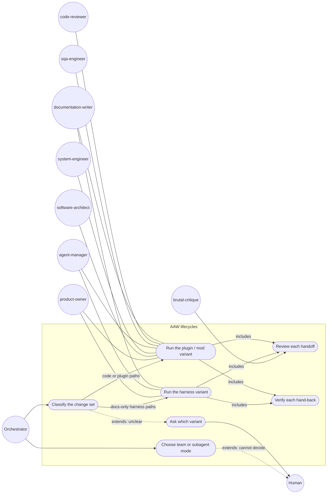

# User stories: root 19, two AAW variants (harness and plugin / mod)

Sources: the approved plan `00c-approved-plan-2026-10-24.md` ("00c"), the team brief `14.1.16-orchestrator-to-team.handoff.md` ("team brief"), the product brief `docs/product/active/brief-tier-1-sprint-1.md` ("brief §n"), `tasks.md` in this folder, and the deep dive `14.1.14-research-assistant-to-orchestrator.handback.md` ("14", by section; its 13 draft ACs are cited "14-AC-n", the same as "AC n" in `tasks.md`). The plan's defaults for root 19 stand; the brief's G1 defaults (§8 Q19a-e) are applied below.

## How to read this file

| Tag | Route |
|---|---|
| `[NT]` | `node --test "tests/**/*.test.mjs"` (`tests/workflow/workflow.test.mjs`, `handoff-naming.test.mjs`) |
| `[BV]` | `node .ai-dlc/workflow.mjs validate`, `rounds --json`, `node tools/build-copilot.mjs --check`, `node .claude/scripts/sync-harness.mjs --check`, the catalog check |
| `[DC]` | document check against the named agent, skill or reference file |

## Terms

- **Harness variant** (variant a): the AAW lifecycle for agent-harness changes: `product-owner` ↔ `agent-manager`, with `documentation-writer` + `brutal-critique` (human decision 19). Its lifecycle name is set at G2.
- **Plugin / mod variant** (variant b): the AAW lifecycle for plugin and mod development: `product-owner` ↔ `software-architect` ↔ `system-engineer` ↔ `agent-manager` ↔ `sqa-engineer` ↔ `code-reviewer`, with `documentation-writer` + `brutal-critique`.
- **Change set**: the paths an AAW request changes or is expected to change.
- **Harness path**: a path under `.claude/agents|skills|rules|commands`, `.ai-dlc/workflow.json`, a `.github/` twin, or `AGENTS.md` (14 §2).
- **Plugin / mod path**: a path under `plugins/claude/*/`, `tools/` or `tests/`, or any file `aaw-review.md` classes as code (rows 2 and 3: scripts, hook registrations, `package.json` scripts, CI) (14 §2).
- **Handoff review**: `brutal-critique`'s PASS / REVISE on a handoff record before its receiver starts.
- **Subagent mode, team mode**: as in `request-routing` (team mode is Mode 5, Claude Code only).

## Stories

### US-19.1 Two AAW variants exist and validate (ITEM-045, ITEM-046, ITEM-047)
As the plugin maintainer, I want two AAW lifecycles in the workflow, so that a docs-only harness change and a plugin or mod change each get the chain they need.

- AC-19.1.1 `[BV]` (ITEM-046, ITEM-047) Given the plugin's template workflow and this repository's `.ai-dlc/workflow.json`, when `validate` runs on each, then both exit 0 and both define the two variants (14-AC-1).
- AC-19.1.2 `[NT]` (ITEM-046, ITEM-047) Given the template workflow, when the stages of each variant are listed, then variant (a) has exactly `product-owner`, `agent-manager`, `documentation-writer` and `brutal-critique`, and variant (b) exactly `product-owner`, `software-architect`, `system-engineer`, `agent-manager`, `sqa-engineer`, `code-reviewer`, `documentation-writer` and `brutal-critique` (14-AC-2).
- AC-19.1.3 `[NT]` (ITEM-045) Given a workflow file in which either variant has a `software-engineer` stage, when `validate` runs, then it exits non-zero and names the stage (human decision: AAW never uses software-engineer).
- AC-19.1.4 `[NT]` (ITEM-045) Given a workflow file in which a variant has no `agent-manager` stage, when `validate` runs, then it exits non-zero (AAW always builds with agent-manager, 00c *Your decisions*).
- AC-19.1.5 `[DC]` (ITEM-048) Given the template workflow's routing, when it is read, then one routing key, `Agent Artifact`, leads to both variants, and the orchestrator picks between them with the rule of US-19.2 (brief §8 Q19d default; the architect confirms at G2).

### US-19.2 The orchestrator picks the variant from the change set (ITEM-048)
As the orchestrator, I want a fixed rule that maps a change set to a variant, so that I route without guessing and ask only when the rule cannot decide.

- AC-19.2.1 `[NT]` Given a change set of harness paths only, all of them docs by `aaw-review.md`, when the variant rule is applied, then the result is variant (a).
- AC-19.2.2 `[NT]` Given a change set with any plugin / mod path, or any file `aaw-review.md` classes as code (a `.claude/hooks/*.mjs` script included), when the rule is applied, then the result is variant (b) (00c default; brief §8 Q19b).
- AC-19.2.3 `[NT]` Given a change set the rule maps to neither variant (a path in neither list), when the rule is applied, then the result is "ask the human", and the orchestrator text says to ask one question with a recommended variant.
- AC-19.2.4 `[DC]` Given `orchestrator.md` and `request-routing`, when they are read, then the rule of AC-19.2.1 to AC-19.2.3 is stated in one place and the other points to it.

### US-19.3 The validator allows a PO-first chain and still guards the reviews (ITEM-045)
As the plugin maintainer, I want the validator to accept a chain that starts with `product-owner`, while the review guarantees stay, so that the new variants are valid and still safe.

- AC-19.3.1 `[NT]` Given a variant whose starting stage is `product-owner`, when `validate` runs, then it exits 0 (today the guard at `workflow.mjs:373-374` requires `agent-manager`) (14-AC-3).
- AC-19.3.2 `[NT]` Given variant (b) with its `sqa-engineer` or `code-reviewer` stage removed, or with `code-reviewer` not after `sqa-engineer`, when `validate` runs, then it exits non-zero (the guards of `workflow.mjs:138-150,376-394` revised, not dropped).
- AC-19.3.3 `[NT]` Given either variant with its `brutal-critique` stage removed, when `validate` runs, then it exits non-zero.
- AC-19.3.4 `[NT]` Given every revised guard and every signal of US-19.2, when the tests run, then each has at least one passing and one failing case (14-AC-3, 14-AC-4).

### US-19.4 Records are written and verified as each mode requires (ITEM-049, ITEM-051)
As the human, I want every handoff written, reviewed and verified by the right agent in each mode, so that the record trail can be trusted either way.

- AC-19.4.1 `[DC]` (ITEM-049) Given the `handoff` skill and `orchestrator.md`, when they are read, then in subagent mode the orchestrator writes each handoff before the spawn, `brutal-critique` gives its verdict before the receiver starts, the receiver starts on PASS with no further approval (brief §8 Q19c), the orchestrator stores the hand-back and verifies it, and the hand-back's line 1 is `handoff <file>: passed|failed — <why>` (14-AC-5).
- AC-19.4.2 `[DC]` (ITEM-049) Given the same files, when they are read, then in team mode the sender writes each handoff, the receiver writes its hand-back to the sender, `brutal-critique` reviews each, the **sender** verifies the hand-back, and the orchestrator only leads and keeps the run state from the record names teammates report; for team mode this replaces the rule at `handoff:129` (receiver verifies, writer never verifies its own record) (00c default; 14-AC-6).
- AC-19.4.3 `[DC]` (ITEM-051) Given the same files, when they are read, then a team-mode run falls back to subagent mode under `-p`, a headless or Agent SDK session, a missing `CLAUDE_CODE_EXPERIMENTAL_AGENT_TEAMS` flag, a session that exposes no team or messaging tool, or GitHub Copilot, and the fallback is recorded in the run state (14-AC-6, 14-AC-13).
- AC-19.4.4 `[DC]` (ITEM-048) Given `orchestrator.md`, when it is read, then for each request the orchestrator chooses team or subagent mode, and when it cannot decide it asks the human (00c *Your decisions*, Team vs subagents).
- AC-19.4.5 `[DC]` (ITEM-049) Given `agent-manager.md` and the `handoff` skill (*Who writes what*, main agent without an orchestrator), when they are read, then they say that when `agent-manager` runs as the main agent with no orchestrator it runs variant (a) in subagent mode only, writes the handoff records, hand-backs and run state itself, and refuses a variant (b) change set with a message that tells the user to start the orchestrator (`claude --agent ai-dlc:orchestrator`) (Q19-4, po 2026-10-24).

### US-19.5 The handoff review has its own loop limits (ITEM-050)
As the human, I want the per-handoff review to have its own round and failure limits, so that it never uses the document critique's budget.

- AC-19.5.1 `[BV]` Given the template workflow, when `node .ai-dlc/workflow.mjs rounds --json` runs, then it prints a row for the handoff review with `maxRounds` 2 and `maxFailures` 1 by default and its own environment variables, separate from the `gate-critique` row (00c default; 14-AC-7).
- AC-19.5.2 `[NT]` Given the handoff review's variables set in a settings `env`, when `rounds --json` runs, then only the handoff review's row changes.

### US-19.6 Record names have slots for the planning agents (ITEM-049)
As the orchestrator and the lens, I want PO, SA and SE records to have step codes, so that variant (b) runs name every record the same way.

- AC-19.6.1 `[DC]` Given the `handoff` skill's *Naming*, when it is read, then variant (b) records of `product-owner`, `software-architect` and `system-engineer` sit under the `N.1` planning sub-codes, and the AAW examples show both variants (00c default; 14-AC-8).
- AC-19.6.2 `[NT]` Given `handoff-naming.test.mjs`, when it runs, then it covers a variant (b) name for each of the three agents and passes.

### US-19.7 The orchestrator's AAW rule matches the variants (ITEM-048)
As the orchestrator, I want my hard rule rewritten for the two variants, so that I route agent-artifact work correctly and still never do the work myself.

- AC-19.7.1 `[DC]` Given `orchestrator.md` (the *Agent Artifact Routing* hard rule) and the generated `AGENTS.md` template, when they are read, then the rule names both variants and their chains, says AAW never uses `software-engineer`, says the orchestrator runs no checks, and says neither variant runs the SDLC chain; its line "No PM consultation." no longer contradicts the `product-owner` stage both variants have (14-AC-9).
- AC-19.7.2 `[DC]` Given `aaw-review.md`, when it is read, then its change kinds, rounds and findings sections cover both variants.

### US-19.8 Consumer repositories can upgrade (ITEM-051)
As the maintainer of a repository on the old AAW, I want a clear upgrade, so that my workflow file is not rejected without a way out.

- AC-19.8.1 `[NT]` Given a consumer workflow file with the old single AAW lifecycle, when `validate` runs with the new plugin, then it exits non-zero and its message names the old AAW lifecycle and `/ai-dlc:workflow upgrade` (14-AC-12; the plugin already tells a consumer to upgrade when a newer `validate` rejects an old file, orchestrator Run Loop step 1). Accepting the old file silently is out: the consumer would keep a single AAW with no variant rule.
- AC-19.8.2 `[NT]` Given the same old file, when the template merge of `/ai-dlc:workflow upgrade` is applied, then the result validates and holds both variants.

### US-19.9 The change is made and checked the AAW way (ITEM-051)
As the human, I want the change made by a freshly spawned agent-manager with every check quoted, so that a self-change of the workflow skill is safe.

- AC-19.9.1 `[BV]` Given the change, when agent-manager hands back, then its hand-back quotes the command and real output of `node tools/build-copilot.mjs --check`, `node .ai-dlc/workflow.mjs validate`, `node --test "tests/**/*.test.mjs"`, `node .claude/scripts/sync-harness.mjs --check` and, when `.ai-dlc/catalog.json` changed, the catalog check with its exit code, and each passes (14-AC-10).
- AC-19.9.2 `[DC]` Given the run state, when it is read, then each agent-manager that changed the `workflow` skill files was spawned for that change alone (00c *Flags*, self-change; 14-AC-11).

## Out of scope

- The new default phases of the full AI-DLC chain, the builder choice per lifecycle and the auto / manual switch: root 23.
- A human gate in either variant (brief §8 Q19c default: no gate).
- Moving the in-flight run FEAT-20261020-ai-dlc-lens to a variant: this run finishes under its recorded 00c override (brief §8 Q19e).

## Traceability to the plan's tier 1 ACs (00c root 19 → 14.1.14 §5 draft ACs, and the plan defaults)

| Plan AC or default | Covered by |
|---|---|
| 14-AC-1 both variants defined; `validate` passes on the template and this repository | AC-19.1.1 |
| 14-AC-2 variant stages; no software-engineer | AC-19.1.2, AC-19.1.3, AC-19.1.4 |
| 14-AC-3 PO / SA may start; guard at `:373-374` revised and tested | AC-19.3.1, AC-19.3.2, AC-19.3.3, AC-19.3.4 |
| 14-AC-4 classification with a test per signal | AC-19.2.1, AC-19.2.2, AC-19.2.3, AC-19.3.4 |
| 14-AC-5 subagent-mode records, BC verdict, line-1 verification | AC-19.4.1 |
| 14-AC-6 team-mode records; previous agent verifies; fallback | AC-19.4.2, AC-19.4.3 |
| 14-AC-7 own limits and env variables for the handoff review | AC-19.5.1, AC-19.5.2 |
| 14-AC-8 phase codes for PO, SA, SE; AAW examples | AC-19.6.1, AC-19.6.2 |
| 14-AC-9 orchestrator AAW rule rewritten; no checks; no SDLC chain | AC-19.7.1, AC-19.7.2 |
| 14-AC-10 checks pass, quoted by agent-manager | AC-19.9.1 |
| 14-AC-11 freshly spawned agent-manager | AC-19.9.2 |
| 14-AC-12 consumer upgrade path | AC-19.8.1, AC-19.8.2 |
| 14-AC-13 Copilot works with subagents only | AC-19.4.3 |
| Default: variant picked from the change set; unclear → ask | AC-19.2.1 to AC-19.2.4, AC-19.1.5 |
| Default: team-mode sender verifies, replacing `handoff:129` | AC-19.4.2 |
| Default: BC handoff review with its own 2 / 1 limits | AC-19.5.1, AC-19.5.2 |
| Default: PO, SA, SE records under N.1 | AC-19.6.1 |
| Default: Copilot subagent mode only | AC-19.4.3 |
| Default: consumer upgrade path | AC-19.8.1, AC-19.8.2 |
| Human decision: AAW never uses software-engineer | AC-19.1.3 |
| Human decision: orchestrator picks team or subagents per request; asks when unsure | AC-19.4.4 |
| po decision Q19-4: no orchestrator → subagent mode, variant (b) refused | AC-19.4.5 |

## Use-case diagram

## Defaults applied (brief §8)

- Q19a: `product-owner` takes part in a harness change, as variant (a) (AC-19.1.2).
- Q19b: hook scripts such as `.claude/hooks/*.mjs` go to variant (b) (AC-19.2.2).
- Q19c: no gate; on PASS the receiver starts; limits 2 / 1 (AC-19.4.1, AC-19.5.1, *Out of scope*).
- Q19d: one routing key, two lifecycles; the architect confirms (AC-19.1.5).
- Q19e: this run finishes under the 00c override (*Out of scope*).

## Questions decided by `po` (2026-10-24)

`po` accepted the recommended default: Q19-4 with no orchestrator, subagent mode only, agent-manager writes the records, and variant (b) is refused with a message to start the orchestrator (AC-19.4.5). Question numbers follow 14 §6; Q19-1 to Q19-3 were answered by the brief (§8 Q19a-e). The question as asked:

- **Q19-4 No orchestrator.** When agent-manager runs as the main agent with no orchestrator, which variant runs and who leads? Recommended: subagent mode only; agent-manager writes the records; variant (b) is refused with a message to start the orchestrator (14 §6 Q6).

## ADR candidates

- Two AAW variants chosen by change set, instead of one AAW with optional stages: hard to reverse in consumer workflows, surprising without context, chosen over optional stages. The architect records it.
- Team mode: the sender verifies, reversing `handoff:129`; surprising without context, chosen over receiver-verifies.

## Docs update

- `README.md` and `docs/plugins.md`, the AAW sections: status *planned*; what changes: two variants and how one is picked (US-19.1, US-19.2). documentation-writer confirms the sections.
