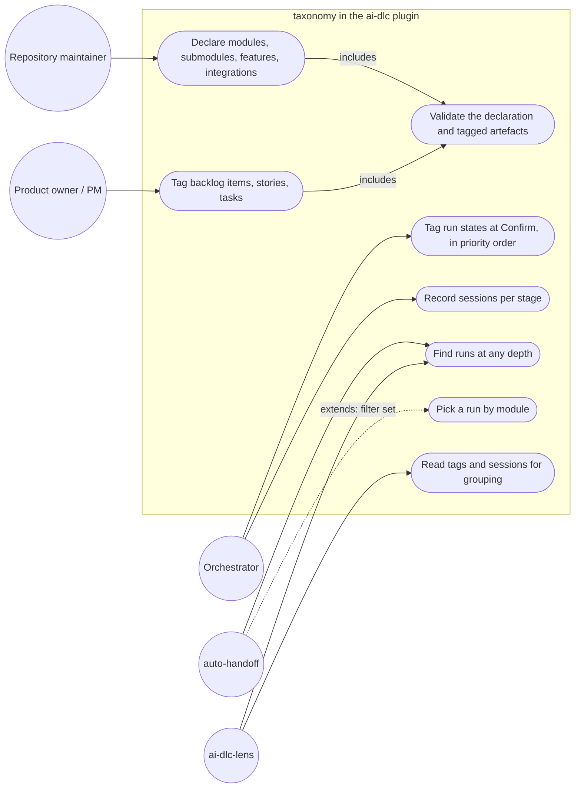

# User stories: root 18, a module taxonomy in the plugin

Sources: the approved plan `00c-approved-plan-2026-10-24.md` ("00c"), the team brief `14.1.16-orchestrator-to-team.handoff.md` ("team brief"), the product brief `docs/product/active/brief-tier-1-sprint-1.md` ("brief §n"), `tasks.md` in this folder, the deep-dive brief `14.1.13-orchestrator-to-research-assistant.handoff.md` ("13b": the human's taxonomy and decisions) and its hand-back `14.1.13-research-assistant-to-orchestrator.handback.md` ("13", by section).

## How to read this file

| Tag | Route |
|---|---|
| `[NT]` | `node --test "tests/**/*.test.mjs"` (`workflow.mjs`, fixtures) |
| `[PT]` | `npx @anthropic-ai/claude-code plugin test ./plugins/claude/ai-dlc` (auto-handoff `run.ts`) or `./plugins/claude/ai-dlc-lens` (lens parser) |
| `[BV]` | `node .ai-dlc/workflow.mjs validate`, `node tools/build-copilot.mjs --check`, or a scripted search named in the AC |
| `[DC]` | document check against the named skill or file |

## Terms

- **Epic**: a business goal. A folder level of the product tree and of the handoff mirror tree, and not one of the taxonomy tags (human decision 18). The folder is authoritative: a file under an epic folder may also record `epic:` in its front matter as a copy of that folder's name (the stories and tasks files do), but `validate` does not check it, and the taxonomy declaration does not list epics.
- **Module, submodule, feature**: the product's structure, nested in that order. **Integration**: a named link between features of one module or across modules. All four are **front-matter tags**, never folders (human decision 18).
- **Taxonomy declaration**: one optional, validated list of the repository's modules, submodules, features and integrations, each with a stable id. Where it lives (a `taxonomy` section of `.ai-dlc/workflow.json`, or `.ai-dlc/taxonomy.json`) is the architect's decision at G2 (00c root 18; brief §8 Q18).
- **Tagged artefact**: a run state, backlog item, story or task that carries the keys `module`, `submodule`, `feature` and `integrations` (a list).
- **Declared id**: an id that appears in the taxonomy declaration.

## Stories

### US-18.1 A repository declares its taxonomy (ITEM-037)
As the maintainer of a repository that uses ai-dlc, I want to declare my modules, submodules, features and integrations once, with stable ids, so that every tool groups work the same way.

- AC-18.1.1 `[NT]` Given a declaration with two modules, each with submodules and features, and two integrations that each name the features they join, when `validate` runs, then it exits 0.
- AC-18.1.2 `[NT]` Given a declaration with a duplicate id, an unknown key, or an integration naming an undeclared feature, when `validate` runs, then it exits non-zero and the message names the file, the key and the offending id (13 §4 AC-1).
- AC-18.1.3 `[BV]` Given the plugin's shipped workflow templates and schema, when they are searched for `ai-dlc-lens`, `cache-keepalive` and `integration-1`, then nothing in the taxonomy schema or the template declaration matches: the plugin ships the schema and the validator, never this repository's names (13 §4 R3).
- AC-18.1.4 `[DC]` Given the `workflow` skill, when it is read, then it says how to add, rename and remove a taxonomy entry, and that an id is stable once a tagged artefact uses it.

### US-18.2 No declaration, no change (ITEM-037)
As the maintainer of a repository that declares no taxonomy, I want every tool to behave exactly as it does today, so that the upgrade costs me nothing.

- AC-18.2.1 `[NT]` Given the plugin's template workflow and no declaration, when `validate` runs, then its output and exit code are the same as before the change, and every existing `tests/workflow/` test passes unchanged.
- AC-18.2.2 `[PT]` Given no declaration, when `run.ts` parses run states, `pickRun` picks a run and the lens parses run states, then every existing test of the auto-handoff module and the lens passes with unchanged assertions.
- AC-18.2.3 `[NT]` Given no declaration and a run state that carries `module: x`, when `validate` runs, then it does not reject the run state for that key (`tasks.md` ITEM-038: undeclared ids are rejected only when a declaration exists).

### US-18.3 Work items carry the tags (ITEM-038, ITEM-042)
As a product owner, product manager or orchestrator, I want each run state, backlog item, story and task to carry its module, submodule, feature and integrations, so that work can be grouped without reading its text.

- AC-18.3.1 `[DC]` (ITEM-038) Given the `handoff` skill's run-state format, when it is read, then its front matter lists `module`, `submodule`, `feature` and `integrations`, says they are written at Confirm from the work item, and says they are left out when the repository declares no taxonomy.
- AC-18.3.2 `[DC]` (ITEM-042) Given the `product-planning` and `task-triage` skills, when they are read, then the backlog-item, story and task formats carry the same four keys.
- AC-18.3.3 `[NT]` (ITEM-038) Given a declaration and a tagged artefact whose `module`, `submodule`, `feature` or any `integrations` entry is not a declared id, or whose submodule is not under its module, when `validate` runs, then it exits non-zero and names the artefact's path, the key and the id (00c root 18).
- AC-18.3.4 `[PT]` (ITEM-038) Given a run state with none of the four keys, when `run.ts` and the lens parse it, then parsing succeeds and the keys are absent (`null` or an empty list), with no error.

### US-18.4 The work breakdown is tagged (ITEM-042)
As the orchestrator, I want each row of a task-triage breakdown to carry its tags, so that run states can be written with them at Confirm.

- AC-18.4.1 `[DC]` Given the `task-triage` skill, when it is read, then its breakdown table has `module`, `submodule`, `feature` and `integrations` columns, and it says that in a repository with a declaration a row without a module or a submodule gets the triage state `needs-info` (00c root 18).

### US-18.5 Runs are found at any depth, with unique ids (ITEM-039)
As anyone reading runs (the orchestrator, `workflow.mjs`, auto-handoff, the lens), I want runs found wherever they sit in the handoffs tree, each with one id, so that root 21's mirror tree works.

- AC-18.5.1 `[PT]` Given a fixture handoffs root with a flat run `docs/handoffs/<run>/` and a nested run `docs/handoffs/<epic>/<sprint>/<feature>/<run>/`, when `run.ts` (`handoffsRoot`, today `run.ts:56-73`) and the lens (today the one-level scan at `lens.ts:986`) list runs, then both runs are found.
- AC-18.5.2 `[DC]` Given the `handoff` skill's *Run state* section (the resume scan, today `SKILL.md:288`), when it is read, then it describes the scan at any depth.
- AC-18.5.3 `[NT]` Given two runs with the same folder name under two different sprints, when `validate` runs, then it exits non-zero and names both paths (`tasks.md` ITEM-039).

### US-18.6 Auto-handoff can pick a run by module (ITEM-040)
As a developer working on one module while other runs are open on the branch, I want auto-handoff's run pick to be filterable by module, so that the right run is resumed.

- AC-18.6.1 `[PT]` Given two active, unclaimed runs on one branch tagged with different modules, and a module filter naming one of them, when `pickRun` runs, then it returns that run.
- AC-18.6.2 `[PT]` Given the same runs and no filter, when `pickRun` runs, then it returns exactly what it returns today (`run.ts:162-171`).

### US-18.7 Each stage records its sessions, readable by tools (ITEM-041)
As the lens (root 24) and the orchestrator, I want each Stages row to list its auto-handoff chain and session ids in a fixed format, so that one run spanning several sessions maps to its steps.

- AC-18.7.1 `[DC]` Given the `handoff` skill's run-state format, when it is read, then the Stages table's sessions cell has the format `<chain id>: <session id>[, <session id>…]`, several chains joined by `; `, the session ids of each chain in order, for example `chain-1: 0a1b2c3d, 4e5f6a7b; chain-2: 8c9d0e1f`; a session that is in no auto-handoff chain is a chain of one. How a chain id is formed is fixed in the spec at G2.
- AC-18.7.2 `[PT]` Given a Stages row in that format, when `run.ts` (`parseStages`, today `run.ts:184-203`) and the lens parser (`parseRun`, today `lens.ts:1192-1245`) parse it, then each returns the chain id and the session ids of the row.
- AC-18.7.3 `[PT]` Given a Stages row whose sessions cell is empty or free text (every run written before the change), when it is parsed, then the row parses, its sessions are an empty list, and nothing throws.

### US-18.8 Moving a run folder keeps its records reachable (ITEM-043)
As anyone holding an old brief, I want a path to a run folder that moved to still lead to the run, so that root 21's migration breaks no record.

- AC-18.8.1 `[PT]` Given a run folder moved to a new path, when it is moved, then the new folder holds `merged-from-<old run folder name>.md` (00c root 18), whose front matter is `from: <old path from the repository root>`, `to: <new path>` and `date: YYYY-MM-DD`, with no other content.
- AC-18.8.2 `[PT]` Given the same move, when the folder is listed before and after, then every other file name in it is unchanged.
- AC-18.8.3 `[PT]` *(blocked on G2)* Given a brief that names the old path, when the lens resolves it, then it finds the run at its new path. Today's lookup, `mergedHomeOf` (`plugins/claude/ai-dlc-lens/hooks/lens.ts:1423-1432`), skips folders with the same run id, which a move keeps, so the spec at G2 says how the lens resolves a move; this AC is written against that spec.

### US-18.9 Runs link to their backlog item, tasks and sessions (ITEM-065)
As the product manager and the lens, I want a run state to name its backlog item and tasks, and each stage its sessions, so that a run, a work item, a task and a Claude session can each be reached from the others (00c tier 1 table, root 18 tasks; 13b decisions).

- AC-18.9.1 `[DC]` Given the `handoff` skill's run-state format, when it is read, then a run state names its backlog item (`work-item`, existing) and the ids of the tasks it implements, and the `product-planning` task format names the run that builds it.
- AC-18.9.2 `[NT]` Given a declaration, a run state naming a task id and that task naming the run, when `validate` runs, then it exits 0; when the task names a different run, it exits non-zero and names both files and both run ids. The test uses a fixture run state and a fixture task file under `tests/workflow/`. *(Stays in root 18: po's condition for moving it to root 21 was "task files do not exist", and they exist, for example `docs/product/active/multi-agent-workflow-foundations/sprint-1/taxonomy/tasks.md`.)*

### US-18.10 Prioritised items get run states in order (ITEM-066)
As the orchestrator, I want run states written in the breakdown's priority order, so that the next run to start is always the top priority (00c tier 1 table, root 18 tasks; 13b decisions).

- AC-18.10.1 `[DC]` Given the orchestrator's Run Loop (Confirm step) and the `handoff` skill, when they are read, then they say that, for a breakdown with several work items, run states are written in priority order, and within one priority in wave order.

### US-18.11 This repository's taxonomy is the first declaration (ITEM-044)
As the maintainer of this repository, I want its taxonomy declared, so that tier 1 to 4 work is tagged from the start.

- AC-18.11.1 `[BV]` Given this repository's declaration, when `node .ai-dlc/workflow.mjs validate` runs, then it exits 0, and its modules, submodules and integrations are exactly the rows below (13b, item 3; labels as the human wrote them; ids kebab-case per Q18-5, the ones `tasks.md` front matter already uses where it has one):

  | Kind | Id | Label | Parent / joins |
  |---|---|---|---|
  | module | `ai-dlc` | AI-DLC | — |
  | submodule | `multi-agent-workflow` | AI-DLC-MULTI-AGENT-WORKFLOW | `ai-dlc` |
  | submodule | `cache-keepalive` | cache keepalive mod | `ai-dlc` |
  | submodule | `auto-handoff` | auto-handoff mod | `ai-dlc` |
  | module | `ai-dlc-lens` | AI-DLC-LENS | — |
  | submodule | `agent-cards-in-chat` | agent cards in chat | `ai-dlc-lens` |
  | submodule | `agent-workflows` | agent workflows | `ai-dlc-lens` |
  | submodule | `review-mods` | review mods | `ai-dlc-lens` |
  | submodule | `diagramming` | diagramming mods | `ai-dlc-lens` |
  | integration | `integration-1` | Integration1 | `auto-handoff` ↔ `cache-keepalive` (within `ai-dlc`) |
  | integration | `integration-2` | Integration2 | `ai-dlc` ↔ `ai-dlc-lens`: (i) the lens shows keep-alive status per session and auto-handoff sessions, (ii) the lens groups ai-dlc workflows into flowcharts using the handoff skill, (iii) auto-handed-off sessions as several flowcharts mapped to run steps and tasks |

  Its features are exactly the list the human approves at G1 for ITEM-044 (pm's G1 question, default: the plan's *Area* values). That list must include the five tier 1 feature ids of the stories and tasks front matter (`auto-handoff-session-numbering`, `keepalive-cache-status`, `taxonomy`, `aaw-variants`, `diagramming`) and the human's features as kebab-case slugs (13b: skills, agents, workflow design, handoff, loop design, commands, rules, hooks; setup, configure, statusline; setup, configure, handing off to a new session). Ids are unique (AC-18.1.2), so the human's repeated names take their submodule as a prefix: `cache-keepalive-setup`, `cache-keepalive-configure`, `auto-handoff-setup`, `auto-handoff-configure`.
- AC-18.11.2 `[BV]` Given the tier 1 `stories.md` and `tasks.md` files under `docs/product/active/`, and the existing run states and backlog items `tasks.md` ITEM-044 tags, when `validate` runs against the declaration, then every `module`, `submodule`, `feature` and `integrations` value is a declared id.

## Out of scope

- The lens accordions by epic, sprint, module and integration, and charts per session: root 24. Root 18 only makes the keys readable (US-18.3, US-18.7).
- The product tree folders, the `agile` skill and the migration of `docs/backlog/` and `docs/product/ai-dlc-lens/`: root 21.
- One run state per wave in the handoff skill: root 23 (brief §5).

## Traceability to the plan's tier 1 ACs (00c, root 18)

`P18-n` is the n-th AC bullet of 00c root 18, the same as "AC n" in `tasks.md`.

| Plan AC or plan task | Covered by |
|---|---|
| P18-1 optional, validated declaration with stable ids; home decided at G2 | AC-18.1.1, AC-18.1.2, AC-18.1.3, AC-18.1.4 |
| P18-2 no declaration → every reader as today | AC-18.2.1, AC-18.2.2, AC-18.2.3 |
| P18-3 run state, backlog items, stories, tasks carry the keys; `validate` rejects undeclared ids | AC-18.3.1, AC-18.3.2, AC-18.3.3, AC-18.3.4 |
| P18-4 task-triage rows carry them; a row without them is `needs-info` | AC-18.4.1 |
| P18-5 run discovery at any depth; unique run ids | AC-18.5.1, AC-18.5.2, AC-18.5.3 |
| P18-6 `pickRun` filters by module | AC-18.6.1, AC-18.6.2 |
| P18-7 machine-readable session column, parsed by `run.ts` and the lens | AC-18.7.1, AC-18.7.2, AC-18.7.3 |
| P18-8 moved folders leave `merged-from-<old>.md` | AC-18.8.1, AC-18.8.2, AC-18.8.3 |
| P18-9 this repository's taxonomy is the first declaration | AC-18.11.1, AC-18.11.2 |
| Human decision 18: epics above modules as folders; tags in front matter | *Terms*, AC-18.3.1, *Out of scope* (root 21) |
| 00c tier 1 table, root 18 task: run ↔ backlog item ↔ task ↔ session ids | AC-18.9.1, AC-18.9.2, AC-18.7.1 |
| 00c tier 1 table, root 18 task: prioritised items create run states in order | AC-18.10.1 |

## Use-case diagram

## Defaults applied (brief §7, §8)

- Q18: the declaration's home is the architect's at G2 (*Terms*).
- Sprint is the folder level; Milestone keeps meaning a release version (brief §7, assumption for G1). No AC here depends on it.

## Questions decided by `po` (2026-10-24)

`po` accepted every recommended default: Q18-1 `module` and `submodule` required with a declaration, `feature` and `integrations` optional; Q18-2 one module and one submodule per item, cross-module work through an integration; Q18-4 ITEM-065 and ITEM-066 stay in root 18 at P2, and AC-18.9.2 moves to root 21 if task files do not exist when ITEM-065 is built; Q18-5 kebab-case ids, the human's names kept as labels. Feature ids follow `pm`'s `tasks.md` front matter where its body differs. Question numbers follow 13's list; Q18-3 was answered by the brief. The questions as asked:

- **Q18-1 Required tags.** With a declaration, is `feature` required on every tagged artefact, like `module` and `submodule`? Recommended: `module` and `submodule` required (as ITEM-042's `needs-info` rule), `feature` optional (a run can span features of one submodule), `integrations` optional.
- **Q18-2 One module per item.** Can an item belong to two modules, or does cross-module work always go through an `integrations` entry? Recommended: one module and one submodule per item; cross-module work names an integration (13 §4 R2).
- **Q18-4 Run ↔ task cross-check.** US-18.9 and US-18.10 come from the 00c root 18 task list and 13b; `pm` added them as ITEM-065 and ITEM-066. Keep both in root 18, and is the cross-check AC-18.9.2 root 18's or root 21's (which creates the task files)? Recommended: both items in root 18; AC-18.9.2 moves to root 21 if task files do not exist when ITEM-065 is built.
- **Q18-5 Ids for this repository.** Ids as kebab-case slugs of the names (`ai-dlc`, `multi-agent-workflow`, `cache-keepalive`, `auto-handoff`, `ai-dlc-lens`, `diagramming`, `integration-1`, `integration-2`), with the human's names kept as labels? Recommended: yes; these are the ids `tasks.md` already uses. The full feature id list is `pm`'s G1 question for ITEM-044.

## ADR candidates

- Epics as folders, module / submodule / feature / integrations as tags (human decision 18): hard to reverse once the trees migrate, surprising without context, chosen over modules-as-folders, which cannot hold a cross-module feature (13 §2). The architect records it.
- The declaration's home (workflow section or separate file): decided at G2; an ADR if it passes the tests.

## Docs update

- `README.md` and `docs/plugins.md`, wherever they describe the workflow file or the run-state format: status *planned*; what changes: the taxonomy declaration and the four tags (US-18.1, US-18.3). documentation-writer confirms which sections apply.
