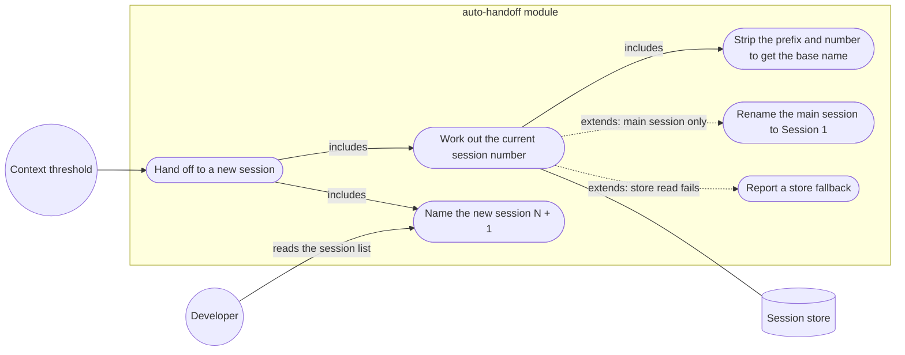

# User stories: root 16, auto-handoff session numbering (bug)

Sources: the approved plan `docs/handoffs/FEAT-20261020-ai-dlc-lens/00c-approved-plan-2026-10-24.md` ("00c"), the team brief `14.1.16-orchestrator-to-team.handoff.md` ("team brief"), the product brief `docs/product/active/brief-tier-1-sprint-1.md` ("brief §n"), the work breakdown `tasks.md` in this folder, and the deep dive `14.1.11-research-assistant-to-orchestrator.handback.md` ("11", by section). Code lines are cited as the deep dive gives them; the architect confirms them at G2. Test files are under `plugins/claude/ai-dlc/hooks/auto-handoff/tests/` (`auto-handoff.test.tsx`, `config.test.ts`); `register.tsx` is in `plugins/claude/ai-dlc/hooks/auto-handoff/`. Question numbers follow 11's list; Q16-1 was answered by the brief (§8 Q16).

## How to read this file

Test routes, one per AC (the tags of `docs/product/ai-dlc-lens/stories.md`):

| Tag | Route |
|---|---|
| `[PT]` | `npx @anthropic-ai/claude-code plugin test ./plugins/claude/ai-dlc` (auto-handoff module tests) |
| `[BV]` | build and validate, or a scripted presence or equality check named in the AC |
| `[DC]` | document check: a reviewer reads the named file against the AC |

## Terms

- **Chain**: the sessions linked by automatic handoffs, from the first session that hands off to the last one seeded.
- **Prefix** (`P`): the session-name prefix in force, `AI_DLC_AUTO_HANDOFF_SESSION_NAME_PREFIX` (default `[ai-dlc:auto-handoff]`).
- **Base name** (`B`): the session's title with the prefix and any trailing `(Session n)` removed; the session's short id when it has no title (11 §1).
- **Title number**: the `n` of a trailing `(Session n)` in the session's current title. A title has a number or it has none.
- **Lineage**: the stored `lineage:<session id>` record; it may carry a depth.
- **Main session**: a session whose title has no number and which has no lineage depth.
- **Chain name**: `P: B (Session n)`.

## Rule (human decision, binding)

The current session's number is its **title number**. Only when the title has no number is it the lineage depth; with neither, it is the main session, number 1. The new session is the current number plus 1. The old session is renamed only when it is the main session (00c root 16; team brief *Human decisions* 16).

## Stories

### US-16.1 The main session hands off to Session 2 (ITEM-030)
As a developer whose first session runs out of context, I want the old session named Session 1 and the new one Session 2, so that I can tell the chain apart in the session list.

- AC-16.1.1 `[PT]` Given a session with no lineage record and the title `B` (no prefix, no number), and session renaming on with `/rename` available, when it hands off, then the old session is renamed `P: B (Session 1)` and the new session is titled `P: B (Session 2)`.
- AC-16.1.2 `[PT]` Given a session with no title, when it hands off, then the base name is its short id, the old session is `P: <short id> (Session 1)` and the new one `P: <short id> (Session 2)` (existing behaviour, 11 §1; test `auto-handoff.test.tsx:1785-1790` kept).

### US-16.2 A numbered session hands off to the next number (ITEM-030)
As a developer in Session N of a chain, I want the new session named N + 1, whatever the store says, so that the number I see is the number that continues.

- AC-16.2.1 `[PT]` Given the title `P: B (Session 3)` and lineage depth 3, when it hands off, then the new session is `P: B (Session 4)` and the old session's title is unchanged (no rename call is made).
- AC-16.2.2 `[PT]` Given the title `P: B (Session 7)` and no lineage record (store lost, or resumed under a new id), when it hands off, then the old session is not renamed and the new session is `P: B (Session 8)` (11 §3 A; replaces the behaviour pinned at `auto-handoff.test.tsx:1766-1774`).
- AC-16.2.3 `[PT]` Given the title `P: B (Session 7)` and lineage depth 2 (the user renamed the session), when it hands off, then the new session is `P: B (Session 8)` and the old session is not renamed to 2 (title wins; 11 §3 F).
- AC-16.2.4 `[PT]` Given the title `P: B (Session 3)` and a lineage record without a depth, when it hands off, then the new session is `P: B (Session 4)` and the new session's lineage record stores depth 4 (11 §3 B; replaces the behaviour pinned at `auto-handoff.test.tsx:693-705`).
- AC-16.2.5 `[PT]` Given the title `P: B (Session 3)` and a store read that fails, when it hands off, then the new session is `P: B (Session 4)`, and the module emits exactly one fallback notice that names the failed read and says the number came from the title (the test asserts it once, not per step) (11 §3 C; Q16-3, po: a notice). The notice is written to the module's log (`~/.claude/state/auto-handoff/auto-handoff.log`) and shown with the handoff's result on the band above the prompt, or as a toast where the band is not drawn (`register.tsx:645-651`); the exact call the test observes is a test seam the architect fixes at G2.
- AC-16.2.8 `[PT]` Given the title `P: B` (or `B`, no number) and lineage depth 3, when it hands off, then the new session is `P: B (Session 4)` (no title number, so the lineage depth is the current number) and the old session is not renamed, since it is not the main session (*Rule*).
- AC-16.2.6 `[PT]` Given a seeded session resumed with the same session id, its title `P: B (Session 4)` and lineage depth 4, when it hands off, then the new session is `P: B (Session 5)` (11 §4 AC-8).
- AC-16.2.7 `[PT]` Given `/rename` is not available and the title is `P: B (Session 3)`, when it hands off, then the new session is still `P: B (Session 4)` (11 §4 AC-10; test `auto-handoff.test.tsx:1792-1800` kept and extended to the numbered title).

### US-16.3 Chain names never nest (ITEM-030)
As a developer, I want each chain name to carry the prefix once and one session number, so that names stay readable after many handoffs.

- AC-16.3.1 `[PT]` Given the title `P: B` (prefixed, no number) and no lineage, when it hands off, then it counts as the main session (N = 1, brief §8 Q16 default): the old session is renamed `P: B (Session 1)` and the new one `P: B (Session 2)`, and neither name contains `P` twice (11 §3 D).
- AC-16.3.2 `[PT]` Given each starting title of AC-16.1.1 to AC-16.3.1 and AC-16.3.5, when a chain name is produced, then it contains the prefix exactly once and exactly one `(Session n)` suffix.
- AC-16.3.3 `[PT]` Given the title `P_old: B (Session 3)`, where `P_old` is the default prefix and the prefix in force is a different `P`, when it hands off, then the new session is `P: B (Session 4)` and `P_old` does not appear in it (11 §3 E). Only the default prefix and the prefix in force are stripped (Q16-2, po): a title `X: B (Session 3)` with any other `X:` keeps `X: B` as its base name, giving `P: X: B (Session 4)`.
- AC-16.3.5 `[PT]` Given the title `B (Session 3)` (a number, no prefix) and any lineage, when it hands off, then the new session is `P: B (Session 4)` and the old session is not renamed (title number wins; the prefix is added once).
- AC-16.3.4 `[PT]` Given `baseName` called with `P: B`, `P: B (Session 2)` and `P: B (Session 1) (Session 2)`, when it returns, then each result is `B` (11 §5, `config.test.ts:109-119`).

### US-16.4 The number only goes up (ITEM-030)
As a developer, I want a chain's numbers to rise by one at each handoff, so that the order of sessions is never ambiguous.

- AC-16.4.1 `[PT]` Given a main session that hands off four times in a row, each seeded session handing off in turn, with the store intact, when the chain is done, then the five sessions are numbered 1, 2, 3, 4, 5 in order and no number repeats.
- AC-16.4.2 `[PT]` Given the same chain where the store read fails at the third handoff, when the chain is done, then the numbers are still 1, 2, 3, 4, 5 (the title carries the number across the failure).

### US-16.5 Tests and records match the rule (ITEM-030, ITEM-031)
As the plugin maintainer, I want the tests, the attribution record and the setting's description to state the new rule, so that the next change does not restore the old one.

- AC-16.5.1 `[PT]` (ITEM-030) Given the auto-handoff tests after the change, when `plugin test ./plugins/claude/ai-dlc` runs, then it passes, the tests at `auto-handoff.test.tsx:693-705` and `:1766-1774` assert AC-16.2.4 and AC-16.2.2, and each AC of US-16.1 to US-16.4 has at least one test whose name cites the AC id.
- AC-16.5.2 `[DC]` (ITEM-031) Given `plugins/claude/ai-dlc/hooks/auto-handoff/ATTRIBUTION.md`, when it is read, then its *Session names* entry (today `:144-155`) states the title-wins rule, the main-session rule and that names never nest, and no longer says that a session without lineage is renamed Session 1 whatever its title.
- AC-16.5.3 `[BV]` (ITEM-031) Given `plugins/claude/ai-dlc/skills/configure-auto-handoff/templates/auto-handoff.schema.json` and `.ai-dlc/auto-handoff.schema.json`, when they are compared, then they are byte-identical, and the naming description (today `:65`) states the rule of this file.

## Out of scope

- Using the previous session's full name instead of the base name (the `AAW-20261022-auto-handoff-chain/run.md:19` wording): the original base name is carried (brief §8 Q16 default).
- Telling apart two chains that share a base name; each numbers on its own (11 §6; Q16-4).
- Overwriting a chain name after the user runs `/rename` on a seeded session: the user's title stands and its number wins at the next handoff (follows from the rule).

## Traceability to the plan's tier 1 ACs (00c, root 16)

`P16-n` is the n-th AC bullet of 00c root 16, the same as "AC n" in `tasks.md`.

| Plan AC | Covered by |
|---|---|
| P16-1 main session (no lineage, no number) → old `(Session 1)`, new `(Session 2)` | AC-16.1.1, AC-16.1.2, AC-16.3.1 |
| P16-2 title `(Session N)` → new N + 1, old never renumbered | AC-16.2.1, AC-16.2.2, AC-16.2.3, AC-16.2.6, AC-16.2.7 |
| P16-3 lineage without depth, or store error → N + 1 from the title | AC-16.2.4, AC-16.2.5, AC-16.4.2 |
| P16-4 prefixed title without a number never nests | AC-16.3.1, AC-16.3.2, AC-16.3.3, AC-16.3.4 |
| P16-5 number never decreases or repeats within a chain | AC-16.4.1, AC-16.4.2 |
| P16-6 tests `:693-705`, `:1766-1774` change; a case per branch | AC-16.5.1 |
| P16-7 `ATTRIBUTION.md:144-155` and `auto-handoff.schema.json:65` (template + `.ai-dlc` copy) updated | AC-16.5.2, AC-16.5.3 |
| Human decision: title number wins; lineage only without a number | *Rule*, AC-16.2.3 (title wins), AC-16.2.8 (lineage without a title number), AC-16.3.5 (numbered title without the prefix) |

## Use-case diagram

## Defaults applied (brief §8)

- Q16: a prefixed title with no number gives N = 1; the original base name is carried (AC-16.3.1, *Out of scope*).

## Questions decided by `po` (2026-10-24)

`po` accepted every recommended default: Q16-2 strip the default prefix and the one in force only; Q16-3 show a notice on store failure (AC-16.2.5 stands); Q16-4 the same base name in two chains is acceptable without a mark. The feature id is `auto-handoff-session-numbering`, as in `pm`'s `tasks.md` front matter. The questions as asked:

- **Q16-2 Prefix changed mid-chain.** When the prefix setting changes, strip only the default prefix and the one in force, or any `<text>:` before the base name? Recommended: the default and the one in force only; stripping any `<text>:` would eat base names that contain a colon.
- **Q16-3 Fallback notice.** Is a notice on store failure (AC-16.2.5) wanted, or should the fallback be silent? Recommended: a notice, so that a lost store is visible.
- **Q16-4 Same base name in two chains.** Acceptable without a distinguishing mark? Recommended: yes for root 16; a backlog item if the human wants one.

## ADR candidates

None: the title-wins rule is a bug-fix rule and easy to reverse.

## Docs update

None. `plugins/claude/ai-dlc/README.md` has no naming wording (11, *Docs and wording*). `configure-auto-handoff/SKILL.md:74-75` is an agent artifact for `agent-manager`. The orchestrator's memory `project_auto-handoff-decisions.md:12` goes stale and is the orchestrator's to refresh.
