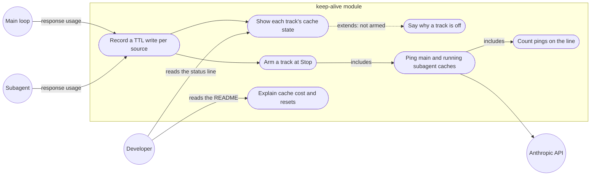

# User stories: root 17, the keep-alive status line shows the real cache state (bug)

Sources: the approved plan `00c-approved-plan-2026-10-24.md` ("00c"), the team brief `14.1.16-orchestrator-to-team.handoff.md` ("team brief"), the product brief `docs/product/active/brief-tier-1-sprint-1.md` ("brief §n"), `tasks.md` in this folder, the deep dive `14.1.12-research-assistant-to-orchestrator.handback.md` ("12", by section), and the status-line strings in `plugins/claude/ai-dlc/hooks/keepalive/keepalive.ts` (`:52`, `:504-506`, `:635`, `:688-690`). US-17.4's root cause comes from the 14.1.17 hand-back (`14.1.17-research-assistant-to-orchestrator.handback.md`, "17"), cross-checked against the keep-alive README (`plugins/claude/ai-dlc/hooks/keepalive/README.md`, "README:n") and 12, and against `keepalive.ts:504-563` directly.

## How to read this file

| Tag | Route |
|---|---|
| `[PT]` | `npx @anthropic-ai/claude-code plugin test ./plugins/claude/ai-dlc` (keep-alive tests, mock clock, stubbed responses) |
| `[DC]` | document check against the named file |
| `[MV]` | manual check in a live Claude Code session, steps given |

## Terms

- **Track**: one keep-alive lane per cache lifetime, `5m` or `1h`, with its own status line `keepalive <track>: …`.
- **TTL write**: a response whose usage has `cache_creation.ephemeral_5m_input_tokens > 0` (a 5m write) or `ephemeral_1h_input_tokens > 0` (a 1h write) (12 §3).
- **Source**: who made a TTL write: `main` (the main loop) or `subagents` (any subagent or teammate response).
- **Cache state of a track**: for each source, whether a TTL write of that track's lifetime has been seen this session, and the time until which that cache is warm.
- **Armed**: keep-alive is pinging the track (today: a Stop with background tasks and a nonzero split, 12 §1).
- **Reason**: a short text after `off` that says why the track is not armed.
- **Ping round**: one timer tick of a track, at which every live cache of that track's lifetime (main and subagents) is pinged once. The counter `k` in `ping k/m` counts ping rounds whose main-loop ping landed (a cache hit); with no subagent cache a round is one ping, so "the k-th ping lands" in AC-17.4.1 and AC-17.4.2 means "the k-th ping round lands".

## Status-line strings (the literal text the ACs compare)

Each track's line is `keepalive <track>: <cache part>; <keep-alive part>`.

- **Cache part** (new): `main warm until HH:MM` or `main expired HH:MM`, then `, subagents warm until HH:MM` or `, subagents expired HH:MM` only when a subagent cache of that lifetime has been seen (Q17-2: one line per track, `main` first, `subagents` only when present). The `subagents` time is the latest of the live subagent caches. When no source has written that lifetime this session, the line has no cache part and reads `keepalive <track>: off (no <track> cache write seen)`.
- **Keep-alive part**: today's text, unchanged, except (1) a bare `off` always carries a reason (AC-17.2.1) and (2) `, first ping at HH:MM` follows `ping 0/m` until the first ping lands (AC-17.4.5). Removing the duplicate `warm until` from running lines is left to the spec at G2.

Examples, 1h write at 10:00 and 5m writes as stated, 1h track: `pingEvery` 50m, keep warm 8h, cap 9:

| # | Case | Line |
|---|---|---|
| E1 | main 5m write 10:00, no background tasks, read 10:01 | `keepalive 5m: main warm until 10:05; off (no background tasks)` |
| E2 | only a subagent wrote 5m (10:02), no background tasks | `keepalive 5m: subagents warm until 10:07; off (no background tasks)` |
| E3 | main 5m 10:00 and subagent 5m 10:02, no background tasks | `keepalive 5m: main warm until 10:05, subagents warm until 10:07; off (no background tasks)` |
| E4 | main 5m 10:00, read at 10:06 | `keepalive 5m: main expired 10:05; off (no background tasks)` |
| E5 | no 5m write by any source | `keepalive 5m: off (no 5m cache write seen)` |
| E6 | 1h armed at 10:00 with one background task | `keepalive 1h: main warm until 11:00; armed, 1 task(s), warm until 11:00, ping 0/9, first ping at 10:50, keep warm 8h, stop by 18:00` |
| E7 | E6 after the first ping landed at 10:50 | `keepalive 1h: main warm until 11:50; warm until 11:50, ping 1/9, keep warm 8h, stop by 18:00` |

## Stories

### US-17.1 Each track shows its own cache state (ITEM-032, ITEM-033, ITEM-034)
As a developer watching the status line, I want each track to tell me whether a cache of its lifetime exists, for the main loop and for subagents, and until when, so that "off" no longer hides a warm cache.

- AC-17.1.1 `[PT]` Given a session whose main loop made a 5m write at 10:00 and no other cache activity, when the turn ends at 10:01 with no background tasks, then the 5m line is exactly E1.
- AC-17.1.2 `[PT]` Given a session whose only 5m write came from a subagent at 10:02, when the turn ends with no background tasks, then the 5m line is exactly E2 (no `main` part). With a main 5m write at 10:00 as well, it is exactly E3.
- AC-17.1.3 `[PT]` Given a main-loop 5m write at 10:00 and then a main-loop 1h write at 10:02, when the turn ends at 10:03 with no background tasks, then the 5m line is `keepalive 5m: main warm until 10:05; off (no background tasks)` and the 1h line is `keepalive 1h: main warm until 11:02; off (no background tasks)` (each track keeps its own last write; the later 1h write does not switch 5m off; 12 §2 candidate 2).
- AC-17.1.4 `[PT]` Given a main 5m write at 10:00 and no later write or read of it, when the line renders at 10:06, then the 5m line is exactly E4.
- AC-17.1.5 `[PT]` Given a 5m cache warm until 10:05 and a response at 10:04 that reads it (a cache hit), when the status line renders, then the 5m warm-until time is 10:09 (a hit refreshes the 5m lifetime, 12 §3). On the 1h track, whose refresh rule the docs do not state, only a 1h write moves the warm-until time.

### US-17.2 A reason instead of a bare `off` (ITEM-033)
As a developer, I want every `off` to say why, so that I can tell "nothing to keep warm" from "keep-alive is not running".

Today a turn start clears the status (`keepalive.ts:649`) and a Stop with no background tasks renders nothing (`:658-660`), so the `keepalive 5m: off` users see comes from a Stop with background tasks whose 5m split is 0 (`:690`), shown under an armed 1h line; the bare `off` is also the published value at turn start and session end (`:635`, `:730`), which the lens reads.

**Keep-alive part when the track is not armed:**

| Case | Today (`keepalive.ts`) | Required |
|---|---|---|
| Stop with no background tasks, nothing running | no line rendered (`:649`, `:658-660`) | rendered: cache part, then `off (no background tasks)` (E1-E4) |
| Stop with background tasks, this lifetime never written by any source | `off` (`:690`) | `off (no <track> cache write seen)` (E5) |
| Stop with background tasks, this lifetime written but every cache of it expired | `off` (`:690`) | cache part (`expired HH:MM`), then `off (cache expired)` |
| Turn start | published `off` (`:635`), status cleared (`:649`) | published: cache part, then `off (turn running)`; the status stays cleared while the turn runs, as today |
| Session end | published `off` (`:730`) | published `off (session ended)` |
| Track disabled | `off (disabled)` (`:688`) | unchanged |
| No split at all | `off (no cache write seen yet, so the cache lifetime is unknown)` (`:689`) | unchanged |
| In overage at Stop | `off in overage` (`:675`) | unchanged |
| A track that stopped | `expired, stopped` (`:535`); `kept warm <d>, stopped, warm until HH:MM` and `no ping needed for <d>, stopped, warm until HH:MM` (`:543`); `missed, stopped` (`:548`); `ping limit <n> reached, stopped, warm until HH:MM` (`:556`); `error, stopped` (`:568`); `spend limit reached, stopped, warm until HH:MM` (`:579`); `compacting` (`:590`); the compaction result (`:594`); `handed off, stopped` (`:602`); `work done, stopped` (`:659`); `overage, stopped` (`:710`) | unchanged, after the cache part |

- AC-17.2.1 `[PT]` Given each case of the table above (mock clock, stubbed responses), when the line is rendered or published, then its keep-alive part is exactly the *Required* text, and no rendered or published line ends in a bare `: off` (12 §1).
- AC-17.2.2 `[PT]` *(regression, red today)* Given a session with a `main` 5m cache warm until a future time and no background tasks, when the turn ends, then a 5m line is rendered and it is E1, not `keepalive 5m: off` and not absent.
- AC-17.2.3 `[PT]` Given a turn start after E3, when the next Stop renders, then the cache part is still E3's (the turn start resets only the keep-alive part, never the recorded writes).

### US-17.3 Keep-alive uses and keeps warm subagent caches (ITEM-034)
As a developer running background subagents, I want keep-alive to arm the 5m track from subagent 5m writes and to ping their cache too, so that their caches do not go cold while I wait.

- AC-17.3.1 `[PT]` Given background tasks running and 5m writes only from subagents, when the turn's Stop runs, then the 5m track arms (today it stays off, because only main-loop splits count: `register.tsx:881`, `keepalive.ts:84-97`).
- AC-17.3.2 `[PT]` Given an armed track and a subagent still running in the background with a live cache of that track's lifetime, when a ping round is due, then one keep-warm ping is sent for that subagent's cache and one for the main loop's (Q17-1). *(The fallback `tasks.md` ITEM-034 names, a labelled "subagent: not observable" state, weakens the human's decision "ping subagent cache too", so neither po nor the team may apply it: it is G1 question Q34 for the human, default "only after a G2 spike proves subagent usage or pings cannot be observed from a hook".)*
- AC-17.3.3 `[PT]` Given a subagent that has finished, when a ping round is due, then no ping is sent for its cache (Q17-1).
- AC-17.3.5 `[PT]` Given an idle teammate (alive, waiting for a message) with a live cache of the track's lifetime, when a ping round is due, then a ping is sent for its cache (Q17-1).
- AC-17.3.6 `[PT]` Given the 1h track with cap 9 and one running subagent cache, when ping rounds run, then `ping k/9` counts rounds, not single pings, and the track stops at the cap after 9 rounds exactly as with the main loop alone; every ping of a round, main and subagent, counts toward the spend limit (`budgetMultiplier`, README:55), so the spend ceiling the user set still holds (Q17-3 and Q17-3a, po 2026-10-24: shared cap by ping round, spend counted per ping).
- AC-17.3.4 `[PT]` Given 5m and 1h writes from main and subagents in one session, when they are recorded, then each TTL is recorded per source, and no single last-write value decides both tracks (12 §2).

### US-17.4 The ping counter advances on every track (ITEM-035)
As a developer, I want `ping k/m` to count up as pings land, and to see when the first one is due, on the 1h track as on the 5m one, so that I can see keep-alive working (human addendum, 2026-10-24: "pings always show 0/9 for 1hr cache in the statusline. it should be updated as well").

**Root cause (14.1.17, cross-checked against the keep-alive README and 12).** Two causes, ranked; the ACs below cover both.

1. *Behaviour, confirmed in code.* `ping k/m` counts **landed** pings: `t.pings++` runs only after a ping that hit the cache (`keepalive.ts:548-550`); a miss ends the track first (`missed, stopped`). The first ping is due one `pingEvery` after the turn ends (`arm`, `keepalive.ts:521-527`), 50m on the 1h track (README:15). A wait that ends before 50m (the next turn starts, `keepalive.ts:633-635`) therefore shows `ping 0/9` for its whole life, which is correct but reads as broken: the line never says a first ping is still to come. Cross-check: README:32 says "pings **sent** since the turn ended", which the code contradicts (landed, not sent); README:35 (`armed` = no ping has run yet) and README:31 (`warm until` from the last successful ping) agree with the code; 12 §1 lists the same states.
2. *Unverified, needs a live check.* After a landed ping the line is rebuilt and `render` is called from the timer callback, outside any hook event (`keepalive.ts:181-185`, `:561-563`). The tests check the recorded `ui.status` call (`hooks/keepalive/tests/keepalive.test.ts:489`, `:552`, `:1737` assert `ping 1/9` after one landed ping; `:1446`, `:1465`, `:1496` assert `ping 0/9` before it; 17 cited `:451`, `:457`, which do not hold these assertions), not what the host paints. If the host does not repaint the status surface between events, the screen keeps the armed text (`ping 0/9`) although the state says `ping 1/9`. The published `$.state` value (README:42-44, `tracks[].pings`) is written at the same moment, so it can tell the two apart in a live session.

Not the cause: a miss or a Stop re-arm (`keepalive.ts:548`, `:692`) cannot leave a stale 0, since the track ends or is re-armed.

AC-17.4.1 to AC-17.4.3 and AC-17.4.6 are *characterisation* tests: they pass on today's code (`tests/keepalive.test.ts:489`, `:552`, `:1737`) and stay to guard the behaviour through the US-17.1 and US-17.2 changes. AC-17.4.5 is the red-first test.

- AC-17.4.1 `[PT]` *(characterisation, green today)* Given the 1h track armed with a ping every 50m and keep warm 8h (so `m` is 9), when the k-th ping lands (a cache hit; k = 1 … 9, mock clock), then the 1h line shows `ping k/9` right after that ping, without waiting for another turn.
- AC-17.4.2 `[PT]` *(characterisation, green today)* Given the 5m track armed, when the k-th ping lands, then the 5m line shows `ping k/m` right after that ping.
- AC-17.4.3 `[PT]` *(characterisation, green today)* Given an armed 1h track after its first landed ping, when the line renders, then it never shows `ping 0/9`.
- AC-17.4.4 `[MV]` *(host repaint, cause 2)* Given a live session in the terminal and in the VS Code extension, with the 1h track's interval shortened for the test (`AI_DLC_KEEPALIVE_1H_PING_EVERY=2m` in the `env` of `.claude/settings.local.json`, which is not trust-gated, README:91) and a background task that runs longer than two intervals, when the turn ends and no other event happens, then after each landed ping the status line on screen shows the new `ping k/9` within 10 seconds (a margin for the ping's own request and the paint, well under the 2m to the next event; any later repaint would be the next event's, which is what this AC rules out), the same `k` as the `pings` of the 1h entry of the published `$.state` value `tracks` (README:44; read by the lens). Steps: set the variable, start a session, start the background task, end the turn, do nothing, read the status line and the lens at 2m and 4m, record the result for each surface. A screen that lags the published value fails this AC; po's Q17-4 decision then applies (README limitation and a backlog item, root 17 not blocked).
- AC-17.4.5 `[PT]` *(cause 1, red first)* Given any armed track before its first ping has landed, when its line renders, then `ping 0/m` is followed by `, first ping at HH:MM`, the clock time of the first ping (E6), so `0` reads as "not yet", not "stuck". A clock time, not "due in 50m": it matches the line's `warm until` and `stop by`, and stays true on a line that is not repainted (brief §8 Q17b's default wording follows this). The tests that assert `ping 0/9, keep warm …` today (`tests/keepalive.test.ts:1446`, `:1465`) change to the new text; `:1496` still holds.
- AC-17.4.6 `[PT]` *(characterisation)* Given an armed track whose ping misses the cache, when the line renders, then the counter does not move and the line reads `missed, stopped` (today's behaviour, `keepalive.ts:548`, kept and tested).
- AC-17.4.7 `[DC]` Given the keep-alive README, when it is read, then *Status lines* says `ping k/m` counts pings that landed (cache hits), not pings sent, and that the first ping is due one interval after the turn ends (50m on the 1h track).

### US-17.5 An explanation of how the cache works (ITEM-036)
As a developer, I want a short explanation of cache reads, writes and resets, so that I understand what the status line and the bill mean.

- AC-17.5.1 `[DC]` Given the keep-alive README (`plugins/claude/ai-dlc/hooks/keepalive/README.md`, written by documentation-writer), when it is read, then it states, each with a link to the Anthropic prompt-caching page and the date it was read: the cache-read price and the 5m and 1h cache-write prices as multiples of the base input price, with any per-model read prices, using the values published on that page on the date of writing as spot-checked by research-assistant (not the figures of 12 §3, which came from a summarising fetch); a hit refreshes the 5m lifetime at no extra cost; what resets the cache (TTL expiry, a change to tools, system or messages, `/clear`, compaction, a model change) (00c root 17; 12 §3).
- AC-17.5.2 `[DC]` Given the same README, when it is read, then it says the docs state no refresh rule for the 1h lifetime, and it labels each listed reset the Anthropic page does not state (today `/clear` and compaction, 12 §3) as Claude Code behaviour, not a documented API rule.
- AC-17.5.3 `[DC]` Given the same README, when it is read, then it explains each status-line state of US-17.1 and US-17.2 and the `main` and `subagents` labels.

## Out of scope

- The lens's cost and savings fixes (writes priced by TTL, the write premium in savings, `lens.ts:330-336,1751-1775`) and the lens panel: root 22 (00c root 17, last AC; brief §8 Q17a default).
- Changing which TTL Claude Code's main loop writes.

## Traceability to the plan's tier 1 ACs (00c, root 17)

`P17-n` is the n-th AC bullet of 00c root 17, the same as "AC n" in `tasks.md`; "AC-A" there is the addendum.

| Plan AC | Covered by |
|---|---|
| P17-1 each track shows whether writes of its own TTL exist (main and subagents, labelled) and until when | AC-17.1.1, AC-17.1.2, AC-17.1.4, AC-17.1.5 |
| P17-2 a reason replaces a bare `off` | AC-17.2.1, AC-17.2.3 |
| P17-3 the 5m track arms from subagents' 5m writes as well | AC-17.3.1 |
| P17-4 splits per TTL, not one last write | AC-17.1.3, AC-17.3.4 |
| P17-5 regression test "5m cache exists → line not off" | AC-17.2.2 |
| P17-6 explanation for the user from the Anthropic docs | AC-17.5.1, AC-17.5.2, AC-17.5.3 |
| P17-7 lens cost fixes go to root 22 | *Out of scope* |
| Human decision: keep-alive also pings subagent cache | AC-17.3.2, AC-17.3.3, AC-17.3.5, AC-17.3.6 |
| Addendum AC-A (2026-10-24): the 1h ping counter advances with each ping | AC-17.4.1 to AC-17.4.7 (root cause from 14.1.17: AC-17.4.4 host repaint, AC-17.4.5 first-ping time, AC-17.4.7 README wording) |

## Use-case diagram

## Defaults applied (brief §8)

- Q17a: the bug is the status line; the lens panel is root 22 (*Out of scope*).
- Q17b: the counter AC is in (US-17.4), with the 14.1.17 root cause folded in.

## Decisions by `po` (2026-10-24)

- **Q17-1 Which subagent caches are pinged:** running background subagents and idle teammates; never finished ones (AC-17.3.2, AC-17.3.3).
- **Q17-2 Line layout:** one line per track, `main` first, then `subagents` only when it has a cache (AC-17.1.1, AC-17.1.2).
- **Q17-3 Ping cap:** subagent pings share the track's cap `m`, so the spend ceiling the user set stays true (AC-17.3.2).

## Questions for the human (G1, each with a default)

- **Q34 ITEM-034 fallback.** May the team fall back to a labelled "subagent: not observable" state if subagent usage or pings cannot be observed from a hook? Default: only after a G2 spike proves it cannot be observed; until then AC-17.3.2 stands as written.

- **Brief §8 Q17b (asked of the human by `po`).** Was the observed session past 50 minutes? Default: `0/9` before the first ping is intended. The ACs do not depend on the answer: AC-17.4.5 covers the short wait, AC-17.4.4 the long one.

## Decided by `po` in revision 3 (2026-10-24)

- **Q17-3a How the shared cap counts:** each ping round counts once against `m`; every ping, main and subagent, counts toward the spend limit (AC-17.3.6). Considered and rejected: each single ping counts against `m`, which would halve the keep-warm time with one subagent.
- **Brief §8 Q17b wording:** the brief's default now uses the clock form `ping 0/9, first ping at 10:50` (AC-17.4.5).

Question numbers follow the order they were raised (12, 17, then po's rounds); gaps are numbers used for questions that research or the brief answered.

## Decided by `po` in revision 2 (2026-10-24)

- **Q17-4 If the host does not repaint (AC-17.4.4 fails):** the module's logic is right, so the fix is outside keep-alive's code. Keep AC-17.4.5 (the first-ping time makes a stale line self-evident), document the limitation in the README's *Limitations*, and open a backlog item for a host-side repaint trigger; root 17 is not blocked by it.

## Research to verify before G2 (not for the human)

- The price and refresh quotes come from a summarising fetch (12 §3); a research-assistant spot-checks them against the Anthropic page before the README is written.
- Whether `subagentPromptCacheTtl` exists as keep-alive `README:150` says (12 §6).
- The host repaint between events (14.1.17 cause 2) is checked live by AC-17.4.4, not by research; 14.1.17's open question on how long the human's waits last is brief §8 Q17b, asked of the human at G1; AC-17.4.4 and AC-17.4.5 cover both answers.

## ADR candidates

- Pinging subagent caches multiplies keep-alive spend by the number of live subagents; the alternative (main loop only) was rejected by the human. Hard to reverse once users rely on it, and surprising without context. The architect decides whether it passes the ADR tests.

## Docs update

- `plugins/claude/ai-dlc/hooks/keepalive/README.md`, the status-line states section and a new cache-explanation section: status *planned* (run.v2.md; the building stage has not started); what changes: US-17.1 to US-17.5 (ITEM-036), and *Status lines* (`ping k/m` counts landed pings; first ping one interval after the turn ends, AC-17.4.7); *Limitations* gets the host-repaint limitation only if AC-17.4.4 fails (Q17-4).
