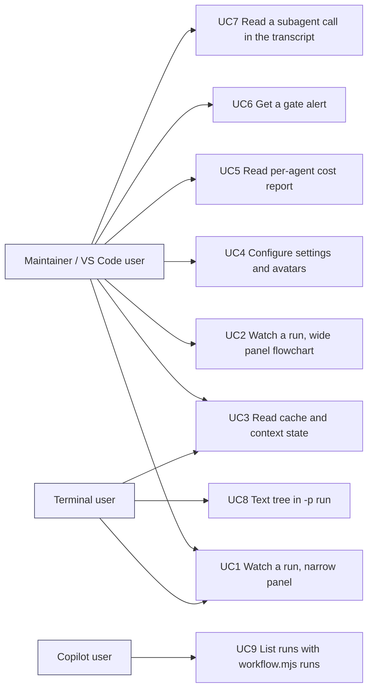

# Product brief: ai-dlc-lens

Sources. Human decisions: `docs/handoffs/FEAT-20261020-ai-dlc-lens/00b-approved-plan-2026-10-22.md` (sections *Your decisions* and *Merged field set*, binding) and `00-approved-plan.md` (decisions of 2026-10-20). Research is cited by hand-back file name, all in `docs/handoffs/FEAT-20261020-ai-dlc-lens/`: `3.2-research-assistant-to-orchestrator.handback.md` (mods API, version gates), `4.2-…` (Svg, width, transcript cards), `4.3-…` (events, shared state, transcripts), `4.4-…` (cache-tax, context-view), `4.5-…` (agent-flow, savvy-progress), each in the form `<step>-research-assistant-to-orchestrator.handback.md`, cited below as "3.2", "4.2" and so on with a line number (`4.4:29`). Breakdown: `docs/backlog/backlog.md`, section *FEAT-20261020-ai-dlc-lens*, ITEM-003 to ITEM-026. Nothing in this brief re-decides a human decision; where intent is open it is listed in section 12 and marked as an assumption.

## 1. Problem

AI-DLC runs are long, multi-agent and gated, and their state is only visible as files on disk (`docs/handoffs/*/run.md`, hand-backs, `workflow.json`). While a session runs, the maintainer or user cannot see in one place:
- which agents are working, what each is doing, and what each costs;
- which stage, gate and loop round the run is in, and what the next action is;
- whether the prompt cache is warm or cold and what a cold turn costs, and how close the context is to auto-compact;
- that a human gate has been reached (today it arrives only as a chat message).

Four third-party mods each show a slice (savvy-progress: agents, tokens, progress; cache-tax: cache state and price; context-view: context meter; agent-flow: live subagent tree). Using them side by side duplicates figures, uses four trust decisions, and none knows AI-DLC stages, gates or loops (`00-approved-plan.md`, *Context*; `00b`, *Context*).

## 2. Vision

One dashboard, `ai-dlc-lens`, that shows the whole run: agents by persona name, tokens, context, cost, cache, and AI-DLC run state, laid out as a compact list in a narrow panel and as a per-workflow flowchart in a wide one. Every figure appears once. Detail is hidden until asked for. It never hides what a subagent or teammate says.

## 3. Users

| Persona | Surface | What they get |
|---|---|---|
| P1 Plugin maintainer (this repository) | VS Code extension; AAW and AI-DLC runs | Full view, per-agent cost to tune model choice and find runaway loops, gate alerts |
| P2 Plugin user in VS Code | VS Code extension, a repository set up with `ai-dlc` | Same view, plus the commands `/ai-dlc:lens`, `/ai-dlc:lens-init`, `/ai-dlc:lens-configure` |
| P3a Terminal user | Claude Code terminal; `-p` runs | Compact list only (Svg draws in VS Code and Desktop only: `00b` research findings, 3.2:27); file-path image avatars via the terminal's `Image` element when trusted, else initials (3.2:27; confirm in the avatar spike); text fallback for `-p` |
| P3b Desktop user | Claude Code Desktop | Svg draws there (3.2:27), so the flowchart is available when the layout allows. Assumption — confirm at G1: Desktop is covered by automated `$.ui.mount(surface: 'desktop')` tests only (3.2:53), and the manual check (M6) is VS Code only, as `00b` says |
| P4 Copilot user (secondary) | GitHub Copilot | No lens (mods are Claude-only); gets the run-state CLI `workflow.mjs runs`; the gate alert only if the hook can be projected (section 6, F2) |

## 4. Desired outcomes

Each feature in section 6 names the outcome it serves.

- O1 See the run at a glance: who is working, on what, at what cost, without reading files.
- O2 Know the cost position: cache warm or cold, cold re-write price, context headroom, so the user can act before paying for a cold turn or a compaction.
- O3 Respond to human gates faster: an alert when a gate is reached or a run is blocked.
- O4 Know where tokens and money go per agent and per stage (an open gap: no other tool does it; `00-approved-plan.md`, option B).
- O5 Trust it: nothing a subagent or teammate says is hidden; licences are honoured; settings are predictable and overridable; the mod is Claude-only and stays out of the Copilot plugin.
- O6 The model knows its own context size (context-view's awareness line, human decision C2), so it can act before auto-compact.

Observable check per outcome (all in section 10): O1 M8, O2 M9, O3 M10, O4 M11, O5 M2 to M5, O6 M12.

## 5. Merged field set and visibility (binding, from `00b`)

The table in `00b`, *Merged field set*, is the input to G1 and the spec and is not copied here, to keep one source of truth. Rules carried into the stories:
- Each figure renders once per pane tree, from one source (a field-uniqueness test enforces it).
- Two dollar figures are different quantities and labelled differently: *est. spend* (savvy-progress) and *cold re-write* (cache-tax). Dollars are estimates from one dated price table.
- Default visibility: header and collapsed rows visible; expanded detail, the guard and the price-table date hidden until asked for. The inline (narrow) pane shows only running or attention-needing agents plus one summary line.
- The context window comes from the engine (`$.session.usage().context.window`), never a hard-coded value (the engine supplies it: context-view reads `measured.window`, 4.4:81; `$.session.usage` is listed in 3.2:73).
- Awareness line (human decision C2, 2026-10-22): context-view's model-facing line is included and on by default (O6). It tells Claude its context size after prompts and tool results. All its options are lens settings: `awareness`, `awarenessFrom`, `awarenessWithin`, `awarenessStep`, `awarenessAt` (4.4:96-100). Rule kept from upstream: the line is appended as a new line and never edited afterwards, so the prompt cache prefix still matches; subagent results and refused calls get no line (4.4:89). The research does not name the engine API that appends it (4.4:89 describes the behaviour only); naming it is a G2 spec decision. This is not the `session.append` rewriting that `00b:45` rules out: that rule is about the transcript cards (F9), which must not rewrite or hide existing entries. Awareness adds a new line, which C2 allows. It is the one place the lens adds text the model reads; it is a risk (section 11) and must be easy to turn off.
- Avatars (human decision C3): each agent shows an initials badge (configurable text and colour) or, when set, an image (a file path or a data URI). A file path goes through the trust check; a data URI is never fetched but is validated for type and size; anything else (a remote URL, a non-image file) is refused. Initials are the fallback when an image is untrusted, refused, missing or cannot be drawn on the surface. Size and type limits are set from the avatar spike (section 11); known bounds: Svg source is capped at 131,072 characters and a terminal `Image` at 2 MiB (3.2:27).

## 6. Features, traced to backlog items

Priority column: the product-manager's P1 and P2 now mean build order only. Because of C1 (no cut), no item is optional and P2 does not mean deferrable.

| # | Feature | Outcome | Items | Pri (PM) |
|---|---|---|---|---|
| F1 | Shared run-state parser (extracted from `hooks/auto-handoff/run.ts`) and `workflow.mjs runs [--json] [--active]`, tolerant of run.md files with missing fields; works for Copilot too | O1, O3 | 007, 008 | P1 |
| F2 | Gate-alert hook installed by `init`: alert when a human gate is reached or a run becomes `blocked`. Alert channels (default, confirm at G1): a toast plus the attention row of the lens pane; for users without the lens, a visible line in the session from the hook. Surfaces: terminal, Desktop, VS Code. Trigger: no later than the next run-state check after the run record changes (the limit N is set in the ACs with the human; none is assumed here). Copilot: only if the hook can be projected, an architect decision at G2; otherwise Copilot users poll with `workflow.mjs runs --active` (`00-approved-plan.md:239` asks for a Copilot twin "where possible") | O3 | 009 | P2 |
| F3 | Plugin packaging: ai-dlc-lens scaffold and marketplace entry (Claude marketplace only), `build-copilot.mjs` ignores it, CI validate and test steps pinned to one Claude Code version | O5 | 010, 011 | P1 |
| F4 | Settings: one resolver, precedence `settings.local.json` env > `settings.json` env > `/ai-dlc:lens-init` and `/ai-dlc:lens-configure` > defaults; invalid values ignored; process env not read; writers refuse untrusted file paths | O5 | 012, 019 | P1 |
| F5 | Data model and compact view (tracer bullet): agents, edges, loops, usage; savvy-progress style rows (name, type, model, context, tokens, est. $, elapsed), task bar | O1 | 013 | P1 |
| F6 | Merged header: context meter, cache figures (warm/cold/unknown, cold price, break-even, cold writes), keep-alive state read from ai-dlc keep-alive when active, opt-in guard (off by default), context-view awareness line (on by default, all five options configurable), no keepwarm | O2, O6 | 014 | P1 |
| F7 | Flowchart view (Svg; dock and wide only): one chart per workflow, avatars (initials badge, or a configured image with initials as fallback) with statuses below, caller to callee arrows, two-way arrow in a loop, active agents blink green, completed green and steady, run details below | O1 | 015 | P1 |
| F8 | Collapse and `[+]` expand per agent, attention flags (waiting for approval, tool call over 30 s, silent over 2 min, gate reached), inline-mode filter, field-uniqueness test | O1, O3 | 016 | P1 |
| F9 | Transcript cards for subagent and teammate calls (avatar, name, status, tokens); prompt and tool chatter collapse on click; the response text is never hidden; a setting turns cards off; no `session.append` rewriting | O1, O5 | 017 | P2 |
| F10 | Text fallback `/ai-dlc:lens text` for `-p` runs and the terminal | O1 | 018 | P2 |
| F11 | Per-agent and per-stage token ledger, report view (`/ai-dlc:lens`), dated price tables, dollars labelled as estimates | O4 | 020 | P2 |
| F12 | Licences: upstream `LICENSE` files and agent-flow `NOTICE` kept, `ATTRIBUTION.md` listing every change, four notices in `THIRD_PARTY_NOTICES.md` (MIT: johnnyvizz, Karan Bansal, kongyo2; Apache-2.0: agent-flow, copyright line per research) | O5 | 021 | P1 |
| F13 | Three thin Claude-only skills in ai-dlc (`lens`, `lens-init`, `lens-configure`); without the lens plugin they say how to install it; excluded from the Copilot build; `plugin-management` skill, rules and CLAUDE.md updated for the layout | O5 | 022, 023 | P1, P2 |
| F14 | Docs: lens README, recommended-mods page with the trust warning, settings table | O5 | 024 | P2 |
| G | Process items: research 003, this plan 004 (G1), spec 005 (G2), task plan 006 (G3), review 025 (G4), release 026 | n/a | 003-006, 025, 026 | P1 |

## 7. Use cases

| UC | Actor, trigger | Outcome (verifiable) | Items |
|---|---|---|---|
| UC1 | Panel is narrow (VS Code inline) or terminal | Compact list shows only running or attention agents plus one summary line; rows expand with `[+]` | 013, 016 |
| UC2 | Panel is 800 px or wider (dock) and Svg is available | One flowchart per workflow; arrows caller to callee; two-way arrow in a loop; active agent blinks green, done agent steady green; run details below | 015, 016 |
| UC3 | Any turn | Header shows context `%`, used/window, headroom to auto-compact; cache warm/cold/unknown, cold re-write price, break-even, cold writes; keep-alive state only when active | 014 |
| UC4 | User runs `/ai-dlc:lens-init` or `-configure`, or edits settings env | Value takes effect by the documented precedence; invalid value ignored; untrusted file path refused | 012, 019, 022 |
| UC5 | User runs `/ai-dlc:lens` | Per-agent and per-stage tokens and est. $ with the price-table date, matching fixtures | 020 |
| UC6 | A run reaches a human gate or becomes blocked | A toast is raised (and, without the lens, a visible hook line); the pane shows the gate in its attention row; channels and latency as in F2 | 009, 016 |
| UC7 | A subagent or teammate is called | Compact card replaces prompt and tool noise; the agent's response text is visible; setting off restores native rows | 017 |
| UC8 | `-p` run or terminal | `/ai-dlc:lens text` prints the agent tree as text | 018 |
| UC9 | Copilot user | `node .ai-dlc/workflow.mjs runs --json` lists runs, tolerating missing fields | 007, 008 |

## 8. Scope

In scope (1.0.0-preview1, all items, no cut; section 9): F1 to F14, with the binding decisions of `00b` and of C1 to C3 (the approved plan option S5, "run-state CLI first, then a thin separate mod plugin", widened on 2026-10-22 to the four merged mods; three commands via thin skills; settings precedence; initials-badge and image avatars with per-agent configuration, trust check and initials fallback; context-view awareness line on by default; cache-tax figures plus opt-in guard; four mods merged; never hide a subagent or teammate response; four licence notices; G1 to G4 and the release approved by the human).

Out of scope (explicit):
- cache-tax keepwarm and its settings (ai-dlc keep-alive already pings; two keepers would pay twice). `00b`.
- Rewriting or hiding existing transcript entries with `session.append` (the transcript cards only change the drawing; the model keeps seeing everything). `00b:45`. Appending a new awareness line is allowed (C2; section 5).
- Reading the process environment for settings. `00b`.
- Copilot lens; the Copilot plugin gets no lens content. `00b`.
- A claude-lens style history browser (option D), usage-limit meters and 5h/7d windows (option C): buy or use existing mods. `00-approved-plan.md`.
- User-facing cost history and export: a later story after the maintainer report (`00-approved-plan.md:235`, WI-1: "user-facing history/export as a later story"). Not in 1.0.0-preview1. Assumption — confirm at G1.
- Pixel snapshot tests (the mods test API has none).

## 9. Release target

Human decision C1, 2026-10-22: everything in F1 to F14 ships in **1.0.0-preview1**, which is not yet released. There is no cut line and nothing moves to 1.1.0. This replaces the 2026-10-20 "1.0.0 unless it delays" rule and withdraws the cut order I first recommended. The backlog milestone changes from 1.0.0 to 1.0.0-preview1. Consequence: the release waits for the whole scope. Any delay that follows is the human's accepted decision (C1), not a risk I can cut away; section 11 states the mitigation (re-estimate at G3, critical path, return-to-human trigger).

Spike sequencing (my scope and sequence decision): the spikes run **before G2**, not in the build waves, so the spec does not freeze on unproven behaviour.
- Spike (a) VS Code panel resize, Svg animation, buttons and the transcript-card nesting; spike (c) avatar image rendering and the Svg `<style>`, `<marker>` and `<image href="data:...">` scrub (4.2:60-63). They run as throwaway scratch mod plugins under `.scratch/`, written by `agent-manager`, touching none of the files the fold merge blocks, so they need neither the lens scaffold (010) nor the fold merge. The human does the manual check in VS Code 2.1.299 or later.
- Spike (b) keep-alive state read (`$.tool.register` / `$.tool.call` across two plugins, 4.3:27, 4.3:74) needs the keep-alive code that is on the unmerged fold branch. It runs before G2 only if that merge has landed; otherwise it stays open at G2 and the spec lists it as an explicit open question with a fallback (F6 omits the keep-alive line, or reads a documented state file).
- Any spike still open at G2 is listed in the spec as an open question with its fallback; the spec cites each spike result. Results are recorded in the run folder.

## 10. Success measures

No usage metrics exist for this project and none are invented. Measures are verifiable at G4 and release, taken from the `00b` Verification section:
Build checks:
- M1 `node --test "tests/**/*.test.mjs"`, `claude plugin test` for ai-dlc and the lens, `plugin validate --strict` for ai-dlc, ai-dlc-lens and `.`, and `node tools/build-copilot.mjs --check` all pass; the Copilot plugin has no lens skills.
- M2 Field-uniqueness test: no figure renders twice in one pane tree.
- M3 Transcript-card tests: the response text is in the mounted tree; the prompt is collapsed; setting off shows native rows.
- M4 Settings precedence is tested level by level, including that invalid values are ignored.
- M5 `THIRD_PARTY_NOTICES.md` holds all four notices; every upstream `LICENSE` is kept beside the code.
- M6 The manual VS Code check list in `00b` passes in extension 2.1.299 or later (narrow compact list, dock flowchart, green blink and steady, loop arrow, second workflow own chart, three commands work, local override wins, cards with responses visible, `[+]` expand), plus the steps C2, C3 and F2 added: an avatar image draws, and an untrusted or undrawable image falls back to initials; the awareness line appears on by default, is appended once per step, and stops when turned off; a gate alert (toast and attention row) fires when a run reaches a human gate.
- M7 G4 review: zero Blockers on both axes.

Outcome checks (one per outcome, observable, run by `claude plugin test` fixtures unless noted):
- M8 (O1) A mounted tree for a fixture run shows, per agent, persona name, status and tokens in its collapsed row, and the run's lifecycle, stage, gate and loop round in the details.
- M9 (O2) After a usage event, the next render of the header shows warm/cold/unknown, cold re-write price, break-even and headroom to auto-compact.
- M10 (O3) A fixture run.md that reaches a human gate raises the alert, and the pane shows it in the attention row, no later than the next run-state check. The limit N is set in the stories; none is assumed here.
- M11 (O4) The report's per-agent and per-stage totals equal the fixture ledger's totals, with the price-table date shown.
- M12 (O6) With awareness on, a fixture turn yields one appended line with tokens, window and headroom, none for subagent results, and none with it turned off.
- M13 Outcome signal (Assumption — needs human confirmation): the maintainer judges at release that the gate alert and the per-agent view replace reading `run.md` by hand. No numeric target is set.

## 11. Risks and dependencies

| Risk | Effect | Handling |
|---|---|---|
| Mods API is early access: it broke at 2.1.271, 2.1.283 and 2.1.299-2.1.304, Anthropic can switch mods off remotely, and three crashes unload every mod (`00-approved-plan.md:145-147`, the architect's feasibility; 3.2:76 flags the types file as early access) | The lens may break between releases | Lens in its own plugin so ai-dlc stays hook-free; CI pins one Claude Code version (011); the `workflow.mjs runs` CLI still works |
| VS Code behaviour of panel resize, Svg animation and buttons in transcript rows is unproven (4.2:32, 4.2:60-63; 3.2:81) | F7 blink, F8 `[+]`, F9 cards may not work as specified | Spikes (a) and (c) run before G2 (section 9) and the spec cites their results; fallbacks: user toggle compact/flowchart (4.2:62); timer blink (4.2:24). No cut is allowed (C1), so a failed spike changes the design, not the scope; if a feature cannot be built, it returns to the human |
| Avatar images (path or data URI) may not draw in VS Code: Svg `<image href="data:...">` is not documented (4.2:22, 4.2:60; 3.2:27, 3.2:79) | F7 images | Avatar spike (c) before G2; initials badge is the fallback when an image cannot be drawn, is refused, is missing or is untrusted; limits per section 5 |
| No `agent.complete` or `agent.stop` mod event (4.3:16); `classic.SubagentStop` exists and carries `agent_id`, `agent_type` and the transcript path (4.3:17-18) | "Completed" green (F7) and the ledger (F11) need a completion signal | Use `$.agent.list` status and `classic.SubagentStop`; the spec confirms; if neither works for a case, the row shows "unknown" rather than a false green |
| Subagent transcripts record `agentType` in `meta.json` (4.3:34), but no document says the `subagents/` layout is stable across versions (4.3:79) | F11 ledger history may break | The ledger records agent type live from `agent.spawn` and `SubagentStop`; transcript reading is a fallback only; a version-drift test |
| `ToolUse` and `ToolResult` are separate render sites; a returned tree at ToolResult is undocumented and a card wrapping `next(e)` at ToolUse is unproven (4.2:39-43, 4.2:63); VS Code and Desktop may differ (`00b:158`) | F9 cards could hide a response | Draw the card at ToolUse and `next(e)` at ToolResult so the native response stays (4.2:39); spike (a) checks VS Code; test that the response text is in the mounted tree (M3); setting off restores native rows |
| cache-tax and context-view internals were read through a summarising fetch, not a clone or install (4.4:13, 4.4:119-124): the guard flow and `BIG_TOKENS` 50,000 (4.4:29, 4.4:64) are medium confidence; context-view's thresholds were not read | Ported guard or thresholds may differ from upstream | The architect clones both repos at G2 and records the upstream commit; guard stays opt-in and off by default; thresholds become settings |
| Awareness line on by default adds text the model reads after prompts and tool results | Extra tokens each turn; any rewrite would break the cache prefix | Append only, never edit (upstream rule); steps and thresholds configurable; a one-switch off; a test that the line is appended once per step and absent for subagent results |
| Schedule: everything ships in one preview with no cut (24 items; the S5 plan was 10 to 14 days before the widening, `00-approved-plan.md:158`) | Late release | The delay is the human's accepted decision (C1). Mitigation: (1) the product-manager re-estimates at G3 from the task plan; (2) critical path to track: G1, spikes, G2, G3, the fold merge, 007 and 010, 013, 014 and 015, 016, 024, 025, 026; (3) trigger: if the G3 re-estimate, a failed spike or an API break shows a feature cannot ship in preview1, the orchestrator returns to the human with options; I do not cut |
| No mods API reads another plugin's state (4.3:23-31) | F6 keep-alive state | Spike (b) on `$.tool.register` / `$.tool.call` or a documented state file (4.3:74); open at G2 if the fold merge is not in; fallback: F6 omits the line and records it |
| Two price tables disagree (savvy-progress 2026-10-10, cache-tax October 2026) | Two inconsistent $ figures | One dated table; $ labelled estimate; table date hidden by default |
| Claude Code minimum version: mods need 2.1.287 (`00-approved-plan.md:24`); context-view 2.1.290 per its README, cache-tax 2.1.287 (4.4:21, 4.4:77, 4.4:125); the VS Code pane renders from 2.1.299, and from 2.1.304 when the session does not fetch feature flags, such as Bedrock (3.2:39) | Below a surface's version the lens does not draw there (VS Code below 2.1.299 shows nothing); it is not "nothing everywhere" | The product need is that VS Code works, so 2.1.299 is the candidate floor. The floor is an architect decision at G2 (4.4:125 asks for it), not a product assumption; the stricter of the sources sets the terminal floor; the minimum version is declared in the manifest and in the docs |
| Mods are not sandboxed (run with the user's permissions) | Trust | Recommended-mods page with the trust warning (F14); path trust check (F4) |
| External blocker: run `AAW-20261022-fold-cache-keepalive` must merge to `main` first | Build waves 007, 010, 011, 021, 023 wait | Planning waves P1 to P4 are not blocked; merge `main` into `feat/ai-dlc-lens` before building |
| Items 012 to 020 share one plugin source tree | Merge conflicts | One module per item, merged one at a time (PM) |
| The 2026-10-20 product-owner view was to defer mod panes until the API stabilises; the human overruled it | Risk accepted by the human | No action; recorded, not re-litigated |

## 12. Answers to the product-manager's questions and open questions

Answers (decided by me unless marked as a human answer):
1. Cut candidates: none. Human answer C1: no cut, everything ships in 1.0.0-preview1.
2. preview2 or 1.0.0: human answer C1: 1.0.0-preview1, unreleased.
3. Plugin location: G2, with the architect. Product constraints: separate from the `ai-dlc` plugin; Claude marketplace only; installable alongside ai-dlc; `build-copilot.mjs` and CI handle it; the thin skills say how to install it.
4. Coarse ACs: a starting point and a traceability map, not final. requirement-analyst replaces them with the G1 ACs, keeping the ITEM ids; the PM then rewrites the backlog ACs from the accepted stories.
5. P0 override: none. No item is a security fix or regression. Rule: a security finding on F4 (path trust check) or any later regression found in review is P0 and overrides the order.

Round-1 critique minors (7-brutal-critique-to-orchestrator.handback.md): all fixed, none rejected. O6 added (section 4); the priority column's meaning stated (section 6); research cited by hand-back and line (sections 1, 5, 11); "S5" spelled out (section 8); WI-1 verified at `00-approved-plan.md:235` (section 8); requirement-analyst cannot interview the human and must return clarify requests, with decided and open items separated (section 13); the 50,000 guard threshold is cited and marked medium confidence (sections 11, 13); the PM list requires updated dependency edges, waves and the blocker note (section 13).

Clarifications answered by the human on 2026-10-22 (all three closed):
- C1, release label and delay rule: everything ships in 1.0.0-preview1, unreleased; no cut. Applied in the front matter, sections 8, 9, 11 and 13.
- C2, context-view awareness: included, on by default, all five `awareness*` options configurable. Applied in sections 5, 6 (F6), 8 and 11.
- C3, avatars: images (a path or data URI) allowed alongside the initials badge; a file path goes through the trust check; initials are the fallback; an image-render spike comes first. Applied in sections 5, 6 (F7), 11 and 13.

## 13. Delegation list

### requirement-analyst (step 6 continues; use `spec-driven-development`)
Inputs: this brief, `00b`, `00`, the backlog section, research hand-backs `4.2`-`4.5`. Output: `docs/product/ai-dlc-lens/stories.md` (or per feature), each story with numbered ACs a tester can verify without follow-up questions, tagged with its ITEM ids and the test route below.
Stories to write (one per F in section 6, plus UC1 to UC9). You cannot interview the human directly: put every question for the human into a `clarify:` request to the orchestrator, with a recommended default.

Already decided (write the ACs, do not ask):
- Cache guard: opt-in, off by default; no keepwarm (`00b`). Settings precedence, no process env, invalid values ignored (`00b`). C1 to C3 as in section 12.
- Attention thresholds: 30 s tool call, 2 min silent (`00b` merged field set; agent-flow, 4.5).
- Awareness (C2): on by default, all five options (`awareness`, `awarenessFrom`, `awarenessWithin`, `awarenessStep`, `awarenessAt`) through the settings precedence, append-only, no line for subagent results or refused calls, one switch that turns it off.
- Avatar images (C3): a per-agent image as a path or data URI next to the configurable initials badge. ACs for: the trust check on a file path (untrusted path refused); data URI type and size limits (the numbers come from spike (c); write the AC with the limit as a named setting); a non-image path or a remote URL refused; the initials fallback in each case; behaviour per surface: VS Code and Desktop draw through Svg, the terminal through `Image` for a trusted file path only (3.2:27), anything else shows initials.

Open, to ask the human through the orchestrator, with my default:
- Which of the "not configurable today" upstream constants become settings (4.4:64-67, 4.4:104-109). Default: all of them, since `00b` says every setting is configurable, except the upstream keepwarm constants (dropped).
- The 50,000-token guard threshold (`BIG_TOKENS`, 4.4:29, 4.4:64; medium confidence, unverified against source): default configurable, starting at 50,000.
- Guard modes. Default: `warn` and `refuse` as cache-tax has them, off by default.
- The alert latency N and the alert channels of F2. Default: section 6, F2.
- Whether Desktop needs a manual check (P3b). Default: automated tests only.
- Awareness line (C2): ACs for on by default, all five options (`awareness`, `awarenessFrom`, `awarenessWithin`, `awarenessStep`, `awarenessAt`) configurable through the settings precedence, append-only (never edited), no line for subagent results or refused calls, and one switch that turns it off.
- Blink period and the compact versus flowchart toggle.
- Which context applies to a subagent row (own context %) versus the header (main thread).
AC routes. Mark each AC with exactly one route:
- `claude plugin test` (automated): settings precedence per level and invalid ignored; mounted tree for vscode and terminal at narrow and wide widths; blink with the mock clock; field uniqueness; transcript card shows response text and collapses the prompt, native rows when off; cache and context figures from fixtures; attention flags; one chart per workflow; awareness line settings, default on and append-only; avatar initials fallback and trust-check refusal.
- `node --test "tests/**/*.test.mjs"` (automated): runstate parser and `workflow.mjs runs`, including run.md files with missing fields.
- Build and validate commands (automated): `plugin validate --strict` (three targets), `node tools/build-copilot.mjs --check`, Copilot plugin has no lens skills, CI steps present.
- Document check (review): the four notices, kept `LICENSE`/`NOTICE`, `ATTRIBUTION.md` completeness.
- Manual VS Code check (2.1.299 or later): panel resize between inline and dock, real blink, transcript cards in the VS Code transcript, `[+]` click, commands, local override, an avatar image drawn and a refused one falling back to initials, the awareness line on, appended and off, a gate alert. Keep these few and name the exact steps (M6).
Rules: no AC may contradict a binding decision in `00b`; every AC is numbered and testable; do not write design (G2).

### product-manager (after G1; backlog only, no code)
- Keep priorities 003 to 026 as in the backlog, with these changes:
  1. No cut order and no cut candidates (C1). Change the backlog milestone of ITEM-003 to ITEM-026 from 1.0.0 to 1.0.0-preview1. Priorities unchanged.
  2. Add three spike items, P1, **before G2**: they depend on G1 only, not on 010 or the fold merge, and item 005 (spec) depends on them. (a) VS Code spike: panel resize across the dock boundary, Svg animation, buttons, and a card wrapping `next(e)` at ToolUse (4.2:60-63); (c) avatar spike: `<image href="data:...">`, `<style>`, `<marker>`, file-path images, and the size and type limits; both are scratch mod plugins under `.scratch/`, written by `agent-manager`, with a manual VS Code check by the human; (b) keep-alive state read spike (`$.tool.call` across two plugins, 4.3:74), run before G2 only if the fold merge has landed, otherwise recorded as open for the spec with its fallback. Note the fold-merge blocker on (b).
  3. Fix a dependency: the header est. $ (013, 014) needs the one dated price table, which 020 currently owns. Move the price table into 013 (or its own P1 item) and make 020 depend on it.
  3a. Return the updated Depends-On and wave columns for every item the spikes and the price-table move touch (005, 013, 014, 015, 017, 020 at least), and state the blocker on spike (b). New spike ids are the product-manager's to assign.
  3b. At G3, add a re-estimate of the whole plan and mark the critical path in section 11 (no cut line; C1).
  4. 019 stays P1; any untrusted-path defect found in it is P0.
  5. Replace the coarse ACs with the accepted G1 ACs, keeping the item ids and the test route tags.
- Update the backlog only after G1 is approved.
