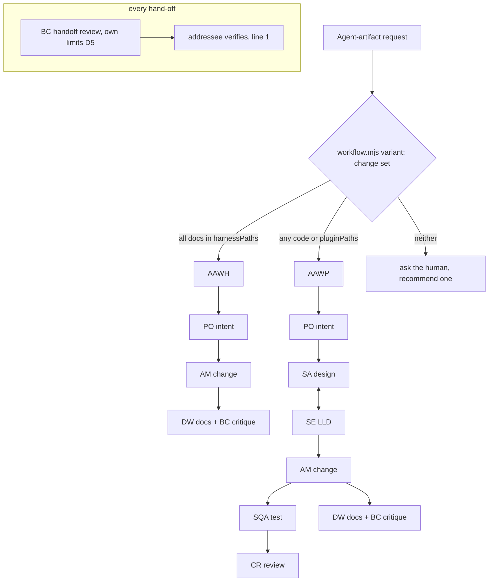

# Spec: two AAW variants, harness and plugin / mod (root 19)

This spec is a synthesis of the G1-approved stories, the deep dive 14.1.14 and the brief's §8 defaults Q19a-e. The stories file stays the source of each AC's wording.

## Overview

Agent-artifact work runs one lifecycle today, `AAW`: `agent-manager` makes the change, then `brutal-critique` reviews docs, and `sqa-engineer` followed by `code-reviewer` handle code. The validator requires that its starting stage is `agent-manager` (`workflow.mjs`, the "Agent Artifact" block). A plugin or mod change needs design (`software-architect`, `system-engineer`) and a product owner before the build. A one-line harness edit needs none of that. This spec splits AAW into two variants:

- variant (a), harness: `product-owner` ↔ `agent-manager`, plus `documentation-writer` + `brutal-critique`;
- variant (b), plugin/mod: `product-owner` ↔ `software-architect` ↔ `system-engineer` ↔ `agent-manager` ↔ `sqa-engineer` ↔ `code-reviewer`, plus `documentation-writer` + `brutal-critique`.

Both variants sit under one routing key. An executable rule picks the variant from the change set. The validator guards each variant by role, and `brutal-critique` reviews each hand-off under its own round limits.

## Acceptance criteria → design

| AC | Design | Item |
|---|---|---|
| AC-19.1.1, 19.1.2 | D1 (template), D9 (this repository's file) | 046, 047 |
| AC-19.1.3, 19.1.4 | D3 guards G1 and G2 | 045 |
| AC-19.1.5 | D2 | 048 |
| AC-19.2.1, 19.2.2, 19.2.3 | D4 `variant` command | 048 |
| AC-19.2.4 | D4: `aaw-review.md` is the one place; `orchestrator.md` and `request-routing` point to it | 048 |
| AC-19.3.1 | D3 guard G3 | 045 |
| AC-19.3.2 | D3 guard G5 | 045 |
| AC-19.3.3 | D3 guard G4 | 045 |
| AC-19.3.4 | Test seams | 045, 048 |
| AC-19.4.1, 19.4.2 | D6 | 049 |
| AC-19.4.3 | D7 | 051 |
| AC-19.4.4 | D7 | 048 |
| AC-19.4.5 | D7 | 049 |
| AC-19.5.1, 19.5.2 | D5 | 050 |
| AC-19.6.1, 19.6.2 | D6 naming | 049 |
| AC-19.7.1, 19.7.2 | D8 | 048 |
| AC-19.8.1, 19.8.2 | D9 | 051 |
| AC-19.9.1, 19.9.2 | D10 | every item |

## Design (high level)

- **D1 Two lifecycles.** The template defines `AAWH` (variant a, harness) and `AAWP` (variant b, plugin/mod). Both have `kind: focused`, and each carries a new `variant: "harness" | "plugin"` field.
  - **The codes have no hyphen**, because the lens reads a run folder's start date with `^[a-z][a-z0-9]*-(\d{8})` (`lens.ts`, `folderDateOf`). A code such as `AAW-H` would break that read. Run folders become `AAWH-<date>-<slug>` and `AAWP-<date>-<slug>`.
  - **AAWH stages:** `intent` (`product-owner`) → `change` (`agent-manager`) → `docs` (`documentation-writer`, when documentation changes) ∥ `critique` (`brutal-critique`, loop to `change`).
  - **AAWP stages:** `intent` (`product-owner`) → `design` (`software-architect`) → `lld` (`system-engineer`, loop to `design`: Refine) → `change` (`agent-manager`, after `lld`) → `test` (`sqa-engineer`, loop to `change`) → `code-review` (`code-reviewer`, after `test`, loop to `change`). `docs` (`documentation-writer`) and `critique` (`brutal-critique`, loop to `change`) both run `after: change`, in parallel with `test`, as the docs and code paths of today's AAW do.
  - **Neither variant has a `software-engineer` stage, and neither has a gate** (Q19c).
- **D2 Routing (Q19d confirmed, ADR-0001).** `routing.byType["Agent Artifact"]` changes from a string to a list of lifecycle codes, `["AAWH", "AAWP"]`. Only this key may hold a list; every other `byType` value stays a string. The orchestrator picks one entry with the D4 rule. The list must hold exactly one `variant: "plugin"` lifecycle and at most one `variant: "harness"` lifecycle. With no harness lifecycle, every change set goes to the plugin variant.
- **D3 Guards (ADR-0002).** These replace the guards that assume a single agent-manager-first lifecycle. The validator applies them to every lifecycle in the D2 list:
  - **G1.** No stage has `agent: "software-engineer"`. The error names the stage (AC-19.1.3).
  - **G2.** At least one stage has `agent: "agent-manager"` (AC-19.1.4).
  - **G3.** Every starting stage, meaning a stage whose `after` is empty, is one of `product-owner`, `software-architect` or `agent-manager`. This replaces the old rule that the start must be `agent-manager` (AC-19.3.1).
  - **G4.** A `brutal-critique` stage loops back to an `agent-manager` stage, with the `when` rule unchanged (AC-19.3.3).
  - **G5.** Only for `variant: "plugin"`: a `sqa-engineer` stage and a `code-reviewer` stage loop back to `agent-manager`, and `code-reviewer` lists the `sqa-engineer` stage directly in its `after`. These are today's rules (AC-19.3.2). The plugin variant also needs a `software-architect` stage and a `system-engineer` stage that `agent-manager` reaches through `after`. Design is part of the plugin variant's promise, so it is guarded, not left to the consumer.
  - **G7.** No agent in `agents.disabled` may own a stage of a lifecycle listed under `Agent Artifact`. The error names the agent and the lifecycle. `UNDISABLEABLE` stays as it is: a repository may disable `product-owner`, but then it must remove that agent from its AAW lifecycles. Variants that no longer meet G2-G5 stay invalid.
  - **G6.** Every lifecycle in the list has a valid `variant`, and the list has the shape D2 gives.
  - The harness variant has no code-review stages. The guarantee "code is always tested and reviewed" therefore rests on **two** checks. The D4 rule picks the plugin variant for any expected code path. The D4b post-change check catches code that a harness run actually changed.
- **D4 The variant rule, one executable source.** A new CLI command, `node .ai-dlc/workflow.mjs variant [--json] <path>...`, prints the chosen code, or `ask` with one reason. It classifies each path in this order:
  1. The kind, from `aaw-review.md` *Change kinds* rows 2-4. For a path that exists, this uses its extension, shebang and top-level keys. For a planned path that does not exist yet, it uses the extension and file name only (`hooks.json`, `settings.json`, `package.json`, `.github/workflows/*`, and `.claude/hooks/*`).
  2. The path's area: a new `routing.agentArtifact` object with `harnessPaths` and `pluginPaths` glob lists. The template defaults come from 14.1.14 §2.
  The rule: any code path, or any path in `pluginPaths`, selects the plugin variant (AC-19.2.2). This includes `.claude/hooks/*.mjs` (Q19b). When every path is docs and in `harnessPaths`, the harness variant is selected (AC-19.2.1). Anything else gives `ask` (AC-19.2.3).
  Generated paths (row 1) are left out of the change set before the rule runs. `agent-manager` marks them, and they never decide the variant.
  `aaw-review.md` states the rule in prose and names the command. `orchestrator.md` and `request-routing` point to `aaw-review.md` (AC-19.2.4). The orchestrator runs `variant` as part of reading its own workflow, which is the exception in `orchestrator.md` (ITEM-048 adds it to the list). The command reads files only to tell their kind and never runs them.
- **D4a No paths.** `variant` with no path prints `ask`, gives the reason `no paths`, and exits 0. This is not a usage error. At routing time the orchestrator seeds the paths from `research-assistant`'s report on the request. When the report names none, it asks the human, recommending AAWP for any change to a plugin, hook or tool.
- **D4b Post-change check (both variants).** After every `change` stage hand-back, the orchestrator runs `variant` on the paths that `agent-manager` reports as changed, leaving out generated paths. This replaces today's classification of the actual change set, which `aaw-review.md` does after the hand-back.
  - In an AAWH run, a result of `plugin` or `ask` means the run does not go on to critique-only review. The orchestrator stops and asks the human one question. The recommended answer is to continue under AAWP from its `test` stage, so the code is tested and reviewed, and to record that design was skipped. The other answer is to restart as AAWP from `intent`.
  - In an AAWP run, the check only confirms the result, because every path is already covered there.
  - **Where it is written:** `aaw-review.md` (*Rounds*) and the orchestrator's hard rule (D8).
- **D5 Handoff review loop (ADR-0002).**
  - **The setting.** A new top-level `handoffReview` object: `{ lifecycles: ["AAWH", "AAWP"], maxRounds: 2, maxFailures: 1 }`. The reviewer is always `brutal-critique` (00c), so it is not a setting. Root 23 needs `lifecycles`.
  - **Its row.** `rounds --json` prints a row `handoff-review` with its own variables, `AI_DLC_HANDOFF_REVIEW_MAX_ROUNDS` and `AI_DLC_HANDOFF_REVIEW_MAX_FAILURES`. The row reads them at the same levels and under the same validity and combination rules as every loop. It never reads the `brutal-critique` variables, so `gate-critique` and `handoff-review` change independently (AC-19.5.1, 19.5.2).
  - **Variable lookup.** `ENV_VARS` is keyed by agent today. It gains an entry keyed by row id, so the handoff review does not share `brutal-critique`'s variables.
  - **On a verdict.** On PASS the receiver starts, with no further approval. On REVISE the writer fixes the record. When the loop stops with findings still open, the human decides, as for every loop (Q19c).
  - **Scope.** Root 23 applies `handoffReview.lifecycles` to the other lifecycles.
- **D6 Records per mode (ITEM-049).** Every record is verified by **the agent it is addressed to**. This generalises today's `handoff` rule ("the receiver verifies a handoff; the writer never verifies its own record") to hand-backs; it does not reverse it.
  - **Subagent mode.** The orchestrator writes the handoff before the spawn. `brutal-critique` reviews it (D5). The receiver verifies it, on line 1 of its report. The orchestrator stores the hand-back verbatim and verifies it (AC-19.4.1).
  - **Team mode.** The sender writes the handoff. `brutal-critique` reviews it. The receiver verifies it on line 1 and writes its hand-back to the sender. **The sender, as the hand-back's addressee, verifies the hand-back.** The orchestrator only leads and keeps the run state from the record names that teammates report (AC-19.4.2). The *Who writes what* table gains a "Verifies" column.
  - **Naming.** The handoff review records take the reviewed record's full step code plus `.h<round>`: `1.2.h1-orchestrator-to-brutal-critique.handoff.md` and `1.2.h1-brutal-critique-to-orchestrator.handback.md`. This extends the naming grammar with one optional segment, and `handoff-naming.test.mjs` covers it.
  - **Planning records.** In AAWP, the `product-owner`, `software-architect` and `system-engineer` records sit under `N.1`: `N.1.1` intent, `N.1.2` design, `N.1.3` LLD, with Refine rounds at `N.1.3.l1.<r>` (AC-19.6.1, 19.6.2).
- **D7 Mode choice and fallback.**
  - **Choosing the mode.** The orchestrator chooses team or subagent mode for each request, in **both** variants, and asks the human when it cannot decide (AC-19.4.4; 00c item 3: "both for agent teams and parallel subagents"). In team mode, AAWH runs `product-owner`, `agent-manager`, `documentation-writer` and `brutal-critique` as teammates. AAWP adds `software-architect`, `system-engineer`, `sqa-engineer` and `code-reviewer`. The team roles have no hard technical limit: the plugin agents that join have `SendMessage` (feature root 29, 329dfbb), and `code-reviewer` has no Write tool, so the sender stores its hand-back (`handoff`, *Who writes what*). Team mode pays off most in AAWP, where the Refine loop (`design`↔`lld`) and the Align loop (`lld`↔`change`) gain from back-and-forth. For a one-line AAWH change, the orchestrator's default is subagents, and it asks when the human asked for a team.
  - **Fallback.** A run falls back to subagent mode when team mode is unavailable: under `-p`, in a headless or Agent SDK session, without `CLAUDE_CODE_EXPERIMENTAL_AGENT_TEAMS`, without a team or messaging tool, or on GitHub Copilot. The run state records the fallback (AC-19.4.3).
  - **No orchestrator.** With `agent-manager` as the main agent and no orchestrator, only AAWH runs, in subagent mode, and `agent-manager` writes the records. AAWP is refused with the message "start the orchestrator: `claude --agent ai-dlc:orchestrator`" (AC-19.4.5).
- **D8 Text.** These files are rewritten for the two variants:
  - the hard rule in `orchestrator.md`, which names both chains, says there is no `software-engineer` and the orchestrator runs no checks, says there is no SDLC chain, and removes "No PM consultation" (only `product-owner` takes part, not `product-manager`);
  - the generated `AGENTS.md` template source;
  - `aaw-review.md`: change kinds, rounds and findings for both variants, and the D4 rule;
  - `agent-manager.md`, `brutal-critique.md` (the handoff review duty), `request-routing` and `handoff`.
- **D9 Upgrade (ITEM-051).**
  - **The legacy file fails `validate`.** A file whose `routing.byType["Agent Artifact"]` is the string `"AAW"` is the legacy single AAW. `validate` rejects it with: `routing.byType["Agent Artifact"] is the single AAW lifecycle of an older plugin; run /ai-dlc:workflow upgrade to replace it with AAWH and AAWP` (AC-19.8.1).
  - **Why upgrade needs a migration.** `merge` never overwrites a value, so on its own it cannot fix this. The `workflow` skill's **upgrade** mode gains a step, *Legacy AAW*, modelled on the existing *Legacy key* step. It runs before `merge` and asks for the developer's consent. The step is implemented as `merge --migrate`, which `--dry-run` lists as `~` lines:
    - it rewrites the routing value to `["AAWH", "AAWP"]`;
    - it removes `lifecycles.AAW` when that lifecycle matches one of the AAW lifecycles the plugin shipped before. `workflow.mjs` embeds a list `LEGACY_AAW` with the normalised stage signature of each shipped version: each stage's `id`, `agent`, sorted `after`, `when` and `loop.to`, with limits and texts ignored. The LLD takes the list from the template's git history;
    - when no signature matches, it keeps the AAW lifecycle, warns that it is customised, and leaves it unrouted.
  - **The result.** `merge` then adds `AAWH`, `AAWP`, `routing.agentArtifact` and `handoffReview`, and the file validates (AC-19.8.2).
  - **This repository's own file** is changed the same way by the Wave 3 build (AC-19.1.1). The in-flight run keeps its 00c override (Q19e).
- **D10 Build discipline.** Every item that changes a `workflow` skill file is made by a freshly spawned `agent-manager` whose brief is that item, or that one atomic unit, alone. The unit is **WF-1**: 045, 050, 046 and 047, built together by one fresh agent-manager, because the guards, the handoff-review row and the two lifecycles do not validate apart (see the LLD). AC-19.9.2 reads "spawned for that change alone" with WF-1 counted as one change. The orchestrator reads the `workflow` skill's files only to tell their kind, and never runs their checks. Each hand-back quotes `node tools/build-copilot.mjs --check`, `node .ai-dlc/workflow.mjs validate`, `node --test "tests/**/*.test.mjs"`, `node .claude/scripts/sync-harness.mjs --check` and, when the catalog changed, the catalog check (AC-19.9.1, 19.9.2).
  - **Merge order.** Root 18 also edits the `workflow` skill. Group WF merges in the order WF-1 (045, 050, 046, 047) → 048 → 051 → root 18's 037 → 038. Root 19's validator and schema change (045) goes in first, so root 18's taxonomy keys land on the new schema.



## Component boundaries

| Part | Owner (file) | Item |
|---|---|---|
| Guards G1-G7, D2 shape, `variant` command, `handoff-review` row, `merge --migrate`, legacy error | `skills/workflow/templates/workflow.mjs` | 045, 048, 050, 051 |
| `variant`, `routing.agentArtifact`, `handoffReview` keys; `byType` list form | `skills/workflow/templates/workflow.schema.json` | 045, 050 |
| AAWH, AAWP, routing, `handoffReview` defaults | `skills/workflow/templates/workflow.json` | 046, 047, 050 |
| Rule prose, change kinds, rounds for both variants | `skills/workflow/references/aaw-review.md` | 046, 047, 048 |
| Upgrade step *Legacy AAW* | `skills/workflow/SKILL.md` | 051 |
| Hard rule, mode choice, `variant` in the exception list | `agents/orchestrator.md`, `tools/templates/AGENTS.template.md` | 048 |
| Pointer to the rule | `skills/request-routing/SKILL.md` | 048 |
| Fallback conditions for both variants (AC-19.4.3), and the run-state field that records a fallback | `skills/request-routing/SKILL.md` (*Mode 5 conditions*), `skills/handoff/SKILL.md` (*Run state*, the `mode` cell) | 051 |
| Post-change check (D4b) | `references/aaw-review.md` (*Rounds*), `agents/orchestrator.md` (the hard rule) | 048 |
| Who writes and verifies what, `.h<round>` naming, `N.1.x` codes | `skills/handoff/SKILL.md` | 049 |
| Main-agent refusal of AAWP | `agents/agent-manager.md` | 049 |
| Handoff review duty | `agents/brutal-critique.md` | 049 |
| This repository's `.ai-dlc/` copy and catalog | via `/ai-dlc:workflow upgrade` (agent-manager) | 051 |
| Generated copies | `node tools/build-copilot.mjs` | every item |

## Data shapes

There is no request/response API, so the `{ data, error }` envelope does not apply. The workflow file shapes, as fragments:

```json
{
  "lifecycles": {
    "AAWH": { "kind": "focused", "variant": "harness", "stages": [ "…" ] },
    "AAWP": { "kind": "focused", "variant": "plugin", "stages": [ "…" ] }
  },
  "routing": {
    "byType": { "Agent Artifact": ["AAWH", "AAWP"] },
    "agentArtifact": {
      "harnessPaths": [".claude/agents/**", ".claude/skills/**", ".claude/rules/**", ".claude/commands/**", ".github/agents/**", ".github/skills/**", ".github/instructions/**", ".github/prompts/**", ".ai-dlc/workflow.json", "AGENTS.md"],
      "pluginPaths": ["plugins/**", "tools/**", "tests/**"]
    }
  },
  "handoffReview": { "lifecycles": ["AAWH", "AAWP"], "maxRounds": 2, "maxFailures": 1 }
}
```

`variant --json` output: `{ "data": { "lifecycle": "AAWP" | "AAWH" | null, "decision": "plugin" | "harness" | "ask", "reason": string, "paths": [{ "path": string, "kind": "code" | "docs", "area": "harness" | "plugin" | "none" }] }, "error": null }`. It uses the envelope, because this is the one machine-readable response the orchestrator consumes. A usage error gives `data: null` and an `error` string, with exit code 2.

The LLD fixes the stage `produces`, `note` and `loop.on` texts and the exact glob semantics. It also lists every reader of `byType["Agent Artifact"]` as a string (`show`, `--mermaid`, `rounds`, the schema, `check-workflow.mjs`, `merge`, `diff`), found by searching the code, and changes each one. The glob matching uses the same minimal matcher as the rest of `workflow.mjs`, and adds no dependency.

## Test seams

- **Existing, primary:** `tests/workflow/workflow.test.mjs` runs `workflow.mjs` on temporary workflow files. It covers:
  - guards G1-G7: a passing case and a failing case each (AC-19.1.3, 19.1.4, 19.3.1-19.3.4);
  - the template and this repository's file (AC-19.1.1, 19.1.2);
  - the `rounds --json` row and the env isolation (AC-19.5.1, 19.5.2);
  - the legacy error, and `merge --migrate` on a fixture of the old file, followed by `validate` (AC-19.8.1, 19.8.2).
- **Same seam, a new command:** `variant` is tested through the CLI in the same file, with one case per signal: harness docs, a plugin path, a code file in a harness folder (`.claude/hooks/x.mjs`), a planned path that does not exist yet, a generated path, an unmatched path giving `ask`, and no path at all giving `ask` with exit 0 (AC-19.2.1-19.2.3, 19.3.4). A further case covers D4b: a reported change set from an AAWH run that holds a `.mjs` file gives `plugin`. The orchestrator's stop-and-ask is a `[DC]` check of `aaw-review.md` and `orchestrator.md`. The guard tests cover G5's design stages and G7.
- **Existing:** `tests/workflow/handoff-naming.test.mjs` covers the `.h<round>` segment and the `N.1.1`-`N.1.3` codes of the three planning agents (AC-19.6.2).
- **`[DC]` ACs:** a reviewer reads the named files (AC-19.1.5, 19.2.4, 19.4.x, 19.6.1, 19.7.x, 19.9.2).
- **`[BV]`:** the checks of D10.

## Out of scope

As the stories:
- the default AI-DLC phases and the auto/manual switch (root 23);
- a human gate in either variant;
- moving this run to a variant.

Also out of scope:
- applying `handoffReview` to lifecycles other than AAWH and AAWP (root 23);
- the lens learning the new codes. The lens reads them like any other code, so no change is needed.

## Open questions

- **OQ1 (po, accepted 2026-10-24).** Traceability of each "↔" link in the stories: PO→SA is the `design` stage's `after`; SA↔SE is the `lld` loop to `design` (Refine); SE↔AM is a clarify request (Align); AM↔SQA is the `test` loop; SQA→CR is `code-review` `after: test`, and CR↔AM is the `code-review` loop; DW + BC are `docs` ∥ `critique`, and BC↔AM is the `critique` loop. Each is checked by AC-19.1.2 (the stage list) and by the template test of the `after` and `loop` fields. Align has **no stage loop**: it is the `change` stage's clarify request to `system-engineer`, recorded in the run state's *Open clarifications*. Original question: The plugin variant's chain in the stories is `PO ↔ SA ↔ SE ↔ AM ↔ SQA ↔ CR`. D1 renders the "↔" as loops: SE ↔ SA (Refine), SQA → AM and CR → AM (fix loops), and BC → AM. AM ↔ SE (Align) is not a stage loop. It runs as a clarify request from `agent-manager` to `system-engineer`, the same as `software-engineer` does today. Default: accept.
- **OQ2 (po, accepted 2026-10-24).** Variant (a)'s `documentation-writer` stage runs only when a README or user guide changes (`when: the change set changes documentation`). Most harness edits touch no documentation, which `docs-status` defines narrowly. Default: accept the condition.

## ADRs

- `docs/architecture/decisions/ADR-0001-aaw-variants-under-one-routing-key.md`: the two lifecycles, the routing list and the executable variant rule.
- `docs/architecture/decisions/ADR-0002-aaw-guards-by-role-and-handoff-review-limits.md`: the role-based guards G1-G7, the code-review guarantee moving to the rule, and the handoff review's own limits.

## Docs update

`README.md` and `docs/plugins.md`, the AAW sections: describe the two variants and how one is picked (US-19.1, US-19.2). Status *planned*: the building stage has not started. They move to *in progress* when ITEM-045 starts. `documentation-writer` confirms which sections change.
