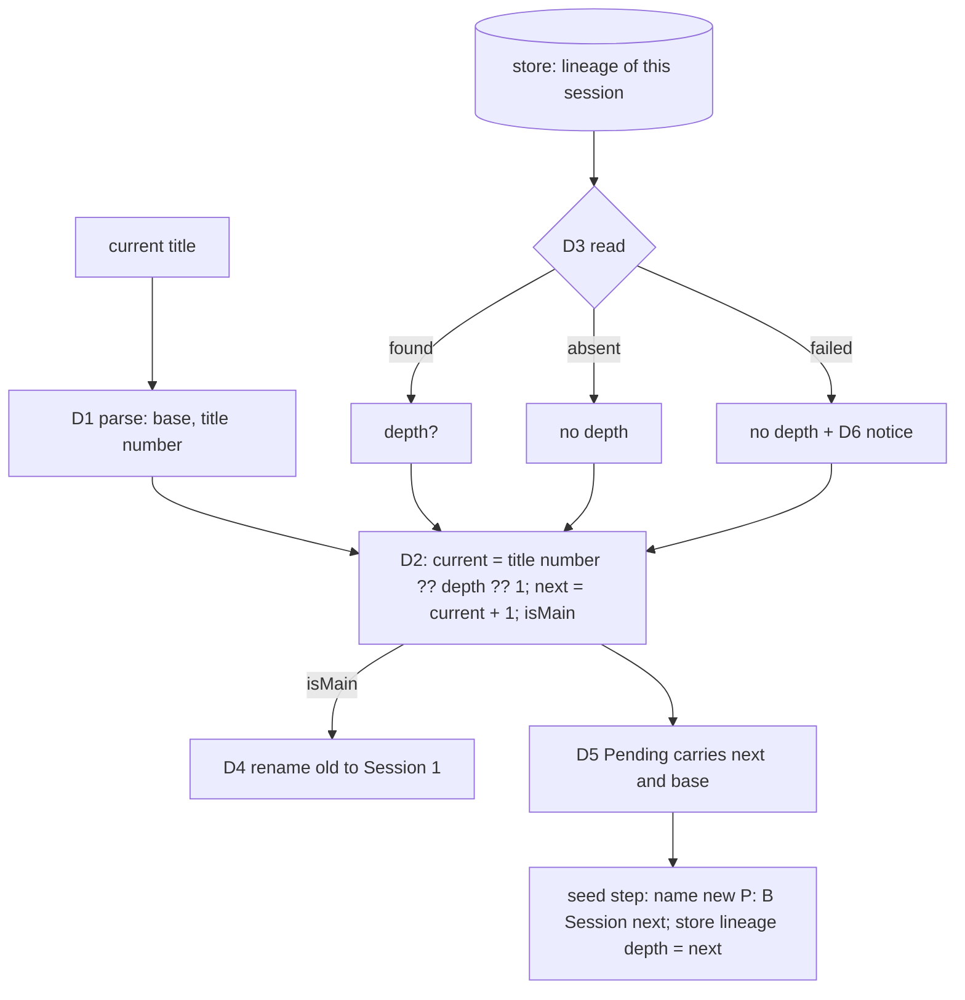

# Spec: auto-handoff session numbering (root 16, bug)

Drafted by the architect, as the Wave 2 team brief (`30-orchestrator-to-team.handoff.md`) assigns. It synthesises the spec from the G1-approved stories (synthesis mode of `spec-driven-development`). It adds no requirement. The AC ids are the stories' ids, so the stories file stays the source of each AC's wording.

## Overview

When the auto-handoff module hands a session off, it names the old and the new session `P: B (Session n)`. Today the number comes from the stored lineage depth (`lineage:<session>` in the module store). When the lineage is missing, the module treats the session as the main session and names it Session 1, whatever its title says. When the lineage has no depth, the module names nothing. So a chain loses its numbering whenever the store is lost or old. The human decision (00c, root 16) is that **the title number wins**: the current number is the title's `(Session n)`, then the lineage depth, then 1. The new session is current + 1, and only the main session is renamed.

## Acceptance criteria

The binding wording is in the stories file. This list gives each id and the design element that answers it (*Design* below):

| AC | Behaviour | Design element |
|---|---|---|
| AC-16.1.1 | Main session: old renamed `P: B (Session 1)`, new `P: B (Session 2)` | D1, D2, D4 |
| AC-16.1.2 | No title: the short id is the base | D1 (base fallback, unchanged) |
| AC-16.2.1 | Title `(Session 3)`, depth 3: new 4, no rename call | D2, D4 |
| AC-16.2.2 | Title `(Session 7)`, no lineage: new 8, no rename | D2 |
| AC-16.2.3 | Title `(Session 7)`, depth 2: new 8, no rename | D2 |
| AC-16.2.4 | Title `(Session 3)`, lineage without depth: new 4, stored depth 4 | D2, D5 |
| AC-16.2.5 | Title `(Session 3)`, store read fails: new 4, one fallback notice | D3, D6 |
| AC-16.2.6 | Resumed seeded session, same id, title 4, depth 4: new 5 | D2 |
| AC-16.2.7 | No `/rename`, title 3: new 4 | D4 (rename skipped, naming independent) |
| AC-16.2.8 | Title without a number, depth 3: new 4, no rename | D2 |
| AC-16.2.5-F (spec case, po-accepted 2026-10-24; Q16-3) | Title `P: B` (no number), store read fails: old session NOT renamed, new `P: B (Session 2)`, one fallback notice saying the number defaulted to 1 and no rename was made | D2, D6 |
| AC-16.3.1 | `P: B`, no lineage: main session, 1 then 2, `P` once | D1, D2 |
| AC-16.3.2 | Every produced name: prefix once, one suffix | D1 |
| AC-16.3.3 | Old default prefix stripped; any other `X:` kept | D1 |
| AC-16.3.4 | `baseName` of nested wrappers gives `B` | D1 |
| AC-16.3.5 | `B (Session 3)`, no prefix: new `P: B (Session 4)`, no rename | D1, D2 |
| AC-16.4.1 | Five-session chain numbered 1..5 | D2, D5 |
| AC-16.4.2 | Same chain, store read fails at handoff 3: still 1..5 | D2, D3, D5 |
| AC-16.5.1 | Tests replace the two pinned tests; each AC cited by a test name | Test seams |
| AC-16.5.2 | `ATTRIBUTION.md` *Session names* entry states the rule | D7 |
| AC-16.5.3 | Schema template and `.ai-dlc` copy byte-identical, description states the rule | D7 |

## Design (high level)

- **D1 Title parsing.** One pure function reads a title into `{ base, number? }`. It strips, repeatedly, a leading `<prefix>:` and a trailing `(Session n)`. Only two prefixes are stripped: the default `[ai-dlc:auto-handoff]` and the one in force (Q16-2). The title number is the last `(Session n)` before any stripping (`P: B (Session 1) (Session 2)` gives 2). `baseName` changes in both behaviour and signature. Today it strips only a `P: … (Session n)` wrapper with one prefix, so `baseName('P: B')` returns `P: B` (`config.ts`). It becomes a thin wrapper over the parser. It strips both prefixes and a bare `P:` with no suffix, as AC-16.3.4 requires. Its tests in `config.test.ts` (the `baseName` cases) are extended rather than kept. A blank title gives no base, and so does a title that is only wrappers (`P: (Session 3)`). In both cases the caller falls back to the short id (AC-16.1.2).
- **D2 Number rule.** One pure function maps (title number, lineage depth) to `{ current, next, isMain }`: `current` = title number, else lineage depth, else 1; `next = current + 1`; `isMain` = no title number, no lineage depth, **and the read did not fail**. The lineage depth counts only when the read succeeded and returned a number. A *failed* read with an unnumbered title gives `current = 1`, `next = 2` and `isMain = false`. The old session is then **not** renamed, because the module never renames on a read it cannot trust, and the D6 notice says so. Every naming decision in the handoff and in the seed step comes from this one result. So does every use of the number elsewhere: the brief's `depth` header and the `Handoff depth` fact (`composeBrief`) show `current`, and they are always present.
- **D3 Three-state lineage read.** The store read for the session's own lineage returns *found*, *absent* or *failed*. It no longer folds a thrown read into "absent", so D6 can tell the two apart. Readers that only need the chain (`ancestors`, the run lookup) keep treating *failed* as absent. The numbering read always goes to the **store**, and never to the in-memory lineage of the seeded session. The seed step writes `lineage:<new>` before that session can hand off, so the store holds the same record, and the numbering path has one source that can fail visibly. `lineageOf` keeps its in-memory shortcut for its other callers (`ancestors`, the run lookup). (Revision 3, adopted from the LLD on bc's round 2 advice.) On a *failed* read the chain id falls back to this session's id, just as for *absent* (`own?.chain ?? sessionId`). This is accepted, and the notice says that the chain id restarted.
- **D4 Rename only the main session.** Before the `/clear`, the old session is renamed `P: B (Session 1)` only when `isMain`, renaming is on and `/rename` is available. The existing `renameOld` behaviour stays unchanged (availability check, timeout, failure logged, never blocking). A numbered or lineage-depth session gets no rename call (AC-16.2.1).
- **D5 Carry the number, do not re-read it.** The handoff puts the D2 result (`next`, and the base) in `Pending`. The seed step after `/clear` names the new session and writes `lineage:<new>` with `depth = next` from `Pending`. It no longer reads the old session's lineage a second time (today `register.tsx` reads it in the seed handler). So a stored lineage always has a depth from now on (AC-16.2.4), and one store failure cannot give two different numbers in one handoff. The current title must be known before the brief is composed, so the transcript path it is read from is resolved before `composeBrief` and passed in. This changes only the order of the work.
- **D6 Fallback notice.** When the D3 read is *failed*, the module emits **one** notice per handoff. The notice names the failed read and the source of the number (`from the title (Session n)`, or `defaulted to 1` when the title has none). It has two parts:
  - **Log line.** One line in `~/.claude/state/auto-handoff/auto-handoff.log`, with the fixed marker `numbering fallback:`. It is written once, when the read fails, at the start of `handoff`, before the first panel update.
  - **Panel step.** One `warn` step on the handoff panel. `steps()` replaces the whole step list, so the step is carried in `Pending`, and then in `handedFrom`. It is included in **every** later step list of that handoff: the `steps()` call after the brief is written, the seed handler's call after `/clear`, and the handed-off panel. It therefore stays on screen across the `/clear`.
  - **Toast.** Off the band (mobile, VS Code), the step goes out as a toast exactly **once**, on the first `steps()` call that carries it. The later calls pass it without a toast; the LLD gives `steps()` a toast parameter for this. It never goes through `addStep`, which would toast on every call.
- **D7 Records.** The `ATTRIBUTION.md` *Session names* entry and the naming description in `auto-handoff.schema.json` (the template and its `.ai-dlc/` copy, kept byte-identical) state D1, D2 and D4. This is ITEM-031, after ITEM-030.

## Component boundaries

| Part | Owner | Notes |
|---|---|---|
| D1, D2 pure functions | `hooks/auto-handoff/config.ts` | `sessionName` and `baseName` already live here, and `config.test.ts` is their test file |
| D3, D4, D5, D6 wiring | `hooks/auto-handoff/register.tsx` | `storedLineage`, `handoff`, the SessionStart `clear` seed handler, `log`, the panel |
| D7 | `hooks/auto-handoff/ATTRIBUTION.md`; `skills/configure-auto-handoff/templates/auto-handoff.schema.json` and `.ai-dlc/auto-handoff.schema.json` | ITEM-031 |
| Keep-alive | untouched | `stopForHandoff` stays as it is |

Build chain: as the run's override (agent-manager implements, then sqa-engineer, code-reviewer ×2). Merge group KA: 030, then 031.

## Data shapes

The module has no request/response API, so the `{ data, error }` envelope does not apply. The shapes below are internal.

- `TitleParts = { base?: string; number?: number }` (D1).
- `Numbering = { current: number; next: number; isMain: boolean; source: 'title' | 'lineage' | 'default' }` (D2). `source` feeds the D6 notice text.
- `LineageRead = { state: 'found'; lineage: Lineage } | { state: 'absent' } | { state: 'failed'; error: string }` (D3).
- `Lineage` stays `{ from, chain, depth?, baseName? }`, so records written before this change are read unchanged. New records always carry `depth`.
- `Pending` gains `next: number`.

The LLD fixes the exact signatures.

## Test seams

One existing seam observes every runtime AC: the module test harness in `tests/auto-handoff.test.tsx`, through the `engine(...)` fake. It observes the store seeding, `calls.renamed`, the `SessionStart({ source: 'clear' })` answer's `sessionTitle`, `calls.written[LOG_FILE]` and `band($)`. A second existing seam, `tests/config.test.ts`, covers the pure functions D1 and D2 (AC-16.3.2, AC-16.3.4, and a table test of D2).

- AC-16.2.5 uses a session that is not seeded, so it reads the store. It needs a store whose `get` throws for `lineage:<session>`. The `engine(...)` options do not have that today (only `failWrite`, `failList` and `failRename`), so the LLD adds a `failStore?: RegExp` option to the test fake, next to the others. This is a new option on the existing seam, not a new seam. The test checks four things after the seed: `numbering fallback:` appears exactly once in `LOG_FILE`; the band holds the warn step; with `surfaces: ['vscode']`, `calls.toasts` holds the step once; and the old session is not renamed when the title has no number (D2).
- AC-16.4.1 reuses the existing `chainRounds` helper.
- AC-16.4.2 is one in-process chain, driven with `chainRounds`. `failStore` matches the lineage key of the session that makes the third handoff. Because the numbering read always goes to the store (D3), that read fails, the title carries the number, and the test asserts 1 to 5.
- Prior art to replace (AC-16.5.1): "a session seeded before a hot reload keeps its chain" (depth undefined, so it now asserts AC-16.2.4) and "a session already carrying the chain name is not wrapped again" (rename to Session 1, so it now asserts AC-16.2.2).
- AC-16.5.3: no test compares the two schema copies today. ITEM-031 adds a byte comparison of `skills/configure-auto-handoff/templates/auto-handoff.schema.json` with `.ai-dlc/auto-handoff.schema.json` to `tests/auto-handoff/auto-handoff-agreement.test.mjs`, run by `node --test "tests/**/*.test.mjs"`.

## Out of scope

As the stories: the previous session's full name as base, telling apart chains that share a base, overwriting a user `/rename`. After a user `/rename` of a seeded session, the new title's **number** wins, but the new session's **base** is still the lineage's `baseName`, which can be stale. The stories accept this (the user's title stands; the original base name is carried, Q16). Also out of scope: the lens (it reads the titles, not the numbering) and keep-alive.

## Open questions

- **Base when the lineage and the title disagree.** D5 keeps today's order: the lineage's `baseName` first, else the base parsed from the title. This follows Q16's default ("carry the original base name"). The title gives the number, and the lineage gives the base. No AC makes the two differ. Default: keep this order. No G2 question is needed unless `po` disagrees.

## ADRs

None. The stories record that this is a bug-fix rule and easy to reverse, and it fails the ADR tests (not hard to reverse, not surprising once the rule is written in `ATTRIBUTION.md`).

## Docs update

None. The README has no wording on numbering (14.1.11). `configure-auto-handoff/SKILL.md:74-75` is an agent artifact, so the Wave 3 build's agent-manager changes it with ITEM-031.
