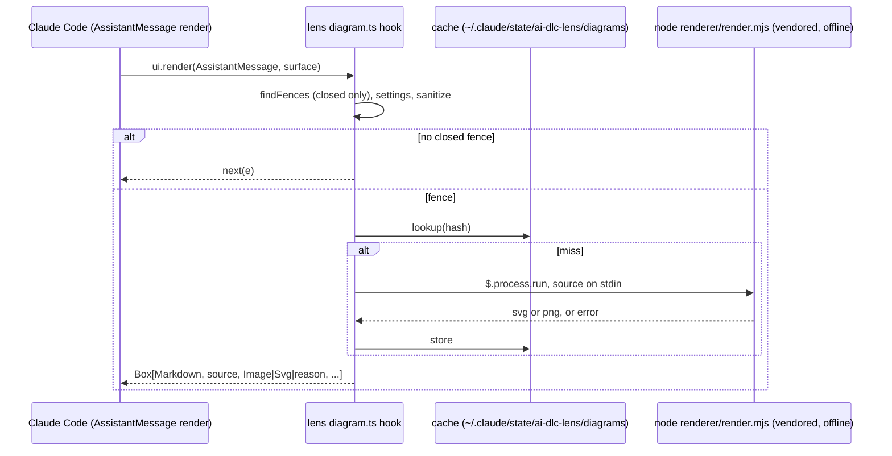

# Spec: the lens diagramming submodule (root 20, P2, sprint stretch)

This spec synthesises the G1-approved stories, deep dive 14.1.15, spike 20.1.1 and human decision 20, which says to render offline only, in the order Mermaid, then math, then PlantUML. The stories file stays the source of each AC's wording.

## Overview

Mermaid, math and PlantUML fences in an assistant reply are shown today as raw text. The lens will draw each closed fence as a picture on the user's machine, with no network, and keep the source visible. Anything that cannot be drawn falls back to the source with a one-line reason.

## Spike results that bind this spec (20.1.1)

- **Splitting a reply works.** A `ui.render` hook on `AssistantMessage` can split one block's text on a closed fence and return `Markdown`, then a picture, then `Markdown`. The stored message is unchanged. This is mermaid-inline's approach. A fence split across two blocks cannot be handled.
- **Rendering needs a child process.** The hooks module cannot load npm packages, so the renderer runs in a separate process.
- **Surfaces.**
  - `terminal`: `Image` only, PNG of at most 2 MiB. Pixels show only in kitty, Ghostty and iTerm2 3.5+; other terminals show the `alt` text.
  - `desktop`, `vscode`, `mobile`: `Svg`, at most 131,072 characters, with `alt` required.
- **Licences.**
  - beautiful-mermaid: MIT. It needs no DOM and draws flowchart, state, sequence, class, ER and XY charts.
  - ELK.js: EPL-2.0.
  - @resvg/resvg-js: MPL-2.0, with a prebuilt native module per platform.
  - MathJax: Apache-2.0.
  - PlantUML: GPL. The user supplies the jar, so nothing is bundled.
- **The math reference is "LaTeX Inline"**, which mermaid-inline credits, not "claude-latex".
- **Still open:** the claude-code-figures NOTICE (checked in ITEM-056). Bundle sizes are no longer open: spike 20.1.5 measured them (below).

## Sprint scope (human, 2026-10-25)

- **Sprint 1:** ITEM-052, ITEM-053 (Mermaid, with the PNG rasteriser and the font of ITEM-053.a) and ITEM-056, which now covers the notices of 053 only.
- **Sprint 2 (deferred):** ITEM-054 (math, MathJax) and ITEM-055 (PlantUML). ITEM-075 holds their notices. Their ACs (US-20.2, US-20.3), D3's math and PlantUML parts, D6's `diagramMath`, `diagramPlantuml`, `plantumlJar` and `javaPath`, and the math and PlantUML rows of D5's sanitiser stay in this spec as the sprint-2 design, and are not built in sprint 1.
- **Sprint-1 fence kinds.** Only `mermaid` fences render. `findFences` still classifies every kind of the *Terms*; in sprint 1 a math, TeX-diagram or PlantUML fence gets `next(e)` behaviour for its segment: its source is shown as today, with no reason line and no render.
- **Carried to sprint 2.** The spike found that `mathjax-full` 3.2.2 throws on simple input in Node 24 (`@mathjax/src` 4.1.3 untried), and that this machine has no Java: both are ITEM-054 and ITEM-055 work.

## Spike results that bind this spec (20.1.5, T20.3a)

- **Rasteriser.** `@resvg/resvg-wasm` 2.6.2 (MPL-2.0), one wasm for every platform, loads and renders offline. It is the rasteriser; the `@resvg/resvg-js` fallback of D3 is dropped.
- **Flatten step (Finding A).** beautiful-mermaid's SVG uses CSS `var()` and `color-mix()`, which resvg cannot resolve, so every shape draws black. Before rasterising, the renderer flattens the SVG: it resolves the custom properties and `color-mix(in srgb, …)` to plain colours, and passes explicit colours (`bg`, `fg`, `line`, `accent`, `muted`, `surface`, `border`) to `renderMermaidSVG`.
- **Google Fonts import (Finding B).** Every beautiful-mermaid SVG carries `@import url('https://fonts.googleapis.com/css2?family=Inter…')` in its `<style>`. The output scrub removes it on every surface, the Svg ones included, since a host drawing the Svg could fetch it.
- **Font.** Inter Regular, SIL OFL-1.1, about 342 KB, bundled under `renderer/vendor/fonts/` with its OFL text and loaded with system fonts off. Bold is not bundled.
- **Size.** The sprint-1 `renderer/` measures 4.75 MB unpacked (with Bold), under the 15 MB threshold of OQ3; MathJax in sprint 2 brings it to about 6.6 MB.
- **Licences found.** All inside the list, except `entities` 7.0.1, BSD-2-Clause, of which esbuild bundles 7,149 bytes into `vendor/mermaid.mjs` (a dependency of beautiful-mermaid). The human accepted it (OQ3). `elkjs` is used under EPL-2.0 (0.12.0 offers EPL-2.0 or GPL-3.0-or-later; beautiful-mermaid pins 0.11.1, EPL-2.0).
- **Not measured.** The PlantUML security profile (LLD 3.2) moves to sprint 2 with ITEM-055.

## Acceptance criteria → design

| AC | Design | Item |
|---|---|---|
| AC-20.1.1, 20.1.2 | D1 placement (after its fence; OQ1 closed at G2), D4 surface formats | ITEM-053 (ITEM-052 hook) |
| AC-20.1.3, 20.1.4 | D2 (fences in order; no fence means `next()` untouched) | ITEM-052 |
| AC-20.1.5 | D3 beautiful-mermaid kinds (the floor holds; XY is an extra) | ITEM-053 |
| AC-20.2.1-20.2.3 | D2 classification, D3 MathJax | ITEM-054 (sprint 2) |
| AC-20.3.1-20.3.3 | D3 PlantUML, D6 path trust | ITEM-055 (sprint 2) |
| AC-20.4.1-20.4.3 | D2 closed fences only | ITEM-052 |
| AC-20.5.1-20.5.3 | D5 offline (sprint 1: the Mermaid rows) | ITEM-053 |
| AC-20.5.4 | D5 output scrub (CSS `@import` and remote `url()` removed; zero network attempts for a PNG and an Svg; spike 20.1.5 Finding B) | ITEM-053 |
| AC-20.6.1-20.6.4 | D4 caps, D7 fallback | ITEM-053 |
| AC-20.9.1a, 20.9.2a (sprint 1) | D6 settings, `diagramMermaid` only; deferred kinds drawn as `next(e)` (*Sprint-1 fence kinds*) | ITEM-052, ITEM-053 |
| AC-20.9.1, 20.9.2 (sprint 2) | D6 settings, all rows | ITEM-054, ITEM-055 |
| AC-20.7.1a (sprint 1: exactly the ITEM-056 list of D8) | D8 notices, sprint 1 | ITEM-056 |
| AC-20.7.1-20.7.3 | D8 notices | ITEM-056 (sprint 1: 053's); ITEM-075 (sprint 2: 054's and 055's) |
| AC-20.8.1 | manual check (`MANUAL-CHECKS.md`) | ITEM-053 |

**AC clarified (po accepted OQ2, 2026-10-24; main ruled it a clarification within the story).** For build and test, this wording replaces the stories' wording.
- **AC-20.3.2** Given no configured `plantumlJar`, or no Java found (no `javaPath` is set and there is no `java` on PATH), when a `plantuml` fence renders, then the source is shown with a one-line notice that names what is missing (the jar, or Java) and how to configure it, and no render is attempted.

**AC wordings, OQ1 resolved at G2 (human, 2026-10-24, `run.v3.md`): the picture goes after its fence.** These are the binding wordings for build and test, and they replace "beneath the reply" in the stories. `requirement-analyst` updates the stories to match.

| AC | Binding wording |
|---|---|
| AC-20.1.1 | …then a PNG picture of it is shown **directly after the fence's source**, and the source is still shown |
| AC-20.1.2 | the same with an Svg picture, directly after the fence's source |
| AC-20.1.3 | three pictures, each directly after its own fence |
| AC-20.2.1 | the formula picture directly after its block |
| AC-20.3.1 | the PlantUML picture directly after its fence |

## Design (high level)

- **D1 Hook and placement.** A new `ui.render` hook on `AssistantMessage` in the lens. It is a separate handler with its own module, `hooks/diagram.ts`, and it shares nothing with the Pane hooks.
  - **No fence.** When the block has no closed diagram fence, the hook returns `next(e)` unchanged (AC-20.1.4).
  - **Fences.** Otherwise it returns a `Box` that holds, for each fence in order, the text before it as `Markdown`, then the fence source as `Markdown`, then the picture or the reason line. It ends with the remaining text.
  - **Placement (G2, OQ1 resolved).** Each picture sits **right after its own fence**, and the fence's source stays shown above the picture. There is one layout only: no picture is drawn beneath the reply, and no layout setting exists.
- **D2 Fence finder (pure).** `findFences(text)` returns a list of text segments and fence segments, each fence with `{ kind: 'mermaid' | 'math' | 'texDiagram' | 'plantuml', source, closed }`. It follows the *Terms*:
  - **Tags.** `mermaid`; `math`; `latex` and `tex`, which are math unless the body holds a TeX-document marker; `tikz`, which is always a TeX diagram; `plantuml` and `puml`; and the display-math blocks `$$…$$` and `\[…\]`.
  - **Open fences.** A fence with no closing delimiter in this block is `closed: false`. It is never rendered and shows no reason. While the reply streams, an open fence is just text. Once the reply is finished, it is shown as source only (AC-20.4.x).
  - **TeX diagrams.** These get no picture, only the reason "TeX diagrams are not supported" (AC-20.2.2).
- **D3 Renderer process (ADR-0005).** One renderer script, `plugins/claude/ai-dlc-lens/renderer/render.mjs`, together with a **vendored, pre-built bundle** of its JS dependencies under `renderer/vendor/`: in sprint 1 beautiful-mermaid with ELK.js, `@resvg/resvg-wasm` and the Inter font; MathJax with SVG output joins in sprint 2 (ITEM-054). Nothing is installed at runtime.
  - **How it runs.** The hook calls `$.process.run(['node', render.mjs, --kind, --format])` with the source on stdin and reads the SVG or PNG from stdout. This is the same mechanism keep-alive uses (`$.process.run`).
  - **Without `node`.** When `node` is not on PATH, the result is the source with the reason `diagram renderer needs node on PATH`.
  - **Mermaid** becomes SVG through beautiful-mermaid. It covers flowchart, sequence, class, state and ER, plus XY (AC-20.1.5). Any other kind (gantt, pie, mindmap, journey and the like) is detected from the first keyword. It gets the source and the reason `mermaid diagram type "<x>" is not supported offline`, and the renderer is not run. A test row covers this.
  - **Math** becomes SVG through MathJax `tex2svg`.
  - **PlantUML** runs `java -jar <jar> -tsvg -pipe` with the security profile that blocks includes and URLs. The profile name and its effect are **CONDITIONAL**: ITEM-055 verifies them in sprint 2 (spike 20.1.5 did not measure the profile; ITEM-053.a is closed), and if no such profile exists, the renderer removes `!include` and URL lines before the call and reports that it did so.
  - **The PNG rasteriser (decided by spike 20.1.5).**
    - `@resvg/resvg-wasm` 2.6.2, MPL-2.0: one wasm file for every platform, so the plugin ships no native binaries. It is loaded from `renderer/vendor/` with no network.
    - **Flatten before rasterising.** The renderer resolves CSS custom properties (`var()`) and `color-mix(in srgb, …)` in the SVG to plain colours, and replaces its `<style>` block with a local font-family rule, before handing it to resvg. Without this step every shape draws black. The flatten step is a pure function with its own test rows; the LLD names it.
    - Bundle sizes are recorded in the LLD from the spike.
    - **Font.** Inter Regular (OFL-1.1), bundled under `renderer/vendor/fonts/` with `OFL.txt`, loaded with system fonts off and Inter as the default family. D8 gives it a notice entry. When text cannot be drawn, for example because the font failed to load, no picture is shown: the fence's source stays, with the one-line reason `diagram text could not be rendered (no font)` (the LLD's `noFont`, LLD 3.1).
  - **Cache.** Results are cached by hash of the kind, the source, the format and the renderer version under `~/.claude/state/ai-dlc-lens/diagrams/`, with a size bound fixed in the LLD. The same fence on the next render does not run the process again.
  - **Async rendering, with a fixed guarantee.** A render never blocks for longer than `RENDER_WAIT_MS`, an LLD parameter of at most 300 ms.
    - **Cache hit, or a process done in time.** The picture is drawn in this render.
    - **Otherwise.** This render shows the source and a `rendering…` line. When the process finishes, the hook asks the host to draw the message again, **once** per fence result. The LLD names the host's redraw call from the types, taking mermaid-inline's handling as prior art. If the types offer no redraw call, the picture appears on the next render the host makes for its own reasons. That fallback is CONDITIONAL, and it is the documented limitation in that case.
- **D4 Surfaces and caps.** On every render the hook picks `Image` or `Svg` from the surface's element table (`$.ui.resolve(e)`), not from the surface name, so a future surface is covered too.
  - The terminal gets an `Image` holding a PNG. Every other surface gets an `Svg`. The stories name desktop and VS Code; the spike adds mobile.
  - An SVG over 131,072 characters, or a PNG over 2 MiB, gives no picture. The source then gets a one-line reason that names the cap (AC-20.6.1, 20.6.3).
  - `alt` is always set to the diagram kind and its first line.
- **D5 Offline (human decision 20).**
  - **No network at all.** No code in the hook or the renderer opens a socket. There is no setting for a renderer URL or host, and the vendored bundles are built with no network fallbacks.
  - **Sources are cleaned before rendering**, by a new pure function `sanitiseSource(kind, source)` in `diagram.ts`. The stories cite the lens's `classify` (`avatar.ts`) for AC-20.5.3. That function classifies one avatar setting value and cannot clean text, so this spec corrects the reference. Removals add one note under the picture, `removed N remote reference(s)` (one note per fence, `N` the forms removed; AC-20.5.3, LLD), and the diagram still renders. It is a note, not a reason line: a reason line replaces a picture that was not drawn. What it removes, by kind:
    - **PlantUML:** `!include`, `!includeurl` and `!import` of a URL; ``; `sprite` definitions loaded from a URL; `!theme … from <url>`.
    - **Mermaid:** `click` lines that open a URL, with the `href` keyword and without it (AC-20.5.3); `` in labels; `` in labels.
    - **Math:** `\href`, `\url` and `\includegraphics`.
    The pure-seam table has one row for each pattern.
  - **Output is cleaned after rendering.** Each SVG is post-filtered to drop any `href` or `xlink:href` that is not a fragment or a `data:` URI, and any CSS `@import` or `url(...)` that is not a fragment or a `data:` URI, which removes the `fonts.googleapis.com` import beautiful-mermaid emits (spike 20.1.5, Finding B; AC-20.5.4). This runs for every surface, Svg and PNG alike, in two places (critique 20.1.l3.1, Major 1): for a PNG, `render.mjs` scrubs the SVG itself before it rasterises it, because the hook receives only the finished PNG; for an Svg, the hook's scrub runs on the body it draws. The LLD names both functions and their tests (the PNG half of AC-20.5.4 is a `tests/lens-renderer/` test).
  - **Scope of the guarantee.** It covers the lens's code and its vendored bundles. The PlantUML jar is the user's own program, and running it is the user's trust decision, gated by the path trust rule (D6). The security profile, or the include stripping, limits what the jar is asked to fetch.
  - **Proof.** AC-20.5.1 is proved by a test that stubs the process call and the network and records every attempt, and by a renderer test that replaces `globalThis.fetch` with one that throws (the spike's method). A renderer test asserts that no SVG it outputs contains `@import` or `fonts.googleapis.com`.
  - **AC-20.5.2, one host list and one file set** (critique 20.1.l3.1, Major 6; the stories and the LLD use the same):
    - **Hosts:** `kroki`, `plantuml.com`, `mermaid.ink`, `fonts.googleapis.com`.
    - **Files searched:** the lens's code only, `plugins/claude/ai-dlc-lens/hooks/**/*.ts` and `*.tsx`, and `plugins/claude/ai-dlc-lens/renderer/*.mjs`, which includes `render.mjs`, the flatten step and the renderer-side scrub.
    - **Not searched:** `renderer/vendor/`, every test, and non-code files (`NOTICE.md`, `ATTRIBUTION.md`, READMEs), which may name a host legitimately.
    - **Comments count.** No host literal may appear anywhere in the searched files, comments included. The scrubs match `@import` and non-fragment `url(` generically and never name a host.
    - **And:** the lens settings `SPEC` has no key naming a renderer URL or host.
- **D6 Settings (Q20-6).** These follow the lens's pattern in `settings.ts`: a key in `.ai-dlc/lens.json` plus an `AI_DLC_LENS_*` variable. **Sprint 1 builds only the `diagramMermaid` row**; the other four rows come with ITEM-054 and ITEM-055 in sprint 2.

  | Key | Variable | Default | Notes |
  |---|---|---|---|
  | `diagramMermaid` | `AI_DLC_LENS_DIAGRAM_MERMAID` | `true` | |
  | `diagramMath` | `AI_DLC_LENS_DIAGRAM_MATH` | `true` | |
  | `diagramPlantuml` | `AI_DLC_LENS_DIAGRAM_PLANTUML` | `true` | Takes effect only with a jar |
  | `plantumlJar` | `AI_DLC_LENS_PLANTUML_JAR` | unset | Trust-gated path |
  | `javaPath` | `AI_DLC_LENS_JAVA` | `java` on PATH | Trust-gated path |

  - **Turning a kind off** draws its fences exactly as they are without the submodule, with no reason line (AC-20.9.2).
  - **A path outside the trusted folders, or a path that does not exist,** is never run. The fence shows the source with a reason (AC-20.3.3). The trust check uses `trustedFolders` and `isInside` from `avatar.ts`.
  - **No jar configured** gives the configure notice, and no render is attempted (AC-20.3.2). This is intended with the default on: the notice tells a user without a jar how to get PlantUML pictures. It is shown once per message, never once per fence. A user who does not want it sets `diagramPlantuml: false`.
- **D7 Fallback (AC-20.6.x).**
  - **A renderer error** (non-zero exit, or a parse error on stderr) gives the source and one line of reason. The other fences are not affected.
  - **The hook throws.** If the hook itself throws, it returns `next(e)`, so the message falls back to its native drawing, as the lens's `ToolUse` hook does.
  - **What the user sees.** Never a stack trace; reasons are one line, at most 120 characters.
- **D8 Notices (ITEM-056 in sprint 1; ITEM-075 in sprint 2).** `THIRD_PARTY_NOTICES.md` gets one entry for each upstream whose code or idea is actually reused, and one for each vendored component. The entries follow the file's existing format, and each includes the full licence text. Each entry for a package under EPL-2.0 or MPL-2.0 (sprint 1: elkjs 0.11.1 and `@resvg/resvg-wasm` 2.6.2) also carries a line `Source code: <repository URL> (tag <upstream tag name>)`, the tag named as upstream names it (research 17.1.48: elkjs tags have no `v`, resvg-js tags do), because both licences require the source to be made available for a minified or compiled copy, not only the licence text (research 17.1.43; AC-20.7.1a, stories rev 7). Expected for elkjs: "The bundled renderer includes elkjs, distributed in minified form under the Eclipse Public License 2.0. Source code: https://github.com/kieler/elkjs (tag 0.11.1)." elkjs is offered as EPL-2.0 OR GPL-3.0-or-later; the lens takes EPL-2.0. The `@resvg/resvg-wasm` line takes the same form, `Source code: https://github.com/yisibl/resvg-js (tag v2.6.2)` (research 17.1.48; that repository builds the wasm package, but whether the tag holds all of the wasm's source is unverified, and ITEM-056 checks it). These are the expected values, not fixed ones (AC-20.7.1a, stories rev 8): ITEM-056 takes each URL from the bundled package's `package.json` `repository` field and the tag as upstream names it, with or without a `v`, and the tester checks that the tag exists upstream.
  - **ITEM-056 (sprint 1):** beautiful-mermaid (MIT), ELK.js (`elkjs`, EPL-2.0), `entities` (BSD-2-Clause, bundled inside `vendor/mermaid.mjs`), `@resvg/resvg-wasm` (MPL-2.0) and the Inter font (OFL-1.1), plus mermaid-inline for the split-render approach.
  - **ITEM-075 (sprint 2):** MathJax (Apache-2.0) and LaTeX Inline, with ITEM-054; PlantUML still gets no entry (not bundled), with ITEM-055.
  - mermaid-inline (sprint 1) and LaTeX Inline (sprint 2) are credited for the split-render approach. LaTeX Inline replaces the stories' "claude-latex": the spike found no project by that name, and mermaid-inline credits LaTeX Inline as its math source.
  - diagram-pane, show-me and archpane get **no entry**. No code or idea of theirs is reused, because this design draws inline in the reply and none of them does. AC-20.7.1 asks only for upstreams that are actually reused.
  - The bundled font, Inter Regular (OFL-1.1, "Copyright 2020 The Inter Project Authors"), gets an entry with the OFL text.
  - A claude-code-figures entry, with its NOTICE, is added only if its idea is used. The source repository (`github.com/natsukium/claude-code-figures-plugin`, per 14.1.15) and its NOTICE are checked in ITEM-056, which decides at build time whether its idea is reused and records that decision, with the reason, in its hand-back, so the notice list is exact for what ships (AC-20.7.1a, stories rev 9). PlantUML gets no entry, because it is not bundled.
  - ITEM-056 **creates** `plugins/claude/ai-dlc-lens/hooks/ATTRIBUTION.md`, which does not exist yet, and records the change in it. The lens's `NOTICE.md` already refers to that file. This follows `ai-dlc/hooks/auto-handoff/ATTRIBUTION.md`.
  - `plugin validate` and `plugin test` for the lens must pass.

## Component boundaries

| Part | Owner |
|---|---|
| Hook, fence finder, tree builder, caps, source sanitising, the Svg output scrub, settings reads | new `plugins/claude/ai-dlc-lens/hooks/diagram.ts`, registered from `hooks/register.tsx` |
| Settings keys | `plugins/claude/ai-dlc-lens/hooks/settings.ts` and its lens schema |
| Renderer process and vendored bundles | new `plugins/claude/ai-dlc-lens/renderer/` (`render.mjs`, the flatten step and the PNG-side scrub, `vendor/`, a build note naming how the vendor bundle is made, with the esbuild metafile package list as the licence inventory) |
| Notices | `THIRD_PARTY_NOTICES.md` (repository root), `plugins/claude/ai-dlc-lens/hooks/ATTRIBUTION.md` |
| Manual check | `plugins/claude/ai-dlc-lens/MANUAL-CHECKS.md` |
| Copilot | none: the lens is Claude-only (`tools/claude-only-plugins.json`) |

Merge group LENS, one merge at a time: 053 → 056 in sprint 1; 054 → 055 → 075 in sprint 2. The lens has one merge lane (the human, run.v4.md 2e and 2f; `docs/plans/tier-1-sprint-1.tasks.md`:290, :309): root 22 (Cache Lab) merges fully first, then root 20 (053, then 056). A lens change in root 18 (039, 041, 043) is a different file, `lens.ts`, but the same plugin, so it also merges one at a time in that lane; its place in the lane is the plan's, not this spec's.

## Data shapes

There is no request or response API, so the `{ data, error }` envelope does not apply to the hook. The renderer process's stdout is its own protocol, and it uses the envelope: `{ "data": { "format": "svg" | "png", "body": "<svg…>" | "<base64>" }, "error": null }` or `{ "data": null, "error": "<one-line reason>" }`.

- `Fence = { kind: 'mermaid' | 'math' | 'texDiagram' | 'plantuml'; source: string; closed: boolean; start: number; end: number }`.
- `Segment = { text: string } | { fence: Fence }`.

The LLD fixes the exact CLI arguments, the cache key and the bound.

## Test seams

- **Existing, primary:** the lens tests (`plugins/claude/ai-dlc-lens/tests/lens.test.tsx` style), which render `ui.render` element trees with a stubbed `$.process.run`. They cover:
  - every `[PT]` AC: tree shape, order and placement (after its fence);
  - surface formats and caps;
  - fallbacks and settings;
  - the network stub recording no attempts (AC-20.5.1).
- **New pure seam:** `findFences` and the sanitiser in `diagram.ts`, tested on their own. They cover the *Terms* table, open and closed fences, and the TeX-diagram markers.
- **New renderer seam:** `node --test` tests under `tests/lens-renderer/` (repository root, never shipped) run `render.mjs` on one Mermaid fixture of each supported kind (math and PlantUML fixtures join in sprint 2). They check that the SVG is well-formed, carries no `@import` or remote URL, that a bad source gives `error`, that the PNG starts with the PNG signature, and that the flattened SVG holds no `var(` or `color-mix(`. The rasteriser is chosen (spike 20.1.5), so the PNG tests are not skipped.
- **`[BV]`:** the AC-20.5.2 search, and lens `validate` / `test`.
- **`[MV]`:** AC-20.8.1 on each surface.

## Out of scope

As the stories:
- remote renderers;
- `Read` results;
- TeX diagrams;
- tool-drawn diagrams.

Also out of scope:
- a fence split across two `AssistantMessage` blocks. It is shown as source only, because the spike says it cannot be handled.
- interactive SVG (`isInteractive`).

## Open questions

- **OQ1 (closed at G2, 2026-10-24).** The human chose to put the picture after its fence. The `belowReply` layout and the `diagramLayout` setting are removed: a setting with a single value would be dead configuration (YAGNI).
- **OQ2 (po, accepted 2026-10-24; AC-20.3.2 restated above).** For PlantUML, `plantumlJar` is required, and `javaPath` defaults to `java` on PATH. Story AC-20.3.2 reads "no configured Java or jar". Default: a jar must be configured, and Java may come from PATH.
- **OQ3 (answered by the human, 2026-10-25).** Vendoring pre-built renderer bundles into the lens plugin is accepted. The allowed licences are **MIT, EPL-2.0, Apache-2.0, MPL-2.0, BSD-2-Clause** (added for `entities`, accepted by the human on the spike 20.1.5 result) and the font's **OFL-1.1**, with the notices shipped (D8). The 15 MB unpacked ceiling for `renderer/` stays; the spike measured 4.75 MB with Inter Bold, about 4.4 MB without it, as bundled (LLD; Bold is not bundled). A later bundle that brings another licence, or passes 15 MB, goes back to the human with the numbers.

## ADRs

- `docs/architecture/decisions/ADR-0005-offline-diagram-rendering-in-a-child-process.md`

## Docs update

`plugins/claude/ai-dlc-lens/README.md` gets a new diagramming section covering the sprint-1 stories (Mermaid) and the D6 settings built in sprint 1 (`diagramMermaid`). Status: *planned*. It turns *in progress* when ITEM-053 starts. Math and PlantUML are described only when ITEM-054 and ITEM-055 are built (sprint 2).

## Review status

- 17.1.40 (rev 4.1, software-architect), gate critique 20.1.l3.2: Blocker 1 (merge order: one lens lane, root 22 fully first, then root 20, 053 then 056; the "20, 22, 24-27" order dropped), Minor 1 (the output scrub cites AC-20.5.4), Minor 9 (the size in OQ3; ADR-0005 cross-links ADR-0006), and the critique's Unverified 1 through research 17.1.43 (D8 `Source code:` line, matching AC-20.7.1a, stories rev 7). The other findings are LLD and stories fixes (system-engineer 17.1.41, requirement-analyst 17.1.39).
- 17.1.45 (rev 4.2), gate critique 20.1.l3.3: Minor 5 (D5: the `removed N` text is a note under the picture), D8 tag names as upstream has them (research 17.1.48), Mermaid `click` with and without `href` (AC-20.5.3).
- 17.1.56 (rev 4.3), gate critique 20.1.l3.5: Minor 3 (D8: ITEM-056 records in its hand-back whether claude-code-figures is reused, as AC-20.7.1a).
