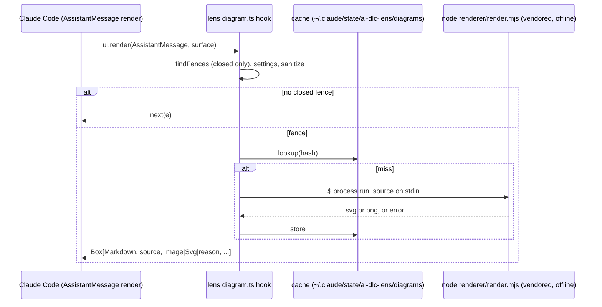

# Spec: the lens diagramming submodule (root 20, P2, sprint stretch)

This spec synthesises the G1-approved stories, deep dive 14.1.15, spike 20.1.1 and human decision 20, which says to render offline only, in the order Mermaid, then math, then PlantUML. The stories file stays the source of each AC's wording.

## Overview

Mermaid, math and PlantUML fences in an assistant reply are shown today as raw text. The lens will draw each closed fence as a picture on the user's machine, with no network, and keep the source visible. Anything that cannot be drawn falls back to the source with a one-line reason.

## Spike results that bind this spec (20.1.1)

- **Splitting a reply works.** A `ui.render` hook on `AssistantMessage` can split one block's text on a closed fence and return `Markdown`, then a picture, then `Markdown`. The stored message is unchanged. This is mermaid-inline's approach. A fence split across two blocks cannot be handled.
- **Rendering needs a child process.** The hooks module cannot load npm packages, so the renderer runs in a separate process.
- **Surfaces.**
  - `terminal`: `Image` only, PNG of at most 2 MiB. Pixels show only in kitty, Ghostty and iTerm2 3.5+; other terminals show the `alt` text.
  - `desktop`, `vscode`, `mobile`: `Svg`, at most 131,072 characters, with `alt` required.
- **Licences.**
  - beautiful-mermaid: MIT. It needs no DOM and draws flowchart, state, sequence, class, ER and XY charts.
  - ELK.js: EPL-2.0.
  - @resvg/resvg-js: MPL-2.0, with a prebuilt native module per platform.
  - MathJax: Apache-2.0.
  - PlantUML: GPL. The user supplies the jar, so nothing is bundled.
- **The math reference is "LaTeX Inline"**, which mermaid-inline credits, not "claude-latex".
- **Still open:** the claude-code-figures NOTICE, and bundle sizes.

## Acceptance criteria → design

| AC | Design | Item |
|---|---|---|
| AC-20.1.1, 20.1.2 | D1 placement (**G2 question**, OQ1), D4 surface formats | 053 |
| AC-20.1.3, 20.1.4 | D2 (fences in order; no fence means `next()` untouched) | 053 |
| AC-20.1.5 | D3 beautiful-mermaid kinds (the floor holds; XY is an extra) | 053 |
| AC-20.2.1-20.2.3 | D2 classification, D3 MathJax | 054 |
| AC-20.3.1-20.3.3 | D3 PlantUML, D6 path trust | 055 |
| AC-20.4.1-20.4.3 | D2 closed fences only | 053 |
| AC-20.5.1-20.5.3 | D5 offline | 053, 054, 055 |
| AC-20.6.1-20.6.4 | D4 caps, D7 fallback | 053 |
| AC-20.9.1, 20.9.2 | D6 settings | 053, 054, 055 |
| AC-20.7.1-20.7.3 | D8 notices | 056 |
| AC-20.8.1 | manual check (`MANUAL-CHECKS.md`) | 053 |

**AC clarified (po accepted OQ2, 2026-10-24; main ruled it a clarification within the story).** For build and test, this wording replaces the stories' wording.
- **AC-20.3.2** Given no configured `plantumlJar`, or no Java found (no `javaPath` is set and there is no `java` on PATH), when a `plantuml` fence renders, then the source is shown with a one-line notice that names what is missing (the jar, or Java) and how to configure it, and no render is attempted.

**AC wordings for OQ1 (both PENDING G2).** The G2 answer picks one wording, and the tree-shape test rows of these ACs follow it. Under either answer, every other part of the ACs, and every other test, stays the same.

| AC | (A) default: after its fence | (B) fallback: beneath the reply |
|---|---|---|
| AC-20.1.1 | …then a PNG picture of it is shown **directly after the fence's source**, and the source is still shown | …then a PNG picture of it is shown **beneath the reply**, and the source is still shown (as in the stories) |
| AC-20.1.2 | the same with an Svg picture, directly after the fence's source | the same with an Svg picture, beneath the reply |
| AC-20.1.3 | three pictures, each directly after its own fence | three pictures beneath the reply, in fence order |
| AC-20.2.1 | the formula picture directly after its block | the formula picture beneath the reply |
| AC-20.3.1 | the PlantUML picture directly after its fence | the PlantUML picture beneath the reply |

## Design (high level)

- **D1 Hook and placement.** A new `ui.render` hook on `AssistantMessage` in the lens. It is a separate handler with its own module, `hooks/diagram.ts`, and it shares nothing with the Pane hooks.
  - **No fence.** When the block has no closed diagram fence, the hook returns `next(e)` unchanged (AC-20.1.4).
  - **Fences.** Otherwise it returns a `Box` that holds, for each fence in order, the text before it as `Markdown`, then the fence source as `Markdown`, then the picture or the reason line. It ends with the remaining text.
  - **Placement.** The spike shows that a picture can sit **right after its own fence**, not only at the end of the reply. The stories say "beneath the reply", and they also say that `po` raises in-place placement at G2 if the spike allows it.
    - Default: right after the fence, with the source still shown above the picture.
    - Fallback: all pictures beneath the reply, in fence order.
    - Both are one layout setting in the LLD's renderer of the tree, so the G2 answer changes no other design element.
    - The two layouts differ only for AC-20.1.1-20.1.3. Those ACs get one wording per answer (OQ1).
- **D2 Fence finder (pure).** `findFences(text)` returns a list of text segments and fence segments, each fence with `{ kind: 'mermaid' | 'math' | 'texDiagram' | 'plantuml', source, closed }`. It follows the *Terms*:
  - **Tags.** `mermaid`; `math`; `latex` and `tex`, which are math unless the body holds a TeX-document marker; `tikz`, which is always a TeX diagram; `plantuml` and `puml`; and the display-math blocks `$$…$$` and `\[…\]`.
  - **Open fences.** A fence with no closing delimiter in this block is `closed: false`. It is never rendered and shows no reason. While the reply streams, an open fence is just text. Once the reply is finished, it is shown as source only (AC-20.4.x).
  - **TeX diagrams.** These get no picture, only the reason "TeX diagrams are not supported" (AC-20.2.2).
- **D3 Renderer process (ADR-0005).** One renderer script, `plugins/claude/ai-dlc-lens/renderer/render.mjs`, together with a **vendored, pre-built bundle** of its JS dependencies (beautiful-mermaid with ELK.js, MathJax with SVG output) under `renderer/vendor/`. Nothing is installed at runtime.
  - **How it runs.** The hook calls `$.process.run(['node', render.mjs, --kind, --format])` with the source on stdin and reads the SVG or PNG from stdout. This is the same mechanism keep-alive uses (`$.process.run`).
  - **Without `node`.** When `node` is not on PATH, the result is the source with the reason `diagram renderer needs node on PATH`.
  - **Mermaid** becomes SVG through beautiful-mermaid. It covers flowchart, sequence, class, state and ER, plus XY (AC-20.1.5). Any other kind (gantt, pie, mindmap, journey and the like) is detected from the first keyword. It gets the source and the reason `mermaid diagram type "<x>" is not supported offline`, and the renderer is not run. A test row covers this.
  - **Math** becomes SVG through MathJax `tex2svg`.
  - **PlantUML** runs `java -jar <jar> -tsvg -pipe` with the security profile that blocks includes and URLs. The profile name and its effect are **CONDITIONAL**: ITEM-053.a verifies them, and if no such profile exists, the renderer removes `!include` and URL lines before the call and reports that it did so.
  - **The PNG rasteriser is CONDITIONAL on ITEM-053.a.**
    - The first choice is the WebAssembly build of resvg, from the same project and under the same MPL-2.0 licence. It is one file for every platform, so the plugin ships no native binaries.
    - ITEM-053.a, a build spike, confirms that the package exists, its licence, its size and that it works offline.
    - If it fails, the fallback is `@resvg/resvg-js` with prebuilt modules for each platform, vendored for the platforms in the spike list. On an unsupported platform the terminal shows the `alt` text with the reason `no PNG rasteriser for this platform`.
    - Bundle sizes are measured in 053.a and recorded in the LLD.
    - **Fonts.** A WebAssembly rasteriser has no system fonts, so without a bundled font every label would render blank. 053.a picks one font to bundle (an OFL or similarly permissive font), records its licence and size, and D8 gives it a notice entry. When text cannot be drawn, for example because the font failed to load, the terminal shows the `alt` text with the reason `diagram text could not be rendered (no font)`.
  - **Cache.** Results are cached by hash of the kind, the source, the format and the renderer version under `~/.claude/state/ai-dlc-lens/diagrams/`, with a size bound fixed in the LLD. The same fence on the next render does not run the process again.
  - **Async rendering, with a fixed guarantee.** A render never blocks for longer than `RENDER_WAIT_MS`, an LLD parameter of at most 300 ms.
    - **Cache hit, or a process done in time.** The picture is drawn in this render.
    - **Otherwise.** This render shows the source and a `rendering…` line. When the process finishes, the hook asks the host to draw the message again, **once** per fence result. The LLD names the host's redraw call from the types, taking mermaid-inline's handling as prior art. If the types offer no redraw call, the picture appears on the next render the host makes for its own reasons. That fallback is CONDITIONAL, and it is the documented limitation in that case.
- **D4 Surfaces and caps.** On every render the hook picks `Image` or `Svg` from the surface's element table (`$.ui.resolve(e)`), not from the surface name, so a future surface is covered too.
  - The terminal gets an `Image` holding a PNG. Every other surface gets an `Svg`. The stories name desktop and VS Code; the spike adds mobile.
  - An SVG over 131,072 characters, or a PNG over 2 MiB, gives no picture. The source then gets a one-line reason that names the cap (AC-20.6.1, 20.6.3).
  - `alt` is always set to the diagram kind and its first line.
- **D5 Offline (human decision 20).**
  - **No network at all.** No code in the hook or the renderer opens a socket. There is no setting for a renderer URL or host, and the vendored bundles are built with no network fallbacks.
  - **Sources are cleaned before rendering**, by a new pure function `sanitiseSource(kind, source)` in `diagram.ts`. The stories cite the lens's `classify` (`avatar.ts`) for AC-20.5.3. That function classifies one avatar setting value and cannot clean text, so this spec corrects the reference. Each removal adds one reason line, `removed N remote reference(s)`, and the diagram still renders. What it removes, by kind:
    - **PlantUML:** `!include`, `!includeurl` and `!import` of a URL; ``; `sprite` definitions loaded from a URL; `!theme … from <url>`.
    - **Mermaid:** `click … href` lines; `` in labels; `` in labels.
    - **Math:** `\href`, `\url` and `\includegraphics`.
    The pure-seam table has one row for each pattern.
  - **Output is cleaned after rendering.** Each SVG is post-filtered to drop any `href` or `xlink:href` that is not a fragment or a `data:` URI (AC-20.5.3).
  - **Scope of the guarantee.** It covers the lens's code and its vendored bundles. The PlantUML jar is the user's own program, and running it is the user's trust decision, gated by the path trust rule (D6). The security profile, or the include stripping, limits what the jar is asked to fetch.
  - **Proof.** AC-20.5.1 is proved by a test that stubs the process call and the network and records every attempt. AC-20.5.2 is proved by a search over `hooks/` and `renderer/*.mjs` (not `renderer/vendor/`) for `kroki`, `plantuml.com` and `mermaid.ink`.
- **D6 Settings (Q20-6).** These follow the lens's pattern in `settings.ts`: a key in `.ai-dlc/lens.json` plus an `AI_DLC_LENS_*` variable.

  | Key | Variable | Default | Notes |
  |---|---|---|---|
  | `diagramMermaid` | `AI_DLC_LENS_DIAGRAM_MERMAID` | `true` | |
  | `diagramMath` | `AI_DLC_LENS_DIAGRAM_MATH` | `true` | |
  | `diagramPlantuml` | `AI_DLC_LENS_DIAGRAM_PLANTUML` | `true` | Takes effect only with a jar |
  | `plantumlJar` | `AI_DLC_LENS_PLANTUML_JAR` | unset | Trust-gated path |
  | `javaPath` | `AI_DLC_LENS_JAVA` | `java` on PATH | Trust-gated path |
  | `diagramLayout` | `AI_DLC_LENS_DIAGRAM_LAYOUT` | `afterFence` (pending G2 OQ1; `belowReply` is the other value) | The G2 answer sets the default |

  - **Turning a kind off** draws its fences exactly as they are without the submodule, with no reason line (AC-20.9.2).
  - **A path outside the trusted folders, or a path that does not exist,** is never run. The fence shows the source with a reason (AC-20.3.3). The trust check uses `trustedFolders` and `isInside` from `avatar.ts`.
  - **No jar configured** gives the configure notice, and no render is attempted (AC-20.3.2). This is intended with the default on: the notice tells a user without a jar how to get PlantUML pictures. It is shown once per message, never once per fence. A user who does not want it sets `diagramPlantuml: false`.
- **D7 Fallback (AC-20.6.x).**
  - **A renderer error** (non-zero exit, or a parse error on stderr) gives the source and one line of reason. The other fences are not affected.
  - **The hook throws.** If the hook itself throws, it returns `next(e)`, so the message falls back to its native drawing, as the lens's `ToolUse` hook does.
  - **What the user sees.** Never a stack trace; reasons are one line, at most 120 characters.
- **D8 Notices (ITEM-056).** `THIRD_PARTY_NOTICES.md` gets one entry for each upstream whose code or idea is actually reused, and one for each vendored renderer: beautiful-mermaid, ELK.js, MathJax and the rasteriser. The entries follow the file's existing format, and each includes the full licence text.
  - mermaid-inline and LaTeX Inline are credited for the split-render approach. LaTeX Inline replaces the stories' "claude-latex": the spike found no project by that name, and mermaid-inline credits LaTeX Inline as its math source.
  - diagram-pane, show-me and archpane get **no entry**. No code or idea of theirs is reused, because this design draws inline in the reply and none of them does. AC-20.7.1 asks only for upstreams that are actually reused.
  - The bundled font (053.a) gets an entry with its licence.
  - A claude-code-figures entry, with its NOTICE, is added only if its idea is used. The source repository (`github.com/natsukium/claude-code-figures-plugin`, per 14.1.15) and its NOTICE are checked in ITEM-056. PlantUML gets no entry, because it is not bundled.
  - ITEM-056 **creates** `plugins/claude/ai-dlc-lens/hooks/ATTRIBUTION.md`, which does not exist yet, and records the change in it. The lens's `NOTICE.md` already refers to that file. This follows `ai-dlc/hooks/auto-handoff/ATTRIBUTION.md`.
  - `plugin validate` and `plugin test` for the lens must pass.

## Component boundaries

| Part | Owner |
|---|---|
| Hook, fence finder, tree builder, caps, sanitising, settings reads | new `plugins/claude/ai-dlc-lens/hooks/diagram.ts`, registered from `hooks/register.tsx` |
| Settings keys | `plugins/claude/ai-dlc-lens/hooks/settings.ts` and its lens schema |
| Renderer process and vendored bundles | new `plugins/claude/ai-dlc-lens/renderer/` (`render.mjs`, `vendor/`, a build note naming how the vendor bundle is made) |
| Notices | `THIRD_PARTY_NOTICES.md` (repository root), `plugins/claude/ai-dlc-lens/hooks/ATTRIBUTION.md` |
| Manual check | `plugins/claude/ai-dlc-lens/MANUAL-CHECKS.md` |
| Copilot | none: the lens is Claude-only (`tools/claude-only-plugins.json`) |

Merge group LENS, one merge at a time: 053 → 054 → 055 → 056. A lens change in root 18 (039, 041, 043) is a different file, `lens.ts`, but it is the same plugin. The two merge one at a time, root 20 first, as the lens order says (20, 22, 24-27).

## Data shapes

There is no request or response API, so the `{ data, error }` envelope does not apply to the hook. The renderer process's stdout is its own protocol, and it uses the envelope: `{ "data": { "format": "svg" | "png", "body": "<svg…>" | "<base64>" }, "error": null }` or `{ "data": null, "error": "<one-line reason>" }`.

- `Fence = { kind: 'mermaid' | 'math' | 'texDiagram' | 'plantuml'; source: string; closed: boolean; start: number; end: number }`.
- `Segment = { text: string } | { fence: Fence }`.

The LLD fixes the exact CLI arguments, the cache key and the bound.

## Test seams

- **Existing, primary:** the lens tests (`plugins/claude/ai-dlc-lens/tests/lens.test.tsx` style), which render `ui.render` element trees with a stubbed `$.process.run`. They cover:
  - every `[PT]` AC: tree shape, order and placement (both layouts);
  - surface formats and caps;
  - fallbacks and settings;
  - the network stub recording no attempts (AC-20.5.1).
- **New pure seam:** `findFences` and the sanitiser in `diagram.ts`, tested on their own. They cover the *Terms* table, open and closed fences, and the TeX-diagram markers.
- **New renderer seam:** `node --test` tests under `tests/lens-renderer/` (repository root, never shipped) run `render.mjs` on one fixture of each kind. They check that the SVG is well-formed and that a bad source gives `error`. These tests depend on ITEM-053.a and are **CONDITIONAL**: until the rasteriser is chosen, the PNG tests are skipped with a reason.
- **`[BV]`:** the AC-20.5.2 search, and lens `validate` / `test`.
- **`[MV]`:** AC-20.8.1 on each surface.

## Out of scope

As the stories:
- remote renderers;
- `Read` results;
- TeX diagrams;
- tool-drawn diagrams.

Also out of scope:
- a fence split across two `AssistantMessage` blocks. It is shown as source only, because the spike says it cannot be handled.
- interactive SVG (`isInteractive`).

## Open questions

- **OQ1 (G2, human; `po` raises it with the default below, and if the build proves the default impossible, the fallback applies).** Where does a picture go? It can go right after its own fence, with the source still shown above it, or beneath the whole reply. Default: right after its own fence, which the spike shows works. The answer changes only the layout setting and the wording of AC-20.1.1 to AC-20.1.3.
- **OQ2 (po, accepted 2026-10-24; AC-20.3.2 restated above).** For PlantUML, `plantumlJar` is required, and `javaPath` defaults to `java` on PATH. Story AC-20.3.2 reads "no configured Java or jar". Default: a jar must be configured, and Java may come from PATH.
- **OQ3 (G2, human).** Vendoring pre-built renderer bundles into the lens plugin, under MIT, EPL-2.0, Apache-2.0 and MPL-2.0 plus the font's licence, with the notices shipped. Default: accept, provided ITEM-053.a measures `renderer/` at **no more than 15 MB** unpacked and finds no licence beyond those named. Above 15 MB, or with another licence, the item goes back to the human with the numbers (brief §8 Q20a).

## ADRs

- `docs/architecture/decisions/ADR-0005-offline-diagram-rendering-in-a-child-process.md`

## Docs update

`plugins/claude/ai-dlc-lens/README.md` gets a new diagramming section covering US-20.1-20.6 and the settings of D6. Status: *planned*. It turns *in progress* when ITEM-053 starts.
