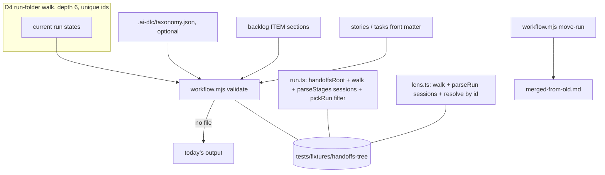

# Spec: a module taxonomy in the plugin (root 18)

This spec is a synthesis of the G1-approved stories, the deep dive 14.1.13 and the human's decision 18. The human decided that epics are folders, and that module, submodule, feature and integrations are front-matter tags. The stories file stays the source of each AC's wording.

## Overview

Nothing in the plugin groups work by module. Discovery reads only one level, so a run in a nested folder is never found (14.1.13 §1). This spec adds five things:

- an optional declaration file that is validated;
- four tags on run states, backlog items, stories and tasks;
- discovery of run folders at any depth, with run ids unique across the tree;
- a machine-readable sessions cell in the *Stages* table;
- a move rule that never breaks a record.

When a repository has no declaration, every reader behaves exactly as it does today.

## Acceptance criteria → design

| AC | Design | Item |
|---|---|---|
| AC-18.1.1, 18.1.2 | D1, D2 | 037 |
| AC-18.1.3 | D1: the template ships the schema only | 037 |
| AC-18.1.4 | D1: text in the `workflow` skill | 037 |
| AC-18.2.1, 18.2.3 | D2: no file, no tag checks | 037, 038 |
| AC-18.2.2 | D4, D5, D6: absent keys and cells parse as today | 038, 039, 041 |
| AC-18.3.1, 18.3.2 | D3: formats in `handoff`, `product-planning` and `task-triage` | 038, 042 |
| AC-18.3.3 | D2: tag checks | 038 |
| AC-18.3.4 | D3: readers | 038 |
| AC-18.4.1 | D3: `task-triage` columns and the `needs-info` rule | 042 |
| AC-18.5.1, 18.5.2 | D4 | 039 |
| AC-18.5.3 | D4: unique run ids in `validate` | 039 |
| AC-18.6.1, 18.6.2 | D7 | 040 |
| AC-18.7.1-18.7.3 | D5 | 041 |
| AC-18.8.1, 18.8.2 (re-tagged `[NT]`, po accepted OQ1) | D6: the `move-run` command | 043 |
| AC-18.8.3 | D6: resolution by run id | 043 |
| AC-18.9.1, 18.9.2 | D8 | 065 |
| AC-18.10.1 | D9 | 066 |
| AC-18.11.1, 18.11.2 | D10 | 044 |

**ACs restated: PENDING G2.** `po` accepted the change on 2026-10-24 (OQ4). It narrows the G1 stories, so only the human can approve it. It is on main's G2 list. If the human approves, `requirement-analyst` updates the stories, with a bc check, before the build. The restatement replaces the stories' "when `validate` runs" in four ACs: AC-18.3.3, 18.5.3, 18.9.2 and 18.11.2. With no declaration file, `--artefacts` runs **only** the unique-run-id check. That check does not depend on the taxonomy, so a flat tree with unique folder names gives today's output. Plain `validate` is always unchanged (AC-18.2.1). The checks run with `node .ai-dlc/workflow.mjs validate --artefacts`. Plain `validate` checks only the declaration file. CI runs `--artefacts` (`validate.yml`, ITEM-044.b), and so does `product-manager` after it writes the backlog, the stories, the tasks or the declaration.
- **AC-18.3.3** Given a declaration and a tagged artefact with an undeclared id, a submodule outside its module, or an open artefact with a required tag missing, when `validate --artefacts` runs, then it exits non-zero and names the path, the key and the id.
- **AC-18.5.3** Given two runs with the same folder name, when `validate --artefacts` runs, then it exits non-zero and names both paths.
- **AC-18.9.2** and **AC-18.11.2** As in the stories, with `validate --artefacts` in place of `validate`.

## Design (high level)

- **D1 Declaration home: `.ai-dlc/taxonomy.json` (Q18 decided, ADR-0003).**
  - **A separate file, optional, never installed by default.** The plugin ships `skills/workflow/templates/taxonomy.schema.json` and nothing else. No template declaration and no names from this repository are shipped (AC-18.1.3).
  - **Who edits it.** The taxonomy is product data, so the file is not agent-artifact work. `product-manager` maintains it through `product-planning`, on `product-owner`'s decision. That keeps a new module out of an AAW run. `AGENTS.md`'s agent-artifact table is unchanged: it lists the `.ai-dlc` files AAW covers, and `taxonomy.json` is not one of them.
  - **The `workflow` skill documents** how to add, rename and remove an entry, and that an id is stable once a tagged artefact uses it. A rename is a new id; the old id stays until no artefact uses it (AC-18.1.4).
- **D2 Validation.** The checks below run **only when `.ai-dlc/taxonomy.json` exists**. With no file, the output and exit code stay unchanged (AC-18.2.1, 18.2.3). There are two levels:
  - `node .ai-dlc/workflow.mjs validate` runs the existing workflow checks plus the **declaration file** checks.
  - `node .ai-dlc/workflow.mjs validate --artefacts` adds the **tagged-artefact**, unique-run-id and link checks (AC-18.3.3, 18.5.3, 18.9.2). Those ACs' "when `validate` runs" means this flag.

  The artefact checks are kept behind a flag because of the Stop gate. `check-workflow.mjs` runs plain `validate` only when something under `.ai-dlc/` has uncommitted changes. A tag error in a story never dirties `.ai-dlc/`, so the gate would not catch it. And when `.ai-dlc/` is dirty for an unrelated reason, such as the model-metadata hook rewriting `.ai-dlc/model-metadata.json`, the gate would block a session over a tag error somewhere else. The artefact checks therefore run in three places:
  - in CI, as a new step in this repository's workflow (ITEM-044.b, a code change built by agent-manager in the AAWP way, and kept apart from 044.a's product data);
  - by `product-manager` after it writes the backlog, stories, tasks or the declaration (`product-planning`, `task-triage`);
  - by the build agent of any item that writes run-state tags.

  The orchestrator never runs it, because that would be a check, not a reading of its workflow.
  - **The file.**
    - It must match the schema: no unknown key, ids in kebab-case.
    - Ids must be unique **within each kind** (modules, submodules, features, integrations). Kinds are separate namespaces, because a tag is always read with its kind. So this repository's submodule `diagramming` and its feature `diagramming` can both exist. Feature ids are unique across all features, whatever their submodule. That is why the repeated feature names in AC-18.11.1 take a submodule prefix.
    - Every integration `joins` at least two kind-qualified references (`module:ai-dlc`, `submodule:auto-handoff`, `feature:taxonomy`), and each reference must be declared.
    - Each error names the file, the key and the offending id (AC-18.1.2).
  - **Tagged artefacts** (AC-18.3.3). These are scanned:
    - the current run state of every run folder (D4);
    - each `### ITEM-NNN` section of the backlog file (`artifacts.backlog`), skipping any heading inside a fenced code block or an HTML comment. This keeps the format's template item (`### ITEM-001: <Title>`, inside an HTML comment at `backlog.md:7`) out of the scan, and a test row covers each case;
    - each Markdown file under `artifacts.product` whose front matter has `kind: user-stories` or `kind: tasks`.

    Each artefact is checked in four ways:
    - every tag present must be a declared id of its kind;
    - `submodule` must sit under `module`;
    - `feature`, when present, must sit under `submodule`;
    - an **open** artefact must carry `module` and `submodule` (Q18-1). Open means a run state with `status: active|blocked`, a backlog item whose Status is not `Done` or `Cancelled`, or a story or task file whose front matter `status` does not start with `done`. A closed artefact without tags is not checked, so history never fails.

    Each error names the artefact's path, the key and the id. A missing required tag on an open artefact also fails, with `<path>: open <kind> has no <key> (required with a declaration)`. A test asserts this case (po condition, OQ2).
- **D3 Tag formats (ITEM-038, 042).**
  - **Front matter** of run states, stories and tasks: `module: <id>`, `submodule: <id>`, `feature: <id>`, `integrations: [<id>, …]`. Scalars are plain values and the list is inline.
  - **Backlog items** (the *Item Format* of `product-planning`) gain the bullet lines `- **Module**:`, `- **Submodule**:`, `- **Feature**:` and `- **Integrations**:`. Summary tables in the backlog file are not checked.
  - **When run states get the tags.** The orchestrator writes them at Confirm, copied from the work item. With no declaration it leaves them out (AC-18.3.1). The orchestrator runs no checks, so the tags it writes are checked **only by CI**, on the next push. A wrong tag at Confirm surfaces there. Because the tags are copied from a work item that `product-manager` has already validated, a wrong one is unlikely.
  - **`task-triage`.** Its breakdown table gains `Module`, `Submodule`, `Feature` and `Integrations` columns. With a declaration, a row without a module or a submodule is `needs-info` (AC-18.4.1).
  - **Readers.** `run.ts` and the lens read the four keys when present and give `null` or `[]` when absent, without error (AC-18.3.4).
- **D4 Run discovery at any depth (ADR-0004).** A **run folder** is a folder under the handoffs root that directly holds a run state, `run.v<version>.md` or `run.md`.
  - **Walk.** Discovery walks from the root and stops descending at a run folder, because physical folders do not nest. Logical nesting stays `parent:`. It skips dot-folders and stops at depth 6, counted from the handoffs root, where a root's direct child is depth 1, which leaves room for the `<epic>/<sprint>/<feature>/<run>` mirror tree of root 21 and keeps the walk bounded. Folders past that depth are reported once each, as a warning naming the path. The warning goes to `validate` and to each reader's log, and it is never an error.
  - **Listing.** A read-only command, `node .ai-dlc/workflow.mjs runs [--json]`, lists every run folder the walk finds, with its id and its current run-state file. The contract tests use it, and so does the `handoff` skill's resume scan. Running it reads the run's own records, so it is not one of the checks the orchestrator must not run.
  - **Run id.** The id stays the run folder's name in lower case (`runIdOf`, unchanged), and it must be unique across the tree. `validate` rejects a duplicate and names both paths (AC-18.5.3). Readers that find a duplicate take the first in path order and log it.
  - **Root.** `handoffsRoot` is unchanged: `artifacts.handoffs` up to its first placeholder.
  - **One rule, three implementations.** The walk is implemented in `run.ts` (auto-handoff), in the lens (a separate plugin that cannot import from `ai-dlc`) and in `workflow.mjs` (zero-dependency Node). The lens scan today is `runFolders` in `ai-dlc-lens/hooks/register.tsx`, with a fixed depth from `handoffsRoot` in `anomaly.ts`. `lens.ts` holds `runIdOf`, which does not change. The stories' `lens.ts:986` reference is out of date. The fixture folder `tests/fixtures/` is new. A shared fixture tree under `tests/fixtures/handoffs-tree/` is the contract. The three test suites each assert the same set of found runs against it (AC-18.5.1).
  - **The `handoff` skill's resume scan** is rewritten to "every run folder at any depth" (AC-18.5.2).
- **D5 Sessions cell (ITEM-041).**
  - **Format.** The *Sessions* cell of each *Stages* row is `<chain id>: <session>[, <session>…]`. Several chains are joined by `; `.
  - **Ids.** A session is its **short id**, the first 8 characters, as the module's `short()` gives it. The **chain id** is `short(chain)`. Auto-handoff stores `chain` in each `lineage:` record and brief header as the **full** id of the chain's first session (`register.tsx`, `chain = own?.chain ?? sessionId`), so the cell and the `Chain:` line write it shortened. Two chains whose first sessions share 8 leading characters are not told apart, which is negligible and accepted. After a failed lineage read the chain id restarts (root 16, D3), so one chain can appear as two in the cell. That is also accepted. A session in no chain is a chain of one, whose id is its own short id. Example: `0a1b2c3d: 0a1b2c3d, 4e5f6a7b; 8c9d0e1f: 8c9d0e1f`. This fixes the chain-id question of AC-18.7.1.
  - **How the chain reaches the run state.** Auto-handoff writes `Chain: <chain id>` into the session handoff it seeds (`writeRunHandoff`). The resumed orchestrator copies it into the cell. A session with no handoff uses its own short id.
  - **Parsing.** `parseStages` (`run.ts`) and `parseRun` (lens) return `sessions: { chain: string; ids: string[] }[]` per row. An empty cell, or one in another format such as every run written before this change, gives `[]` and never throws (AC-18.7.2, 18.7.3).
- **D6 Moving a run (ITEM-043).**
  - **The command.** `node .ai-dlc/workflow.mjs move-run <old dir> <new dir>` renames the folder and writes `merged-from-<old folder name>.md` into the new folder. The file's front matter is `from`, `to` and `date`, with no body. No other file is renamed (AC-18.8.1, 18.8.2). Root 21's migration uses it.
  - **Lens resolution** (AC-18.8.3, ADR-0004). When a brief names a run folder that does not exist, the lens first looks up the run **by id** in the D4 scan. Ids are unique, so a moved run is found at its new path. Only then does it fall back to `mergedHomeOf`, which is the merge case, a different id. `mergedHomeOf` itself is unchanged.
  - **The stories tag these ACs `[PT]`.** AC-18.8.1 and 18.8.2 are observed through the CLI, so they are `[NT]`. AC-18.8.3 stays `[PT]` (lens). `po` is asked to accept the re-tag (OQ1).
- **D7 Run pick by module (ITEM-040).**
  - **The function.** `pickRun` gains an optional `filter?: { module?: string }`. Before today's rules run, it narrows the open runs to those whose `module` equals the filter. With no filter, the code path and the result stay exactly as they are today (AC-18.6.2).
  - **The setting.** The filter comes from a new auto-handoff setting, `runModule` (variable `AI_DLC_AUTO_HANDOFF_RUN_MODULE`, default unset, not trust-gated). It is documented in the `configure-auto-handoff` schema, with the template and the `.ai-dlc` copy changed together.
- **D8 Links (ITEM-065).**
  - **The keys.** A run state's front matter gains `tasks: [<ITEM-NNN>, …]`, the tasks it implements; `work-item` already names the backlog item. This one key replaces the `backlog-item`, `task` and `sessions` keys sketched in `tasks.md` ITEM-065, and sessions are D5. A `tasks.md` file is a **table**: a header row with an `ITEM` column, and rows such as `| 037 | 18.1 | … |`. The table gains a `Run` column that holds the run id, or is empty. `validate --artefacts` parses every Markdown table under `artifacts.product` whose header has both an `ITEM` and a `Run` column. A row matches a run's `ITEM-NNN` when its `ITEM` cell, with any `ITEM-` prefix removed, equals `NNN`, ignoring leading zeros (so `037` and `ITEM-037` both match `ITEM-037`). The test seam adds a fixture `tasks.md` with such a table.
  - **The check.** With a declaration, `validate` cross-checks the two (AC-18.9.2). It finds each task a run names in the product tree's `tasks.md` files. When that task names a different run, `validate` fails and names both files and both run ids. A task row with an empty `Run` cell, or a task that is not found, is a warning, not an error.
  - **Readers** ignore absent keys. The `sessions` link is D5.
- **D9 Priority order (ITEM-066).** This is text only. In the orchestrator's Run Loop, the Confirm step and the `handoff` skill's *Run state* section say that when a breakdown has several items, their run states are written in priority order, and in wave order within one priority (AC-18.10.1).
- **D10 This repository's declaration (ITEM-044.a: product data, written by `product-manager`; ITEM-044.b: the CI step, code, written by agent-manager).** 044.a writes `.ai-dlc/taxonomy.json`:
  - the modules, submodules and integrations of AC-18.11.1;
  - the features approved at G1: the plan's *Area* values, the five tier 1 feature ids, and the human's feature slugs, with the four prefixed ids AC-18.11.1 names.

  It then tags the current run state of each open run, plus `docs/product/ai-dlc-lens/stories.md` as `ai-dlc-lens` / `agent-workflows` until root 21 moves it (an interim tag; product-manager confirms the submodule with po), the open backlog items, and the tier 1 `stories.md` and `tasks.md` files. Older run-state versions stay as they are (AC-18.11.2). This change is product data, and `product-manager` writes it.



## Component boundaries

| Part | Owner (file) | Item |
|---|---|---|
| Schema of the declaration | `skills/workflow/templates/taxonomy.schema.json` (new); `workflow` skill install and upgrade copy it to `.ai-dlc/` when a declaration is created | 037 |
| Declaration and tag checks, walk, unique ids, link cross-check, `move-run`, the read-only `runs` listing | `skills/workflow/templates/workflow.mjs` | 037, 038, 039, 043, 065 |
| Taxonomy section (add, rename, remove) | `skills/workflow/SKILL.md` | 037 |
| Run-state front matter, sessions cell, resume scan, priority order, move rule | `skills/handoff/SKILL.md` | 038, 039, 041, 043, 065, 066 |
| Backlog item and task formats, taxonomy upkeep | `skills/product-planning/SKILL.md` | 042, 065 |
| Breakdown columns, `needs-info` rule | `skills/task-triage/SKILL.md` | 042 |
| Confirm order | `agents/orchestrator.md` (and the `AGENTS.template.md` build) | 066 |
| Walk, sessions parse, `pickRun` filter, `Chain:` line | `hooks/auto-handoff/run.ts`, `register.tsx` (`writeRunHandoff`) | 039, 040, 041 |
| The `runModule` setting | `hooks/auto-handoff/config.ts` (the `SETTINGS` row); `skills/configure-auto-handoff/SKILL.md` and its `auto-handoff.schema.json` (the template and the `.ai-dlc/` copy, kept identical); `tests/auto-handoff/auto-handoff-agreement.test.mjs` and `settings-levels-aligned.test.mjs`; a README row requested from documentation-writer | 040 |
| CI step `validate --artefacts` | `.github/workflows/validate.yml` | 044.b |
| Walk, sessions parse, resolve by id | `plugins/claude/ai-dlc-lens/hooks/register.tsx` (`runFolders`), `anomaly.ts` (`handoffsRoot`), `lens.ts` (`parseRun`, the id resolution beside `mergedHomeOf`) | 039, 041, 043 |
| This repository's declaration and tags | `.ai-dlc/taxonomy.json`, run states, backlog, product tree | 044 |

Build chains follow the run's override. Every change to a `workflow`-skill file is made by a freshly spawned `agent-manager`, in WF order after root 19 (045 → 050 → 046 → 047 → 037 → 038). The HS group handles the `handoff` skill (041 → 043 → 049). The RUN group handles `run.ts` and `lens.ts` (039 → 041 → 040). The lens changes join the one LENS lane, merged one at a time; its order is the human's (run.v4.md 2e, 2f: root 22 fully first, then root 20) and the plan's (`docs/plans/tier-1-sprint-1.tasks.md`, Wave E1).

## Data shapes

There is no request/response API, so the `{ data, error }` envelope does not apply. The declaration:

```json
{
  "$schema": "./taxonomy.schema.json",
  "version": 1,
  "modules": [
    { "id": "ai-dlc", "label": "AI-DLC", "submodules": [
      { "id": "auto-handoff", "label": "auto-handoff mod", "features": [ { "id": "auto-handoff-setup", "label": "setup" } ] }
    ] }
  ],
  "integrations": [
    { "id": "integration-1", "label": "Integration1", "joins": ["submodule:auto-handoff", "submodule:cache-keepalive"], "description": "…" }
  ]
}
```

- **Tags:** `module`, `submodule`, `feature` (strings), `integrations` (array of strings).
- **Links:** `tasks` (array of `ITEM-NNN`) on a run state; `Run:` on a task.
- **Parsed:** `RunState` gains `module`, `submodule`, `feature` (`string | null`), `integrations` and `tasks` (`string[]`). `StageRow` gains `sessions: { chain: string; ids: string[] }[]`. The lens's `LensRun` and stage rows get the same fields.
- **`merged-from-<old>.md`:** front matter `from`, `to`, `date` only.

The LLD fixes the exact schema, the parsers and the error texts.

## Test seams

- **Existing:** `tests/workflow/workflow.test.mjs`, the CLI on temporary trees. It observes:
  - the declaration checks (AC-18.1.1, 18.1.2);
  - no file meaning today's behaviour (AC-18.2.1, 18.2.3), with the existing tests unchanged;
  - the tag checks, open and closed (AC-18.3.3);
  - duplicate run ids (AC-18.5.3);
  - `move-run` (AC-18.8.1, 18.8.2);
  - the link cross-check (AC-18.9.2);
  - this repository's file (AC-18.11.1, 18.11.2).
- **Existing:** `hooks/auto-handoff/tests/run.test.ts`. It observes the walk (AC-18.5.1), the absent keys (AC-18.3.4), the `pickRun` filter and no-filter behaviour (AC-18.6.x), and the sessions parse (AC-18.7.2, 18.7.3). The existing tests stay unchanged (AC-18.2.2).
- **Existing:** `plugins/claude/ai-dlc-lens/tests/lens.test.tsx`. It observes the walk, the sessions parse, the absent keys and resolution of a moved run (AC-18.8.3).
- **New shared fixture:** `tests/fixtures/handoffs-tree/` (repository root, never shipped), with a flat run, a nested run, a too-deep run, a dot-folder and a duplicate pair. The run.ts and lens suites load the fixture through their test harness's file fake. **CONDITIONAL:** this depends on each harness being able to read a repository path, or a generated copy, which the LLD confirms. If a harness cannot, the fixture becomes a JSON listing that all three suites read.
- **`[DC]`:** a reviewer reads the named skills (AC-18.1.4, 18.3.1, 18.3.2, 18.4.1, 18.5.2, 18.7.1, 18.9.1, 18.10.1).
- **`[BV]`:** the AC-18.1.3 search, and `validate` on this repository.

## Out of scope

As the stories: the lens accordions and charts (root 24), the product tree migration and the `agile` skill (root 21), and one run state per wave (root 23). Also out of scope: epics in the declaration (they are folders), physically nested run folders, and checking `epic:` in front matter.

## Open questions

- **OQ1 (po, accepted 2026-10-24; each AC keeps a seam).** Re-tag AC-18.8.1 and 18.8.2 from `[PT]` to `[NT]`, because the move is a `workflow.mjs` command. Default: accept.
- **OQ2 (po, accepted 2026-10-24, with the missing-tag message above).** Say "open artefact" for the required-tags rule: a closed run, item, story or task with no tags is not checked, so history stays valid. Default: accept. It follows from AC-18.11.2 (only current versions are tagged).
- **OQ4 (po, accepted 2026-10-24; PENDING G2 because it narrows G1 stories).** AC-18.3.3, 18.5.3, 18.9.2 and 18.11.2 run under `validate --artefacts` (see the restatement above).
- **OQ3 (G2, human).** The taxonomy home is `.ai-dlc/taxonomy.json`, maintained by `product-manager` and validated by `workflow.mjs` (ADR-0003). This is the brief's Q18, put to the human at G2 with this as the recommendation.

## ADRs

- `docs/architecture/decisions/ADR-0003-taxonomy-declaration-in-its-own-file.md`
- `docs/architecture/decisions/ADR-0004-tags-not-folders-and-a-deep-run-scan-with-unique-ids.md`

## Docs update

`README.md` and `docs/plugins.md`, wherever they describe the workflow file or the run-state format. They gain the optional taxonomy declaration, the four tags, run discovery at any depth, and `move-run`. Status *planned*. It becomes *in progress* when ITEM-037 starts. `documentation-writer` confirms the sections.
